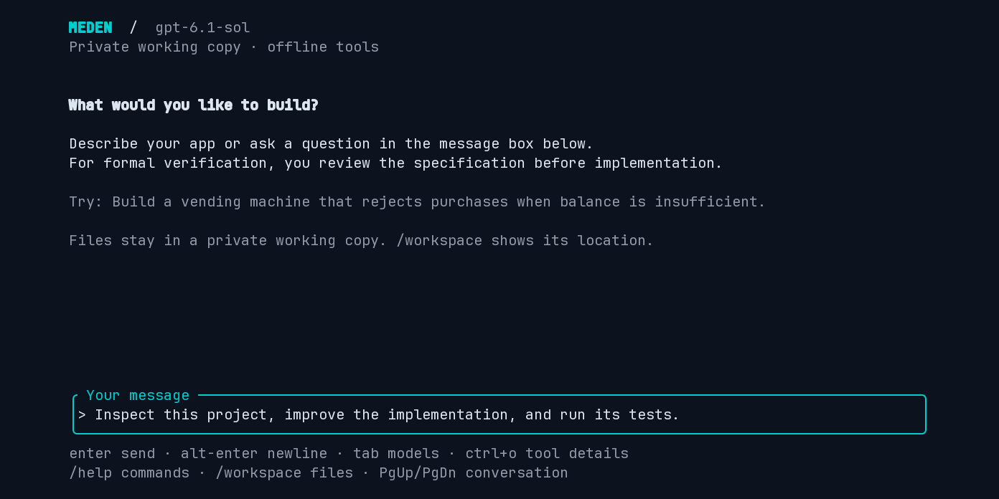
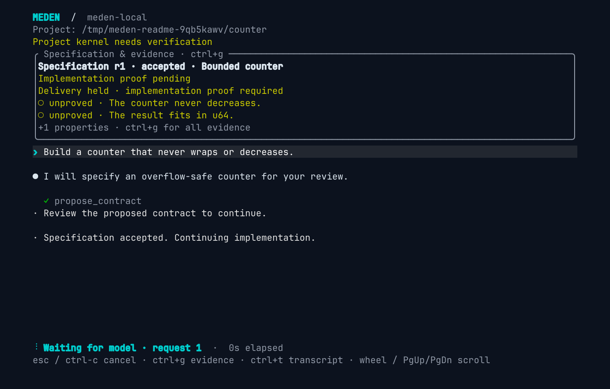
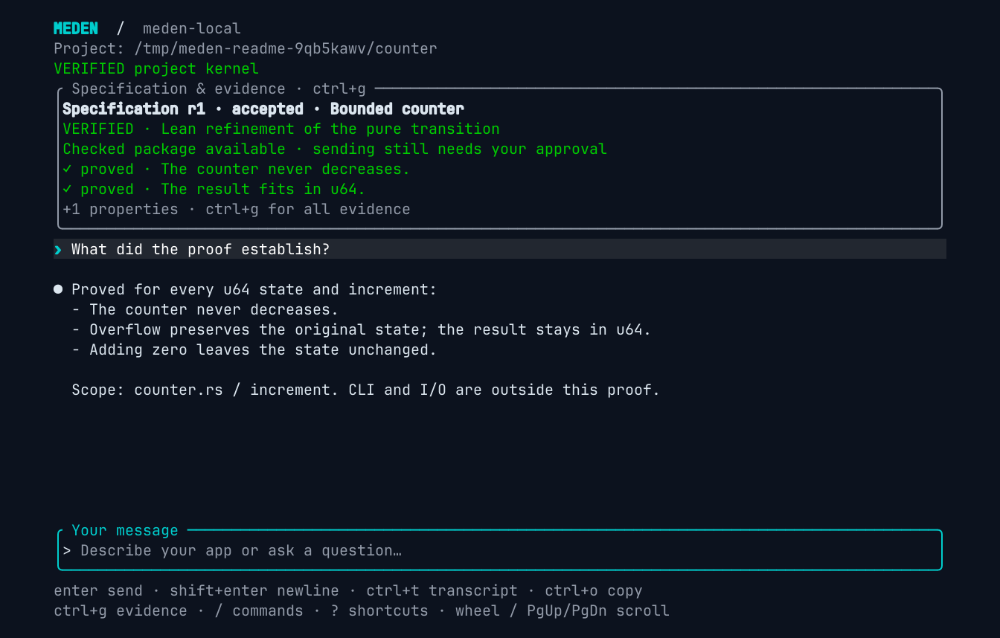

<p align="center">
  
</p>

<h1 align="center">MEDEN</h1>
<p align="center">
  Proof-driven development, with ease.<br />
  Formal verification through natural language.
</p>

<p align="center">
  <a href="https://github.com/grandchildrice/meden/actions/workflows/ci.yml"></a>
  <a href="docs/verification.md"></a>
  <a href="Cargo.toml"></a>
  <a href="LICENSE"></a>
</p>

<p align="center">
  <a href="#getting-started">Getting started</a> ·
  <a href="docs/design.md">Design</a> ·
  <a href="docs/verification.md">Formal verification</a> ·
  <a href="results/README.md">Benchmarks</a>
</p>

Meden is a Rust coding agent for proof-driven development. Describe what to
build, review the specification, and follow the implementation and its evidence
in one terminal. It edits your repository directly and keeps context when you
reopen it.

## Getting started

Build and open the project you want to work on:

```bash
cargo build --release -p meden-cli
./target/release/meden tui --workspace /path/to/project
```

No model flags, environment exports or configuration file are needed to open
the TUI. If `meden` is on your PATH, running `meden` in your project directory
opens that directory directly.

1. **Choose a connection.** Select an existing host login, **Add HTTP connection**
   or **Use local model**. The HTTP form has Ollama Cloud's URL prefilled; enter
   a model and API key, or edit the URL for another OpenAI-compatible server.
2. **Review the destination.** For HTTP inference, the TUI shows the exact
   destination and model before you allow it to receive project context.
3. **Describe your task.** For example: “Build a vending machine that rejects
   purchases when balance is insufficient.” Review its proposed specification
   before implementation and formal verification continue.

Connection settings are remembered per project. API keys are masked; enable
**Remember API key on this device** only if you want the key saved in a private
host settings file outside the repository. Otherwise the key stays in memory
for this session and the TUI asks for it again next time. Existing account
logins are reused without copying their tokens into these settings. Each new
HTTP session still requires a fresh destination review.

Use `/connect` to add or edit an HTTP connection, and `/model` to switch
connections or select local weights. Files, conversation and accepted meaning
survive reopening the same project; a fresh check is required to show verified again.
[Interactive setup and usage →](docs/tui.md)

**Requirements:** Rust, Linux 5.6+, Bash, Bubblewrap and permission to create
user namespaces. [Linux runner setup →](docs/release.md#exact-source-to-staged-archives)
The first TUI launch automatically prepares pinned verification tools and can
take several minutes. That preparation needs network access, Git, Curl, Tar,
XZ and Zstd; later launches reuse the installation. Project tools and proof
checks run offline, so project dependencies must be available locally.

## Web GUI

Build the browser UI and attach it to a real local project:

```sh
npm ci
npm run build
cargo build -p meden-cli
./target/debug/meden gui --workspace /path/to/project
```

Open the session URL printed in the terminal. History and dependency graphs are
available before connecting a model. For development, use the model tag in the chat composer to select a
provider/model, review the exact destination, approve it, then send an instruction. The GUI uses the same native
agent, offline tools, files and conversation checkpoints as the TUI. Stop the GUI
before opening that project in the TUI; the repository permits one writer.
Code, actual tool inputs/results and native contract status appear beside the chat.
The file tree is on the left, a large project map is in the center, and chat/work
history with the composer is on the right. The project-map tab stays mounted; selecting a declaration opens its filename tab
with syntax-highlighted source and reference graph side by side. Returning to the map retains its camera. The initial source inventory
prepares the reference map once: zoom reveals categories, files and declarations
in the same coordinates, without switching views or starting compilation.
Map markers distinguish main proof targets, theorems, lemmas and definitions by
shape and color. Main targets come from saved work items, not a name heuristic or
proof-status claim. Clicking graph nodes never changes chat activity or send state;
a submitted message waits for a concurrent inspection and is then dispatched.
UI labels are English. Drag either sidebar boundary to resize it; widths are saved
per workspace. Long user and assistant messages fold automatically. Work items and
tool records open through the composer's **Work history** icon; cancellation is a
compact inline conversation notice, not a header banner.
File graphs use L4SB's cone layout (uses above, used-by below). Atlas type/value
edges distinguish human meaning-review targets from proof-only dependencies;
unknown references stay unknown. These colors are not proof or review completion.
Large projects retain a complete file map and index opened files and nearby import
barrels on demand; ordinary-sized projects retain the full prebuilt reference map.
The model selector is inside the composer. Provider/model choices update directly;
**Use this model** approves the exact displayed binding. The explorer heading
shows the workspace path, with one refresh icon for files and the map.
**Refresh references** provides lexical inspection before Lean dependencies are
prepared; it is not a compiler dependency graph or a new proof check.
The optional tools action **Extract compiled dependencies** recompiles selected Lean
modules and their imports (up to 32 files / 16 MiB); ordinary browsing does not need it.
With installed Lean, extraction automatically prepares the pinned Lean Atlas
core offline on selected modules. The workspace's `lean-toolchain` selects its
installed Elan version; no Atlas environment variable is required.
Compiled type/value dependencies and declarations
can then supply meaning analysis; a successful extraction does not grant proof status.
For a new Mathlib/EthLib clone, run its initial `lake exe cache get` preparation
from the project directory first. The GUI names missing dependencies and lets you
choose an existing source file; source-only graphs work before dependency preparation.
Select a declaration, enter a requirement and run meaning analysis to get a
source-bound back-translation and comparison through the reviewed processor.
These model assessments do not accept contracts or establish proofs.
The Preview tab opens selected local HTML/JS/CSS or static build output, so you can
interact with the developed application and reread files after edits. It supports
browser applications without backend services or persistent browser storage.
When the agent proposes a send, **送信提案を確認** reviews the same fixed file/checked-package queue as the TUI,
then sends once to the displayed destination or rejects the proposal.
HTTP connections can also use `--base-url URL --model MODEL --api-key-env NAME`.
Prepare real proof tools with `meden setup` before requesting formal verification.

Chat work records keep named work items, requirements, next steps, visible
conversation and local Lean check records in `.meden/workspace.json`. Commit that
file with your sources to continue from a clone on another machine. Open the clone
with `meden gui --workspace /path/to/clone`; select a task and **この作業を再開**.
The new machine reviews its own processor connection. Imported results are history;
use **Leanを再チェック** with the project's installed Lean and prepared dependencies.
The TUI offers the same records through `/work`, including `/work resume ID`.
[Portable work and prerequisites →](docs/gui.md#portable-work-and-check-history)

`npm run dev` opens the separate recorded vending-machine demo at
`http://127.0.0.1:4320`. Its graph, preview and simulated meaning-analysis UI use
archived/demo data. Native preview and meaning analysis use the selected local project.

[GUI development and checks](docs/gui.md) ·
[Shared contracts and strategy implementation map](docs/architecture/semantic-workspace.md)
and [typed-core/plugin refactoring policy](docs/architecture/typed-core-and-plugins.md)
describe the module boundaries. `meden-app` owns shared workspace, analysis and
verification use cases; compiler/renderer/model ports keep transports and
presentation outside their ownership. See the
[application extraction record](results/shared-application-20261123.json).
Run `npm run architecture:check` to check inward
Rust dependencies and pure TypeScript data/port packages, including negative
regression cases. Browser HTTP and clock/identity inputs belong to adapters.

## From unproved to verified

The specification/evidence card stays above the conversation. It distinguishes
accepted intent, missing proofs and current checked evidence.

**Before verification:** requirements are unproved and delivery is held.

<p align="center">
  
</p>

**After verification:** the same requirements are proved and a checked package
is available. Sending it still needs your approval.

<p align="center">
  
</p>

These are actual TUI captures with a scripted, confined local model fixture and
real offline Rust extraction and Lean checks. They illustrate the workflow;
they do not measure live-model capability. [Reproduce the captures →](tools/capture-readme.py)

## Daily use

| Action                                   | Key or command                          |
| ---------------------------------------- | --------------------------------------- |
| Send / insert a newline                  | Enter / Shift+Enter (Ctrl+J also works) |
| Scroll                                   | Mouse wheel or PgUp/PgDn                |
| Inspect tool details                     | Ctrl+T                                  |
| Inspect requirements and evidence        | Ctrl+G or `/proofs`                     |
| Configure / switch a connection          | `/connect` / `/model`                   |
| Continue a stopped task                  | `/retry`                                |
| Start a new chat, retaining files        | `/new`                                  |
| Clear chat and its view, retaining files | `/clear`                                |
| Find the working directory               | `/workspace`                            |
| All shortcuts / quit                     | `/help` / `/quit`                       |

Ordinary tool and checker rejections feed bounded automatic repair. If work
must stop, the TUI explains why, what remains incomplete and what to do next.
Responses stream as they arrive; activity and elapsed time remain visible
while waiting. Source edits require fresh verification, and a model's success claim
cannot turn the host's proof status green.

## What is verified today?

This is a development prototype. The project backend checks accepted **pure
u64 Rust transitions** using Rust extraction and Lean refinement. Examples
include counters, ledgers and fee calculations. Its proof does not cover the
entire application, CLI or I/O. Tests and ordinary tool success are separate
from formal evidence. [Supported contracts and workflow →](docs/project-verification.md)

Local inference runs in an offline namespace with prepared llama.cpp/GGUF
assets. An approved HTTP connection may be remote; cloud success is not
evidence of local inference or confidentiality. The development baseline is
explicitly approved Ollama Cloud, followed by capable 100–600B local deployment.
[Model connections →](docs/local-inference.md) · [Security limits →](SECURITY.md)

Meden's processor, invocation, evidence and approval kernels have scoped
Rust-to-Lean refinement proofs. Connecting every adapter and proving the full
application remain work in progress. [Actual checks and proof boundaries →](docs/verification.md)

## Optional command-line configuration

<details>
<summary>Connection flags, automation and offline setup</summary>

You can still provide a connection directly:

```bash
meden tui --workspace /path/to/project \
  --base-url https://ollama.com/v1 --model your-model --api-key "your-key"
```

Use `--api-key-env OLLAMA_API_KEY` to read an existing key variable instead.
Host logins can be selected with `--provider codex`, `--provider claude` or
`--provider hermes:ollama-cloud`; `meden providers` lists available connections.

For a prepared local model:

```bash
meden tui --workspace /path/to/project \
  --local-engine /path/to/llama-server --local-model /path/to/model.gguf
```

`meden run` accepts JSON Lines for automation. `meden exec` runs an explicit
private snapshot, leaving its source unchanged. `meden setup` prepares the
verification bundle ahead of an offline session. `meden prefetch` prepares a
fixed documentation snapshot before confidential work.
[CLI reference →](docs/cli.md) · [Connection details →](docs/local-inference.md)

</details>

## For developers

The workspace contains the Rust CLI, shared controller/runtime, Lean
specifications and Python integration checks. Work on `main` and follow the
[contributing guide](CONTRIBUTING.md) for validation and proof regeneration.

[Experience tests →](docs/ux-testing.md) ·
[Design →](docs/design.md) · [Assurance targets →](docs/assurance.md) ·
[Recorded benchmarks and trials →](results/README.md) ·
[Release checks →](docs/release.md)

## License

[Apache-2.0](LICENSE).

### Inspect finite transition models

Open a workspace containing a `.contract.json` file in `meden gui`, then select
that file in the explorer. The default registered finite backend reads its
workspace-relative JSON transition, runs actual offline Z3 counterexample searches
and prepares English descriptions before publishing the shared source/graph view.
Properties and assignments keep their original JSON locations. Retained tabs and
restart reuse separate compilation, search and reading artifacts after current
input/resource checks. Model approval is needed only for explicit assessment or
reviewed repair; search observations do not admit project evidence.

The installed public Z3 executable is required. This is the bounded one-step
`finite-bitvectors-v1` data format in `verification/examples/finite-counter.*.json`,
not a general SMT-LIB or native-code frontend. To use the public TUI without
preparing the unrelated Lean verifier:

```sh
meden tui --workspace /path/to/project --verifier z3.finite.v1
# In the TUI:
/graph counter.contract.json
/analyze transition.value -- Preserve state when an increment would overflow.
```

### Inspect candidate meaning in the TUI

Local graphs do not require model approval. Use `/graph` to discover Lake library/executable roots, or
`/graph src/App.lean` to select a source. Lake package/library `srcDir`, local path
dependencies and already-populated manifest packages are resolved offline.
The project's installed Lean is detected automatically, and the Atlas library is
prepared offline on first use. `/lean-prepare` can also prepare it explicitly.
The collected module closure is compiled and listed with its original file paths. Run
`/analyze Demo.stock_bound -- Stock always decreases on purchase` to compare a
requirement with a blind natural-language translation of that declaration.
For a source-only observation, use `/sources stock.rs`, then
`/analyze stock.rs:2 stock -- Stock always decreases`.

The GUI shows distant main-target stars and prepares Lean compilation, deterministic
English and Plausible observations before opening the source/graph page. The optional
Informath/GF adapter uses a pinned research implementation; hover only displays saved
meaning and candidate values. Large project maps prepare a disk index and fetch small
cached chunks on zoom. [Adapters and preparation](docs/research/2026-11-22-observation-adapters.md).

`/analysis` shows the retained assessment; `/analysis history` lists previous
runs and `/analysis ID` selects an analysis or Finding ID. Exact requirement text
has a stable ID; reruns keep earlier findings and their source revisions. These are model-generated candidate
findings, separate from native proof evidence. Cancellation and provider errors
stop the operation. Changed sources require rereading; reopening retains a
historical result and requires a fresh processor review before inference.

For a mismatch/unclear Finding, `/repair` prepares one source diff. The review
keeps the file, hash and original requirement identity fixed while details
scroll. Press `y` to apply once and reanalyze the original requirement, or `n`/Esc
to reject. Changed source or accepted-contract identity invalidates the proposal.
Pending approval is discarded on restart. Reanalysis is a candidate assessment;
formal proof evidence requires a fresh check.

Use `--judge-model MODEL` with the same HTTP connection to select a different model
for meaning comparison. The processor review shows both models before sending.
For JSONL `run`, also provide `--approve-judge` with the exact inference URL;
approval is session-scoped and is never restored or renewed automatically.

Local stage timing, native perf capture and reproducible performance/fuzz gates
are documented in [tools/perf/README.md](tools/perf/README.md). Measurements retain
their workload and cache conditions; no remote telemetry is enabled.
