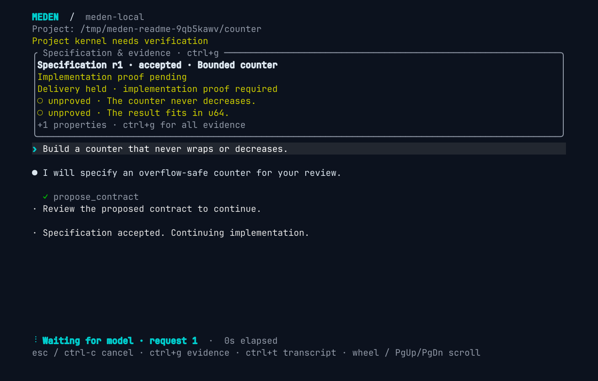
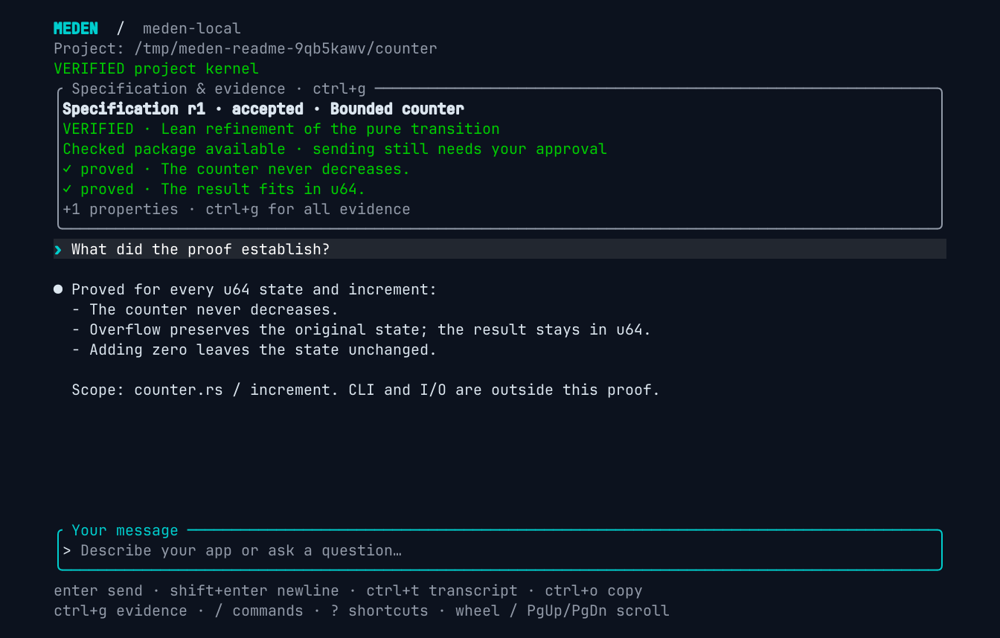

<p align="center">
  
</p>

<h1 align="center">MEDEN</h1>
<p align="center">
  Proof-driven development, with ease.<br />
  Formal verification through natural language.
</p>

<p align="center">
  <a href="https://github.com/grandchildrice/meden/actions/workflows/ci.yml"></a>
  <a href="docs/verification.md"></a>
  <a href="Cargo.toml"></a>
  <a href="LICENSE"></a>
</p>

<p align="center">
  <a href="#getting-started">Getting started</a> ·
  <a href="docs/design.md">Design</a> ·
  <a href="docs/verification.md">Formal verification</a> ·
  <a href="results/README.md">Benchmarks</a>
</p>

Meden is a coding agent for proof-driven development, bringing formal
verification into a local-first, natural-language workflow. Describe what
to build and what must never go wrong, then connect that intent to code,
formal contracts, verification and the artifact you deliver. The target is
one natural-language workflow across Lean, Rust verification, language
checkers, model checking and fuzzing, with explicit evidence for each
requirement.

The current prototype is a native Rust conversational coding agent. It
works on real files, runs tools and keeps context across instructions. It
uses isolated local inference by default, with explicit OpenAI-compatible
HTTP connections and optional Hermes configuration.

- **Workspace tools:** list/read files, write files and make exact edits.
- **Terminal workflow:** multiline Unicode input, history, scrolling,
  cancellation and `/clear`.
- **Model choice:** confined local llama.cpp inference or approved HTTP processors,
  including existing Codex and Claude subscription logins.
- **Explicit boundaries:** Lean specifications for capability decisions and
  exact, single-use outbound authorization, checked in CI.

The TUI keeps the accepted specification and its current evidence above the
conversation, so you can see what still needs proof and what has been checked.

**Before verification:** the accepted requirements are marked unproved and
delivery is held while the implementation is being prepared.

<p align="center">
  
</p>

**After verification:** the same requirements are marked proved, and a checked
package is available. Sending it still requires your approval.

<p align="center">
  
</p>

These are actual terminal captures using a scripted, confined local model fixture
and real offline Rust extraction and Lean checks. The proof covers the accepted
pure counter transition, not CLI/I/O or the whole application. They do not
measure live-model capability. [Capture the screens →](tools/capture-readme.py)

A [recorded Ollama Cloud delivery trial](results/checked-delivery-ollama-cloud-minimax-m3-8dea35f.json)
completed one natural-language request with model-written Rust, checked Lean
refinement and a host-reviewed kernel package delivered once to a local receiver.
An independent rebuild matched every delivered file; a fault passing all
submitted examples failed refinement. Large local deployment remains to be measured.

> Development prototype. General local orchestration and project proof workflows,
> controller-wide refinement and general project delivery are design targets.
> An experimental [pure Rust transition workflow](docs/project-verification.md)
> connects reviewed mathematical contracts to actual Rust extraction, Lean proof
> and a retained library. Counter and ledger contracts use the same backend.
> TUI and `run` edit the selected repository through offline workers;
> `exec` runs an explicit private snapshot.
> Local inference runs in a separate offline namespace; HTTP connections
> require host approval and may still be remote. See [verification scope](docs/verification.md)
> and [security limits](SECURITY.md).

## Getting started

The workspace backend currently requires Linux 5.6 or newer (`openat2`), Bubblewrap, Bash and host
permission to create the required namespaces. Ubuntu 24.04 may need its
packaged Bubblewrap AppArmor profile enabled by an administrator; see
[the tested runner configuration](docs/release.md#exact-source-to-staged-archives).
Installed Bubblewrap is detected from public PATH entries and standard
system locations. On NixOS, Meden also searches the dependency closure of
the installed system software, without changing PATH or requiring a
`MEDEN_BWRAP` export. Bubblewrap discovery does not download or install system packages.
`MEDEN_BWRAP` remains an optional trusted host override. Isolation remains required.
Build from source, then pass the connection settings in the launch command:

```bash
cargo build --release -p meden-cli
./target/release/meden tui --workspace /path/to/project \
  --base-url https://ollama.com/v1 --model your-ollama-cloud-model \
  --api-key "your-ollama-api-key"
```

No `MEDEN_*` exports or configuration file are required. If `OLLAMA_API_KEY`
is already available, replace `--api-key "…"` with
`--api-key-env OLLAMA_API_KEY`. Keys supplied this way are not written to the
repository or saved conversation. Existing host logins can be selected with
`--provider codex`, `--provider claude` or `--provider hermes:ollama-cloud`,
without passing a URL or copying a key.

On Linux x86_64, the TUI prepares its pinned local verification tools on first
launch, before opening your repository. Public tool downloads and proof-library
preparation may take several minutes and need network access, Git, Curl, Tar,
XZ and Zstd. Existing compatible tools/libraries are reused. Later launches use
the saved installation; no verifier environment variable is required. `meden setup`
can prepare it ahead of time for an offline session. A host-administered
`MEDEN_VERIFIER_BUNDLE` remains an explicit override.

Development targets Ollama Cloud first, then capable 100–600B local deployments.
Comparable roughly 10B performance is deferred. Cloud inference requires
explicit processor approval; code execution and verification stay local.

For the existing confined CPU backend, prepare a compatible llama.cpp executable
and GGUF weights:

```bash
./target/release/meden tui --workspace /path/to/project \
  --local-engine /path/to/llama-server --local-model /path/to/model.gguf
```

This backend currently uses Linux/CPU with a 16384-token context. The process
stays warm across turns; it has no external route, workspace access or cloud
fallback. [Model connections and local inference →](docs/local-inference.md)

Select an HTTP connection explicitly:

```bash
./target/release/meden providers
./target/release/meden tui --workspace /path/to/project \
  --provider hermes:ollama-cloud --model minimax-m3
```

Existing subscription logins can also be selected without an API key:

```bash
./target/release/meden tui --workspace /path/to/project --provider codex --model gpt-6.1-sol
./target/release/meden tui --workspace /path/to/project --provider claude --model claude-sonnet-4-6
```

Codex reads the Hermes Codex login or `$CODEX_HOME/auth.json`
(`~/.codex/auth.json` by default). Claude reads a host OAuth/setup token or
`$CLAUDE_CONFIG_DIR/.credentials.json` (`~/.claude/.credentials.json` by default).
Use `--provider auto` to choose among discovered connections in the TUI.
These are experimental Hermes-compatible token adapters; the provider must
authorize the account, model and third-party use. They do not bypass plan
restrictions or fall back to paid API keys. See
[subscription connections](docs/local-inference.md#subscription-connections)
for login sources and limitations.

For another OpenAI-compatible endpoint, pass its API base URL and model directly.
For a server that needs no key:

```bash
./target/release/meden tui --workspace . \
  --base-url http://localhost:11434/v1 --model your-model
```

Add `--api-key KEY` or `--api-key-env NAME` when the server requires authentication.
`--base-url` uses the OpenAI-compatible Chat Completions API and needs no
`--provider` flag. It uses only the key explicitly selected by these flags;
it does not borrow a key from another configured connection or login.
Environment-based connections (`MEDEN_LLM_BASE_URL`, `MEDEN_LLM_MODEL`,
`MEDEN_LLM_API_KEY` with `--provider configured`) remain optional.

Before HTTP inference, the TUI shows the actual processor URL and asks whether
it may receive this workspace's conversation, file contents and tool
results. A local `y` key grants permission for this session, up to eight
hours. Choosing another processor requires fresh approval. Loopback alone
does not establish that a server keeps data local.

HTTP automation must specify the exact inference URL with
`--approve-processor URL`; for example, a configured local endpoint uses
`--approve-processor http://localhost:11434/v1/chat/completions`.
This is required by `run` and optional in the TUI.

`tui` and `run` develop directly in `--workspace` (default: the current directory).
File tools and offline Bash see that selected repository at `/workspace`;
changes are saved there immediately, including project manifests and build files.
The header and `/workspace` show the actual host directory. Reopening the same
directory restores the saved conversation and accepted specification automatically.
`/new` starts a fresh conversation; `/clear` also clears its visible transcript.
Both retain project files and accepted meaning.

Conversations, contract decisions and checked artifacts live outside the writable
repository under `$XDG_DATA_HOME/meden/projects/` (default
`~/.local/share/meden/projects/`). On restart the native controller replays the
saved contract decisions with a fresh session identity. Proof coverage, running
jobs and processor/export approvals are not restored; verification and sending
need current checks and authorization. One Meden process owns a repository at a
time to keep its checkpoints consistent.

`meden exec` explicitly imports a private snapshot under
`$XDG_DATA_HOME/meden/workspaces/`, leaving its source unchanged. All worker
profiles remain offline and have no host-shell fallback. Dependency caches and
toolchains must be prepared locally; workers cannot download project packages.

The TUI marks your messages with `›` on a shaded row and model replies with
`●`. Responses and provider-exposed reasoning summaries stream as they arrive.
Arriving text is revealed in Unicode graphemes at a 16ms refresh interval;
batched replies catch up quickly, including providers that return ordinary JSON.
Initial model computation still takes time before the first text arrives; the
activity indicator shows the phase and elapsed time during that wait.

Recoverable tool errors return to the model for correction within the existing
bounded budget, with a visible recovery notice. When work must stop, a host
explanation states why, what remains incomplete and how to proceed. `/retry`
starts a new host turn using the current files and conversation, asking the model
to inspect completed operations before continuing. Stop explanations survive
reopening the repository and can be copied with `/copy`. Model connection failures,
usage limits and inconclusive checker runs are not retried automatically.
Bash commands show live stdout/stderr and their final exit status; the normal
view retains the last six output lines. `Ctrl+T` expands tool arguments and
captured output; failures remain visible when details are collapsed.
`Enter` sends, `Shift+Enter` adds a line,
and `PgUp`/`PgDn` scroll. Use `/help` for commands, `/model` to
choose a connection, `/contract` to review the specification, and `/exports`
to review proposed deliveries. A single selected HTTP connection opens its
approval screen directly. Each approval shows its destination or contract
identity in a fixed card, with the action and its key below the details.

During development, a specification/evidence card keeps the accepted revision,
property previews, current verification state and delivery hold reason visible.
Edits invalidate the displayed proof before another tool runs. `/proofs` or
`Ctrl+G` opens the formal statements, assumptions, source/artifact identities
and retained report location. `Esc` returns from that view without cancelling
running work. Replacement reviews include a field diff and retain the original
accepted meaning until you approve the replacement. Proof status applies to the
supported pure transition; ordinary tool/test successes do not establish it.

Run a command without a model through the same offline tools:

```bash
printf 'python3 -m unittest -v' | ./target/release/meden exec --workspace /path/to/project
```

`exec` returns JSON with the retained workspace path and execution result.
Applying changes back to the original project remains a separate workflow.

Prepare documentation before confidential work, then attach the saved snapshot:

```bash
meden prefetch --url https://lean-lang.org/ > pages.json
meden tui --workspace /path/to/project --pages pages.json
```

The model can list/read those cached documents, including raw HTML as inert
text. Selecting a page or missing handle never fetches anything. `prefetch`
accepts up to eight exact HTTPS URLs and rejects private/special-use IPs,
redirects and oversized responses. `run` accepts the same `--pages` option.
[Documentation cache →](docs/cli.md#documentation-cache)

The agent can propose a file export for review. `/exports` in the TUI shows
the actual HTTP destination and frozen bytes; only a local `y` key sends
once. File changes after preparation cannot replace those bytes. The CLI
provides equivalent host review commands. Once a project contract exists,
exports require a checked kernel package and current matching evidence at
dispatch. Ordinary files cannot substitute for it. Git/email adapters and
whole-application delivery remain unfinished.

For model-driven automation, `meden run --workspace ...` accepts
`{"instruction":"..."}` objects, one per line, and emits JSON events. It
retains conversation and files across instructions using the same coding
session as the TUI. [CLI protocol →](docs/cli.md)

### Controls

| Key | Action |
| --- | --- |
| Enter / Shift-Enter | Send / insert a newline (Ctrl-J also inserts a newline) |
| Arrows, Home, End | Edit input; Up/Down recall single-line history or move between lines |
| Ctrl-A / Ctrl-E, Ctrl-B / Ctrl-F | Start/end of line, move left/right |
| Alt-B / Alt-F, Ctrl-Left / Ctrl-Right | Move by word |
| Ctrl-W / Ctrl-U / Ctrl-K | Delete previous word / before cursor / after cursor |
| Ctrl-Y | Paste the last deleted text |
| Ctrl-R | Search prompt history; Enter selects a match without sending |
| Ctrl-T | Expand/collapse transcript details |
| Ctrl-G / `/proofs` | Inspect requirements, evidence, assumptions and delivery hold reason |
| Ctrl-O / `/copy` | Copy the latest completed response through the terminal clipboard |
| Ctrl-L | Clear the view while retaining conversation context |
| Mouse wheel / trackpad | Scroll the conversation or review details without changing the draft |
| PgUp / PgDn | Scroll one viewport page |
| Shift-Up / Shift-Down | Scroll one line |
| Ctrl-Home / Ctrl-End | Jump to the beginning / end of the conversation or details |
| `/`, Tab, Up/Down | Browse and complete slash commands |
| `/model` / `/model NAME` | Choose a connection / review a new model binding |
| `/new` / `/clear` | Start a fresh chat / also clear the visible transcript; retain files |
| `/status`, `/workspace` | Show session state / working directory |
| `?`, `/help`, `/keymap` | Show shortcuts and implemented commands |
| Ctrl-C while editing | Clear the draft; exit when it is empty |
| Ctrl-D, `/quit`, `/exit` | Exit (Ctrl-D deletes a character when the draft is nonempty) |
| Esc / Ctrl-C while running | Request cancellation; Ctrl-C again exits |
| `/exports` / `/exports ID` | Review a pending or specified immutable file export |
| `/contract` | Review the proposed Rust ledger contract |

Common controls follow the [Codex CLI command reference](https://learn.chatgpt.com/docs/developer-commands?surface=cli).
Shift-Enter uses modified-key reporting in compatible terminals; Ctrl-J works
in legacy terminals. Keyboard, paste and mouse modes are restored on exit. Clipboard
copy uses OSC 52, subject to the terminal's clipboard support. `/keymap` displays
Meden's current bindings. Meden's specification and delivery approvals retain
their exact local `y` confirmation.

## Product direction

Meden's controller will preserve accepted requirements, choose supported
verification backends, use counterexamples to guide repairs and allow
delivery only when the required evidence covers the exact artifact. Local
inference and local verification protect project data; external services
require explicit authorization. The TUI, CLI and tools share one controller.

The target controller will be specified in Lean, with refinement proofs
connecting its production Rust implementation. Extending those proofs
across Meden's own TUI, CLI and tool behavior is part of the product goal.
Transfer, export review and evidence kernels now have Rust-to-Lean refinement
proofs, including arbitrary finite compositions for review and evidence.
[Meden's own releases](docs/release.md) use the evidence kernel to bind
scoped CI results, source and staged Linux archives before publication.
General user-project contracts, verification adapters and the remaining
controller/effect paths are still implementation work.

[Architecture and implementation order →](docs/design.md) ·
[Assurance and refinement obligations →](docs/assurance.md)

## Confidential development

The confidentiality requirement remains:

> Reading an external page must not enable the agent to send confidential
> files to an unapproved recipient.

The agent can read tool results normally. The target boundary consists of
an isolated coding runner, a fixed model gateway, a local page cache and
host-approved outbound transfers. It does not use an isolated planner or
ask a model to decide whether its own action is authorized.

Lean refinement proofs connect extracted production Rust kernels to their
specifications, including finite execution traces. Processor calls retain
the original local/HTTP configuration; revocation and observed expiry cannot
reopen authorization. Exports preserve the reviewed request and permit at
most one attempt. Evidence and conversation controllers have their own
scoped proofs. A Linux runner confines actual TUI file/Bash tools and `exec`;
tests use real host files, descriptors, sockets and receivers. Connecting
every remaining effect and proving the full controller remain work in progress.

[Confidentiality design and acceptance criteria →](docs/confidentiality.md) ·
[CI checks, theorem statements and proof limits →](docs/verification.md)

## Benchmarks

Recorded AgentDojo benign utility with `minimax-m3`, four workers:

| Suite | Meden | AgentDojo baseline | Passes |
| --- | --- | --- | --- |
| banking | 44/48 | 42/48 | 3 |
| Slack | 18/21 | 18/21 | 1 |
| travel | 14/20 | 12/20 | 1 |
| workspace | 33/40 | 31/40 | 1 |

These measure frozen prototypes. Their external host-tool bridge has been
removed; the scores do not measure the current private workspace runtime
or establish confidentiality. Current tests compare real TUI/CLI requests
and effects and independently check changed code.
[Raw records and historical settings →](results/README.md)

## Development

| Package | Responsibility |
| --- | --- |
| `meden-agent` | Conversation, native tool calls and tool interfaces |
| `meden-core` | Capability policy, file requests, admitted tool invocation, processor authorization, export review and evidence kernels |
| `meden-llm` | Confined local inference, approved HTTP connections and discovery |
| `meden-runtime` | Host execution, process lifecycle and offline Linux isolation |
| `meden-cli` | Shared coding session, TUI and isolated JSON Lines automation |
| `lean/` | Formal specifications, axiom audit and executable oracle |
| `python/` | CLI, adversarial-model, PTY and live-model checks |

See [CONTRIBUTING.md](CONTRIBUTING.md) for local checks. Maintainer work
happens directly on `main`; small, loosely coupled implementations take
priority over backward compatibility.

The screenshots are captured from the running TUI. The
[README capture script](tools/capture-readme.py) reproduces all three using a
scripted local model and the prepared offline checker bundle. The
[PTY renderer](tools/capture-tui.py) records actual terminal cells; font and
terminal dimensions are explicit for reproducibility.

## License

[Apache-2.0](LICENSE).
