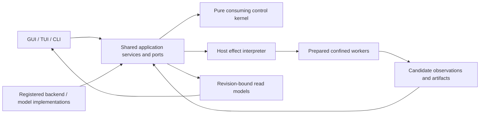
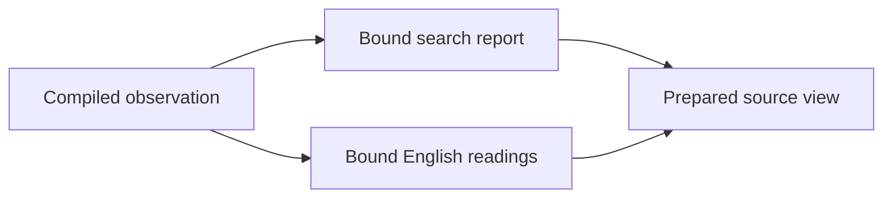

# Small typed kernel, replaceable integrations, reproducible views

Decision date: 2026-11-23. This is the design review and migration policy for
[design.md](../design.md). The current implementation is audited below; the
migration exits are requirements, not claims that every backend, profiler or
proof is already implemented. No backward-compatibility layer is required.

## Principles

1. Keep the trusted kernel small, pure and closed over authority decisions.
   It owns contracts, grants, jobs, evidence admission and consuming effects.
   Filesystems, clocks, transports, model SDKs, prover syntax and rendering stay
   outside it. Fewer lines are useful only when their obligations disappear too.
2. Represent permitted states and transitions with a small algebra of owned
   values. Use private constructors, disjoint result variants, immutable
   bindings and consuming transitions. Avoid independent booleans that admit
   impossible combinations. Decode and validate external data once at a port.
3. Extend supported behavior by adding an implementation type, its typed
   configuration, a host registration and conformance tests. An existing effect
   must not require another prover/provider branch in the kernel or renderer.
   A genuinely new authority/effect is different: extend its specification,
   extraction/refinement and tests before permitting it.
4. Plugins produce observations and candidates. Only the existing kernel can
   admit evidence or authorize effects. A semantic match, exit code or cache hit
   cannot substitute for an admitted receipt bound to the accepted requirement.
5. Give every domain operation one owner. TUI, GUI and automation call shared
   application services; they do not maintain separate acceptance/repair rules.
6. Make the viewer a projection of prepared, revision-bound data. Rendering,
   hover and returning to a prepared tab cannot start compilation, inference or
   evidence admission. An explicit request for an unprepared semantic view can
   schedule one deduplicated application job; a read model reports its progress.
7. Reproducibility is a data contract: identical inputs, versions, configuration
   and seed produce the same identities, ordering and world coordinates.
   Clocks, randomness, locale ordering and font-dependent measurements must be
   explicit inputs where they affect an artifact. React memoization is a
   performance optimization, not the source of truth for retained state.
8. Minimize latency end to end. First reuse valid prepared artifacts, reduce work
   to the visible/requested region, deduplicate jobs and bound transfer sizes.
   Choose a language or rendering engine from comparable measurements, including
   boundary-copy and startup costs.
9. Keep lightweight local timing observable throughout the pipeline. Use native
   `perf` and browser traces for sampled diagnosis and repeated regressions;
   continuously collecting full stacks is not the default. Measurements name
   the workload, environment, revision, cache condition and observation limits.
10. Delete superseded implementations, unused ports and dependencies in the
    migration that replaces them. Generate repetitive wire definitions instead
    of maintaining parallel versions. Keep functions small for reasoning, and
    test their composition as seriously as their individual behavior.

Types rule out represented invalid states. They do not establish truthful I/O,
correct requirements, valid plugin implementations or physical input provenance.
Those obligations still need runtime validation, tests and scoped proofs.

## Domain ownership and dependencies

These are logical boundaries first. A new crate/service is justified by a real
independent dependency or execution boundary, not by each noun in this table.

| Context                               | Owns                                                                                  | Must not own                                               |
| ------------------------------------- | ------------------------------------------------------------------------------------- | ---------------------------------------------------------- |
| Trusted kernel                        | Accepted revisions, policy, consuming calls/tickets, evidence eligibility             | Tool syntax, I/O, UI, provider discovery                   |
| Requirements and evidence application | Reviewed intent, snapshot linkage, validation/admission workflow, history             | A second authority bit outside the kernel                  |
| Workspace and materialization         | File inventory, immutable inputs, indices, graph/layout artifacts, cache invalidation | Model-selected filesystem/network authority                |
| Analysis and verification application | Job preparation, cancellation, plugin binding, candidate interpretation               | Frontend-specific state or a hardcoded prover dispatcher   |
| Agent application                     | Conversation/repair proposals and bounded iteration through existing controllers      | Accepting its own contracts or results                     |
| Plugin ports and implementations      | Compiler, verifier, meaning, search and model capabilities                            | Grant renewal, unchecked receipts or kernel state mutation |
| Host runtime                          | Prepared workers, actual I/O, locks, clocks and storage                               | Prover-specific product policy                             |
| Presentation                          | Typed commands, read-model projection, selection/camera and accessibility             | Compiling to render, inferring current proof status        |

The kernel provides the minimal common control vocabulary. Role-specific ports
and shared use cases now live in `meden-app`, inward of model transports and
presentation. The CLI executable composes these services. Workspace tools,
source capture/compilation/cache, meaning assessment/repair and accepted-contract
verification have moved out of the binary; they were not moved into `meden-core`.

## Typed extensibility

Keep the control vocabulary closed; keep implementation selection open. The
common job lifecycle is preparation, dispatch, execution, validated observation
and completion/admission, with typed refusal, cancellation, operational failure,
unsupported capability and refutation. Do not add `RunLean`, `RunTlc` or
`RunProviderX` to that lifecycle for ordinary integrations.

Use distinct `SessionId`, `SnapshotId`, `RequirementRevision`, `JobId`,
`PluginBinding` and `ArtifactRef` domains instead of interchangeable strings.
The binding freezes implementation/resource digests, configuration and schema
identities with the original inputs and policy. A serialized/branded ID is not
itself an authorization token. Host constructors and consuming checks remain
authoritative after decoding.

Define separate compiler/indexer, verifier, meaning renderer, counterexample
search and model ports. They share a job envelope and observation protocol,
not one untyped `run(anything)` service with optional fields for every tool.
Backend-specific ASTs and configurations are validated at their adapter boundary;
the kernel does not interpret a universal Lean/TLA+/SMT/RTL language. Existing
accepted-contract syntax checks must not be weakened into acceptance of opaque
executable payloads during this separation.

The unused byte/format `Adapter<Context>` primitive has been removed from the
kernel. The application has a consuming compiler request/result port and explicit
host compiler registry, a renderer role with backend-owned decoded expressions,
and a session-bound model port implemented by the existing gateway. Lean's frozen
and prepared-Lake implementations return typed snapshots directly, without a
JSON/format-tag round trip. Model calls still use their actual consuming processor
binding and retain the original preflight/postflight revocation checks.

Compiler ports now return only compiler observations. They do not select
or load the external renderer. The shared application owns the next preparation
step: immutable raw observations and renderer-specific readings have separate
content-addressed caches. A renderer change can reuse an exactly validated raw
observation without rerunning the compiler/search. Its overlay can replace only
the sentence, renderer attribution and rendering error; it cannot replace the
checker, formal expression, refutation, source or graph. The complete view's
revision binds the reading artifact as well as the original graph. These are
application/cache checks and ownership constraints, not new evidence authority
or extracted refinement claims. See the renderer-update journey in
[ux-testing.md](../ux-testing.md).

The Lean adapter also retains deterministic evaluation of frozen Lake
configuration. Its identity binds the complete disposable input-file map,
command/options, selected validated Lean/library manifest and evaluator/cache
implementation. A bounded replacement cache rechecks the full identity and
output digest, then decodes the result through the original role parser.
Failed evaluations are not retained. The prepared compiler still executes the
actual build and exact compiled-input fingerprinting; this removes repeated
configuration evaluation rather than substituting a cached verification result.
Explicit workspace refresh advances the browser's retained-file generation,
so a late status response cannot suppress the next requested file read.
Command activity also retains its generation and pending count: a fast directory
operation cannot lose the wake-up for a queued file read when React batches its
busy/idle updates. Prepared compilation batches the ordinary root build and
source/output/compiler-setup queries in one Lake build state, while preserving
the exact complete-input fingerprint and original resource checks.

Cache metadata validation now groups directory observations by their actually
observed parent frontier, then reads present configuration files in bounded
batches through the existing policy-bound file worker. Each original path still
receives its own original/resolved resource checks. Complete bytes, missing-path
observations and filtered Lean inventories must all match. The previous per-file,
per-response and aggregate observation limits remain enforced; an incomplete,
cancelled or malformed batch cannot admit a successful prefix. No successful
validation is reused across operations or replaced by timestamps. This reduces
worker startup, without removing either caller's cache check or establishing an
atomic filesystem snapshot. See [the measurements](../gui-performance.md).

Prepared-input fingerprint version 2 reads every byte with four bounded readers,
then aggregates per-file SHA-256 values in canonical path order. Its framing
binds all compiler setup records, path names, lengths and file counts; scheduling
and filesystem timestamps do not enter the identity. At most 256 read jobs are
queued, with 1 MiB chunks per reader. Descriptor checks reject observed file
replacement, mutation and short reads. The host resource identity includes this
implementation, so old fingerprints are not relabeled as new observations.
This is tested I/O behavior under the existing worker limits, not an extracted
filesystem or concurrent-snapshot proof.

This is the first application extraction, not the complete multi-backend registry.
Compiler snapshots remain Lean-oriented internally. Native source pages now use
the generic application projection described below. Complete role-wide
plugin/resource/schema bindings and remaining read models are still required.
The verifier role now has two real host registrations:
`lean.refinement.v1` and `z3.finite.v1`. Their backend-owned typed contract
formats feed the same application service and unchanged pure job/admission
kernel. Common artifact retention and viewer strength/scope distinguish
bounded checking from refinement. The finite contract is a one-step JSON
model, not a general SMT frontend or a Rust/RTL correctness claim. See
[project verification](../project-verification.md) for the public entry points,
real-tool journeys and remaining conformance work.
Verifier definitions now retain role/version/format and exact
implementation/configuration/schema fingerprints. Their original descriptors
are included in checker identities, prepared inputs and consumed outputs;
registrations freeze their initial schema and refuse metadata drift before
dispatch. Backend-local schema references have separate namespaces. Public
types/parameters remain role-specific, and the core still sees its existing
opaque consuming job vocabulary.

Compiler registrations now freeze the original descriptor and both typed
schemas. Their consuming invocation retains the original source selection and
definition for the backend's cache lookup. Dispatch checks the definition before
and after the call, requires all selected sources and validates the projected
graph before producing an opaque completed observation. Persisted compiler
artifacts and their lookup keys include that original definition; a different
implementation or request cannot return another invocation's opaque completion
as its own. Cache restoration checks the retained descriptor rather than
unconditionally stamping a new one onto old data. The prepared Lake build
timeout is captured once with host configuration and used by both the descriptor
and actual execution.

Meaning rendering retains one selected instance across cache lookup, execution
and publication. Readings have a typed bounded shape, and a scoped batch caller
cannot escape the enclosing original-resource checks. Grammar hashing happens
around the batch rather than for each declaration. The retained rendering
artifact contains the full original descriptor, and cached publication rechecks
the selected resources. A renderer update changes only the independent reading
projection; compiled expressions, search observations and their provenance stay
bound to their compiler artifact. These metadata/resource checks are adapters,
not new extracted authority or proofs that an implementation is truthful.

Model implementations now freeze both port schemas, method configuration and
implementation identity before constructing the session caller. Ordinary chat,
translation, independent comparison and repair use that caller and reject method
drift before dispatch or after a complete reply. HTTP wire backends register
their own decoded configuration, encoder and decoder; the existing three formats
use the same registry as an additional native implementation. The shared executor
still consumes only the original `HttpCall`, including endpoint, model and
credential. It refuses method/path/header/capability drift, partial bodies and
oversized results without retries or fallback. Local calls retain their original
consuming engine/weights check. Discovery and provenance confer no approval.

Meaning history and reviewed repair artifacts retain original method descriptors;
older history without descriptors remains unknown rather than being relabeled.
These are host adapter and application checks, not new extracted refinement or
a sandbox for arbitrary native plugin code. The
[model-port validation record](../../results/model-transport-bindings-20261123.json)
records actual HTTP extension, public TUI/GUI and approved cloud-model checks.
Counterexample search now has its own typed request/result port and host registry.
The original compiler artifact, search descriptor and complete per-declaration
report are bound independently. A compiler result cannot supply a search verdict,
and an incomplete description cannot become a published source explanation.
Lean/Plausible retains compiled frozen modules by complete content/input identity;
prepared Lake search uses the original selected inputs and checks their exact
fingerprint again. Search workers see read-only compiled inputs and stay offline.

Search and English readings are separate projections of the same compilation.
A seed change executes search without recompiling or rerendering English; a
renderer update executes neither compilation nor search. The resulting graph
revision binds both artifacts. Missing, foreign, stale-method and changed-cache
outputs are refused; corrupted retained modules are rebuilt through ordinary
file preparation. The full-cache diagnostic flag requires every stage to reuse
its result. Fixed-seed observations, unsupported inputs and exhausted budgets
remain candidates/inconclusive data, never proof receipts. See the
[search validation record](../../results/independent-search-20261124.json).
Verifier selection now persists in the host journal. The selected decoder is
chosen before parsing; an unknown selection or ambiguous unselected format has
no fallback. Proposals retain their original method observation, description and
checker binding. Contract data no longer retains an executable implementation,
and replay never infers one from a format. Execution rebinds the exact original
data/definition through the installed registry before source authority is derived.
The existing kernel's opaque checker value binds both the method and recipe;
completion derives the same value from the actual validated report. Switching
methods therefore requires a new host review even for identical contract bytes.

Historical entries without method metadata retain their original meaning and
obligations, with an unknown method and no execution. A newly reviewed proposal
can replace them; old history is not relabeled. Same-format conformance fixtures
exercise routing/replay without claiming another production solver. Real Z3,
public TUI/GUI, an approved cloud-model repair and the independent 256-case oracle
cover the installed finite backend; a real Lean refinement journey covers the
shared evidence path. See the
[selection validation record](../../results/verifier-selection-20261124.json).

The [binding validation record](../../results/compiler-renderer-bindings-20261123.json)
names the actual installed-tool journeys and their limits.
A completed host registry must describe supported operations/formats,
implementation versions, resource requirements and limits. Initially use ordinary
Rust implementations and explicit host registration. External implementations
can later use the same validated protocol through prepared isolated workers;
do not introduce a native dynamic-library ABI or a marketplace first.

For an additional verifier, the exit is a real pinned example through unchanged
job, admission and viewer paths, plus malformed-output, timeout, cancellation,
stale-input and incorrect-result cases. For an additional provider, discovery
and inference selection remain separate from the existing frozen processor
approval. A model, workspace manifest or plugin cannot nominate an unrestricted
executable/network destination.

Lean checked theorems, TLC bounded/model results, SMT results, empirical searches
and model assessments retain their logic, scope, assumptions and evidence kind.
Meden's own Rust-to-Lean refinement is a separate assurance chain from selecting
a project's verification plugin.

## Reproducible and fast presentation

The common projection is a project/resource inventory, source spans, stable
symbol/node/edge identities, presentation roles, artifact provenance and job
state. Unsupported rich analysis still has a file/metadata view. Binary or
undecodable input, inaccessible paths, resource limits and incomplete analysis
are explicit states; they are not silently dropped or represented as complete
graphs. Arbitrary inputs do not imply unbounded resource consumption.

Prepared semantic/proof content is published only after its required checks.
The project shell and source inventory need not wait for that content. This
preserves prepare-before-display for enriched analysis without making basic
navigation depend on a compiler or model. A component mounting or pointer moving
cannot itself queue compilation or inference. The application owns preparation
triggered by an explicit view/work request and keeps basic source browsing usable.

Persist layout as a versioned artifact when expensive: source/index and selected
observation/label content digests, plugin configuration, algorithm/label policy versions and explicit seed/order
rules form its key. Avoid ambient `localeCompare` for canonical ordering. Keep
world coordinates independent of camera/viewport; view state is separate from
evidence state. Retain source pages/tokens and only invalidate affected artifacts.
Caches of presentation data never restore current verification or an approval.

Use small revisioned read models and bounded log/chunk streams rather than
resending full source, graph and history on each status tick. Progress names
the job/resource, current step, queue/wait reason, elapsed time, applicable limit
and local log reference. Distinguish queued, preparing inputs/dependencies,
executing, validating and persisting. Do not route file preparation into chat.
Monotonic revisions/generations reject late responses; cancellation remains a
host-observed result, not a message-string heuristic.

| Component                                                        | Decision                                                                                | Condition for changing it                                                                                       |
| ---------------------------------------------------------------- | --------------------------------------------------------------------------------------- | --------------------------------------------------------------------------------------------------------------- |
| Trusted control and host execution                               | Rust; retain existing extraction/refinement boundary                                    | New supported semantics with renewed evidence                                                                   |
| File discovery, dependency preparation and large materialization | Host/application service near the actual inputs, with immutable artifact outputs        | Measure native preparation, cache and serialization before changing runtime                                     |
| Shell, source readers, interaction and accessibility             | Keep TypeScript/React initially; typed validated read models and deterministic reducers | A comparable prototype improves end-to-end latency and retains UX/authority boundaries                          |
| Heavy browser computation                                        | A Worker behind a typed job/result port when main-thread profiling justifies it         | Include copies/transfers, cancellation, warm/cold and memory costs                                              |
| Rust/WASM kernel                                                 | Optional compute implementation behind that same port                                   | Differential agreement and a measured end-to-end win; batch data across the boundary                            |
| SVG/DOM versus Canvas/WebGL                                      | Keep the current renderer while reducing work to visible data                           | Migrate only when measured paint/DOM cost dominates; retain hit testing, source linkage and accessible controls |

Browser WASM remains a computation/presentation implementation; it does not
become a second authoritative contract, job or evidence controller.

The [existing Riemann audit](../gui-performance.md) found full-map traversal,
hidden map work, source retokenization and CSS/hit-test problems. Changing the
language would not itself remove those operations. Workers have separate
execution contexts and message-copy/transfer costs; WASM complements JavaScript
and does not directly replace DOM/CSS work. See the primary
[Worker](https://developer.mozilla.org/en-US/docs/Web/API/Web_Workers_API/Using_web_workers)
and [WebAssembly](https://developer.mozilla.org/en-US/docs/WebAssembly/Guides/Concepts)
documentation. React documents `useMemo` as a
[performance optimization](https://react.dev/reference/react/useMemo); durable
view state and correctness must have an explicit owner.

## Profiling and verification policy

Record cheap, bounded, local spans/counters for request queueing, input capture,
sandbox/resource preparation, dependency/build work, decoding, indexing, layout,
storage, serialization/transport and UI commit/paint. Correlate job and revision
identities across boundaries. Record wait and CPU time separately; a timer for
the entire request is not a function profile. Do not put source, prompts or
credentials in metric labels or enable remote telemetry by default.

Use Linux `perf stat`/`perf record` for native CPU/stack attribution and CDP
traces/profiles for browser event, layout and paint costs. Provision the native
tool in the development/measurement environment, with suitable symbols and a
documented kernel permission check. The host-only wrapper in `tools/perf/perf.sh` provisions a pinned Nix tool
when perf is absent. Same-user `task-clock` and `cpu-clock:u` sampling ran on
this workstation with `perf_event_paranoid=2` and `kptr_restrict=1`; no host
permission settings were changed. Raw profiles and bounded correlated native
spans now complement the browser audit.
Do not silently lower host security settings or label an unavailable profile a
pass. Follow the upstream [perf guide](https://perfwiki.github.io/main/tutorial/).

Performance CI must use a pinned workload/runner, consistent instrumentation,
multiple runs, normal/reduced motion and cold/warm cache states. Capture complete
gesture/debounce tails and separate instrumentation overhead. Retain raw profiles
with digests and a compact summary. The existing browser tool is a diagnostic
baseline; its one-run percentiles and probe-boundary limitations are not yet a
continuous performance gate. Prepared-cache captures still spend tens of seconds
in build/input resolution and fingerprinting; this is the next
preparation target. Map legend decisions now use visible areas and actual
rendered symbols; center breadcrumbs traverse only containing branches.
Differential camera traces and the paired navigation budget cover these queries
before considering a framework rewrite. Set budgets from repeated baseline data;
a 60 Hz frame budget may be a
scenario target, not a portable theorem about every machine.

| Layer                            | Required checks                                                                                                                                             |
| -------------------------------- | ----------------------------------------------------------------------------------------------------------------------------------------------------------- |
| Pure types and functions         | Generated valid/adversarial data; invariants, round trips, determinism and bounded/resource-limit cases; retain seeds and shrunk failures                   |
| State machines                   | Generated command traces against a reference model, including stale revisions, cancellation/restart, duplicate completion and refusal                       |
| Trusted kernel                   | Actual-source extraction/refinement, arbitrary finite compositions where claimed, conformance and mutation sensitivity; update proof links when moving code |
| Parsers and optimized paths      | Differential fuzzing against independent specifications/reference implementations; preserve explicit unknown/unsupported outcomes                           |
| TS/worker/Rust/WASM alternatives | The same corpus and comparison rules; exact identities/results, with declared numeric tolerance only for geometry                                           |
| Plugin boundary                  | Real-tool positive/negative fixtures, complete-output admission, configuration/resource binding, isolation and failures                                     |
| Integration and E2E              | Public TUI/GUI journeys, cold/setup and failure/retry/restart paths, rendered screens, view/evidence linkage, and original independent checks               |

Property-based tests do not prove universality; formal results do not prove the
adapters they exclude. For models and semantic translation, strict framing and
reproducible fixtures check integration; evaluate quality separately with actual
models and independent judgments. Proptest's
[state-machine testing](https://proptest-rs.github.io/proptest/proptest/state-machine.html)
describes the generated-trace/reference-model approach. Every new invariant
must name its owner and its proof/test evidence, not merely increase test count.

## Current audit and migration exits

Baseline: `de0965f`. Counts include tests/comments; the approximate kernel count
before the first `cfg(test)` block is 2,488 of 4,278 Rust lines. The larger
concentration is `meden-cli/src` at 20,268 lines and `NativeApp.tsx` at 1,154.
Line counts identify inspection targets, not automatic deletion candidates.

| Finding                                                                                              | Evidence                                                                  | Action / exit                                                                                                                |
| ---------------------------------------------------------------------------------------------------- | ------------------------------------------------------------------------- | ---------------------------------------------------------------------------------------------------------------------------- |
| Kernel has no backend I/O dependency and already owns consuming authority                            | `meden-core`, policy/processor/invocation/evidence modules                | Preserve these boundaries and proof linkage; no wholesale rewrite                                                            |
| Neutral artifact interface exists, but formats/payloads are strings/bytes                            | `meden-core/src/adapter.rs`                                               | Typed role wrappers/validated schemas and host registry; do not call the existing interface a complete plugin system         |
| Compiler/meaning selection and preparation live under CLI; runtime verification is still specialized | `meden-cli/src/adapters`, `analysis.rs`, `meden-runtime/src/verification` | Move use cases behind shared application ports; exercise a second real backend through them                                  |
| Model abstraction exists; discovery/transport selection uses built-in matches                        | `meden-agent::ChatModel`, `meden-llm::provider/gateway`                   | Registered provider implementations with the same consuming processor binding                                                |
| GUI state mixes many contexts and is polled as one document                                          | `gui.rs::View`, `NativeApp.tsx`, `agent-protocol/native.ts`               | Small generated read models and role-specific application services; generation-aware queries, one authoritative command path |
| Data package contained browser fetch, ambient time and UUID creation                                 | `NativeClient`, workspace constructors                                    | Moved HTTP to the browser adapter; require explicit identity/time for pure transitions                                       |
| Unused proposed job/event port and generated schema were retained                                    | Former `AgentClient`/event schemas                                        | Deleted; `WorkspaceRepository` remains because it has a real implementation/caller                                           |
| General file/index presentation still has Lean/Rust branches                                         | Source adapter, native file workspace and source index                    | Registry-selected analysis with a generic inventory/source view; no render-triggered compilation                             |
| Verification is strong in selected kernels but PBT/fuzz/perf coverage is uneven                      | Core proptest, Rust/Lean conformance, GUI oracle, browser profile         | Extend by risk/owner; add native profiling and a repeated performance CI gate                                                |

Perform the migration in reviewable vertical slices:

1. **Enforce boundaries and remove dead abstractions.** The current change moves
   HTTP I/O out of the protocol package, makes data transitions deterministic,
   deletes the unused event port/schema and adds `npm run architecture:check` to
   CI. The guard checks Cargo dependency direction plus owned TypeScript imports,
   browser globals and direct ambient clock/random reads. It is a structural
   regression check, not an I/O/refinement proof or an alias-proof security tool.
2. **Make profiling and adversarial validation routine.** Provision native perf,
   correlate lightweight spans, add shrinkable trace/corpus tests and differential
   fuzz targets, and establish repeated performance budgets. Exit: benchmark
   workloads expose their dominant stages and regressions fail meaningful gates;
   unavailable platforms are explicit, not counted as completed coverage.
3. **Separate application ownership.** Extract source/materialization and
   analysis/verification use cases from CLI composition. Introduce typed plugin
   registration and decoded role requests/results. Exit: existing Lean/model
   journeys work through those ports and a second real backend requires no
   kernel/prover-specific viewer branch.
4. **Materialize generic read models.** Separate inventory/source availability,
   prepared semantic graphs, job progress and admitted evidence. Generate native
   wire types from one application-owned DTO definition, with runtime validation
   and cross-reference/freshness tests. Keep recorded workspace interchange in
   its own context. Exit: unsupported/large/binary/cyclic inputs have bounded,
   explicit views; navigation is fast and side-effect free.
5. **Delete replaced paths and reconsider compute/render engines.** Retire a demo
   or duplicate implementation only after its current entry point, capture and
   negative tests have a replacement. Prototype Worker/WASM/Canvas only for a
   measured residual bottleneck, compare the same corpus, then keep one path.

Step 2 now has bounded correlated native spans, an authenticated local query,
real perf captures, a shrinkable differential camera/inventory corpus, a paired
large-map performance budget with a rejected full-scan mutation, and serialized
cold-analysis-store/prepared-tab browser budgets in both motion modes. See
[the measurement tools](../../tools/perf/README.md) and
[the native audit](../gui-performance.md). These budgets cover the named
workloads; they are not universal latency guarantees or live-model validation.

Step 3 now has a shared application crate and the first typed compiler, renderer
and model ports. Step 4 has its first source/graph projection in
`meden-app::view`: a prepared immutable page retains the original snapshot for
explicit analysis, and serializes only source text, declaration locations,
reference edges and prepared semantic observations. Publication checks exact
source revisions, ranges, unique IDs, complete edge targets and bounds; cycles
remain valid. These observations cannot assert an admitted proof receipt.
Rust's DTO derives the JSON Schema and the generated browser validator/type.
Generation fails on unsupported constraints rather than guessing their meaning.
The duplicate browser lexical index and its unused package entry were deleted;
its namespace/comment/privacy cases now run against the application projection.
The native renderer consumes the prepared graph without inventing a recorded
workspace or recompiling to render it. Materialization has its own bounded local
timing span, and clones retain shared immutable source/page values.

File availability now has its own application-owned `FileView` and generated
schema/validator, separate from prepared semantic graphs. The ordinary pinned,
policy-bound snapshot worker returns complete bounded UTF-8 text or explicit
binary, unsupported-encoding and size-limit observations. Host-derived typed
failures remain separate from worker content. The application checks full byte
identity before projecting 200-line pages with explicit EOF; it never labels a
prefix as a complete source or graph. The viewer preserves literal source text
instead of decoding numbered strings. Unsupported formats remain readable from
the directory explorer; unreadable Lean/Rust entries remain in the map inventory
without invented declarations or compiler evidence.

Inventory and directory navigation now also have application-owned DTOs and
generated validators. Inventory metadata freezes once outside the host status
lock; its complete envelope binds canonical file order, original navigation data
and the prepared cache generation. File sizes and that generation are canonical
u64 decimals rather than lossy browser numbers. The envelope is the sole view
identity; the former second serialization/hash of the whole metadata vector is
removed. Exact-revision inventory queries share cached bytes, and the unversioned
`/api/overview` route and duplicate browser schemas are deleted.

Large-project chunks require their exact original inventory publication and
requested file. The host checks that scope before/after reading prepared cache
artifacts; a changed inventory is a conflict. Complete generated chunk envelopes
are retained per immutable inventory, bounded by 64 chunks / 64 MiB. A cache hit
performs no artifact/source read. First reads consult prepared navigation
artifacts, never source workers, compilation or inference. The browser rejects
wrong parent/file responses and late old-context callbacks.

Directory reads use the original policy-bound offline worker directly and
publish complete original UTF-8 names and filesystem types, with explicit typed
failures. The GUI's 500-entry formatted tool listing, omitted-entry sentinel and
newline parser are deleted. Up to 100,000 entries form a complete listing; a
worker/envelope limit admits no prefix. File readers and directories share one
64-entry / 64 MiB publication table per owner. Status contains only references;
expanded/collapsed retained folders do not reread files or change chat, and warm
folder navigation remains available during another operation. Source/tree views
remain separate from compiler jobs and admitted evidence.

Opening a file publishes its complete bounded reader observation before semantic
preparation. Only the graph pane waits for compilation/search/rendering. The
shared application freezes reader envelopes outside the status lock and retains
at most 64 files / 64 MiB of serialized data. Status contains only generated
references; exact reader queries return already-frozen bytes without host I/O.
The browser fetches each wanted observation once and derives 200-line pages
locally, including EOF and selected-line navigation. Page changes work during an
active compiler and issue no command, filesystem read or inference. The former
page-read command and server paging DTO are deleted. Refresh, replacement and
eviction make old references unavailable; delayed bodies cannot replace newer
observations. Fresh changed/failed inputs still invalidate affected graphs.
Public browser journeys cover literal text, unreadable files, retry/restart,
delayed publications and paging while a real compiler is held. These are
adapter/read-model checks, not new evidence authority or filesystem refinement.

History now has an application-owned read model too. Status reads contain only
its revision and transcript count; complete original conversation/work/tool
records are serialized and hashed at their mutation boundary. Exact-revision
queries share the frozen bytes outside the state lock. A stale query receives a
typed HTTP conflict, and a publication failure retains the records without
admitting a partial response. The browser requests history on revision changes
or explicit retry, rejects mismatched envelopes and aborts superseded requests.
Its chat projection is memoized by the immutable history data rather than
stringifying the complete transcript on each status render. The common record
types and their existing validation moved out of CLI composition; portable
storage, host observation and HTTP interpretation remain adapters. History
cannot restore authority or evidence. The initial history read is still a
complete bounded document; this slice does not introduce lazy history paging.

Prepared source/graph bodies now have their own application-owned retention
store and generated index/envelope schemas. Status contains only the current
publication and per-file references. An exact-revision query shares already
serialized bytes outside the view lock; it performs no compiler, model or file
operation. The publication identity covers the complete projected body, so a
changed explanation/scope receives a new identity even when the input-source
and graph identities remain unchanged. Original backend snapshots remain
private to the store for explicit analysis. A fresh changed/unavailable input
invalidates every related retained graph. Oldest eviction bounds retention to
64 artifacts and 128 MiB of serialized bodies; this is not a total process-memory
bound. A single complete publication is limited to 64 MiB and serialization
stops at that bound instead of producing a prefix.

Source and history share that framing primitive and a browser read cache. The
cache owns wanted IDs, aborts released requests, rejects superseded callbacks
and retains object identity across status ticks. Transient conflicts retry only
after a fresh status observation, at most three times per availability context;
a changed context or explicit retry can recover the same republished content
ID. Persistent failures expose a local retry. File navigation does not populate
chat, and no read query schedules a semantic job. Large input/compiler freshness
checks remain in their original host operations. Complete reader, inventory and directory observations now use the same query
boundary. Resource-local preparation status and logs now have application-owned generated
DTOs too. A fresh host-session/sequence/resource identity binds a non-deserializable
observer handle. Replacement, completion, backwards time, clear and oldest eviction
prevent stale notifications from changing current progress. Disjoint outcomes retain
cache observation only for success and separately typed host cancellation, operation
or invalid-observation failure. Host clocks and diagnostic normalization remain
adapters. At most 64 resources retain UTF-8 diagnostic tails of 64 KiB each; status
contains only exact log references. Logs freeze when output changes and immutable
queries never start work. These observation handles are not kernel job tickets or
evidence. General analysis/verification jobs still need their own revisioned
queries; accepted-contract evidence now has the separate projection below.

Candidate meaning observations now have application-owned current/history views
and generated validators too. Frequent status reads contain only two bounded
availability records. Exact current and complete-history queries share frozen
bytes; selecting or advancing a candidate does not serialize, hash or transfer
unchanged history. The original journal and host records retain their existing
format. The presentation sequence is a canonical u64 decimal, without browser
rounding. Current source invalidation belongs to this shared owner and does not
rewrite historical inputs. Late responses cannot replace a newer selection;
failed transfers retry locally without a command, and an unreadable journal is
reported beside the source rather than in chat or a startup banner. Up to 1000
runs and 64 MiB of combined retained current/history envelopes are allowed;
failure retains original records but admits no prefix or superseded body.
These are model assessments, not proof, kernel job tickets or admitted evidence.
The new output schemas use the serialization contract: nullable fields emitted
by Rust remain required and nullable in the browser. Original opaque method
diagnostics remain data and cannot register an implementation.

Accepted-project meaning and evidence now have a separate application-owned
immutable publication. Status contains only availability and its exact revision;
`GET /api/evidence?revision=…` shares frozen bytes without checking sources,
compiling, inferring or admitting evidence. Disjoint empty/proposed/accepted
states separate the selected proposal, any retained accepted meaning and current
versus unverified output observations. The projection preserves the complete
original review, canonical contract, backend, strength/scope and source/output
bindings. Invalid or oversized observations retain the original host summary but
retire the old body instead of publishing a prefix. Current display data grants
no authority: the existing controller still owns acceptance, job completion,
freshness and delivery checks.

Generated contract-reference DTOs transport original positive u64 revisions as
canonical decimal strings. Command adapters recover the exact original number,
session and contract identity before the existing controller checks. Repair
presentation uses the same reference while its original queue/journal data stay
unchanged. Generated repair DTOs replace handwritten validators; repair review
itself remains inline pending the remaining native-wire migration. The browser
uses the shared revision-bound query cache, retries failed transfers locally and
freezes contract review only for its originally requested reference. The public
finite-verifier journey covers transfer failure/retry, actual Z3 rejection and
repair, current bounded evidence and accepted meaning after restart without
restored coverage or model approval.

Accepted-project checks now publish their actual progress through a separate
application-owned job observation. Immutable context retains the original
contract reference, method, class, scope and source path. Running stages are
source reading, checker preparation, checking, source refresh and evidence
retention. Stages after issue carry the original source and prepared-input
digests; failed/cancelled variants retain that exact stage rather than optional
input fields. Only the original successful completion can display admission.
The consuming observer is separate from the unchanged kernel job ticket and
cannot authorize a check or manufacture a receipt. Replacement jobs reject old
observers; malformed observations retire the publication until a new job begins.

Status contains only an idle/ready/unavailable observation. Exact
`GET /api/verification-job?revision=…` reads share frozen bounded bytes and cannot
start work. The generated browser validator checks both publication and job
identity. Local transfer retry sends no command, and delayed bodies cannot
replace cancellation or a newer job. Progress uses the existing chat activity
row; terminal details are folded. Idle graph navigation fetches no job body.
Only the latest job is retained; conversation/tool history remains separate.

The shared project service now owns evidence publication at its actual summary
and mutation boundaries. GUI composition holds a read-only reader with one-way
invalidation for host source observations; it cannot install replacement
evidence. Source edits invalidate current evidence before a later model reply,
and completion publishes before that reply too. These are tested application
and transport observations, not new kernel refinement or model-abort guarantees.

File workspaces own their selected declaration and meaning-input draft. The
graph renders prepared observations and reports the original selected name,
file and line; it no longer owns the analysis form or a second selection state.
Replacing/loading a graph or selecting a node in another file cannot discard
that file's input. Temporary missing publications preserve the last observed
draft context; explicitly selecting another saved analysis restores its original
requirement. Freshness and displayed-result matching still use the actual source
and graph revisions, independently of retained input text.

Static preview preparation now also lives in the shared application. It freezes
complete bounded static assets through the original policy-bound offline file
worker; the CLI's duplicate preparation module is deleted. The host retains its
existing nonce origin, listener and browser response policies. Immutable bundle
getters cannot reread files or replace captured content.

Preview metadata has separate generated idle/ready/unavailable status and
`GET /api/preview?revision=…` publication. Capture and missing-asset observations
materialize once at mutation boundaries, rather than cloning/serializing the
description during status polling. The original asset revision, frame URL and
bounded diagnostics remain distinct. A frame identity binds the bundle and URL:
diagnostic updates retain the running document, while retirement/replacement
rejects delayed former-frame bodies. Transfer retry performs no capture. The
shared browser retention hook also replaces the duplicate job fallback logic.
The owned generator preserves URI validation and refuses unknown formats,
including format handling for nullable scalar fields. Browser execution, origin
attribution and complete isolation remain tested adapters, not proof evidence.

Immutable export proposals and their model-tool registration now live in the
shared application too; the CLI's former queue module is deleted. The TUI and
protocol use that same queue. The native host's selected review and consuming
serial comparison also have one application owner, while the GUI adapter only
interprets commands and displays observations. The existing project/kernel still
owns authorization, frozen payloads, freshness, dispatch and terminal attempts.

Delivery references, summaries, review pages and outcomes are generated from
application-owned DTOs. Queue indices and payload/page bounds reflect the actual
bounded queue. Observed HTTP codes retain the transport's full 100–999 range.
Contract revisions and delivery review serials share a canonical positive-u64
decimal-string representation, including exact range validation in the generated
browser validators. Decoding a reference or counter grants no authority; the
host still compares the original selected session, entry and serial, consuming
the selection even on mismatch. Delivery observations remain inline at operation
boundaries. This is application extraction and transport validation, not a new
kernel or whole-renderer proof.

The complete native session projection and host command vocabulary now also
come from shared application definitions. Rust generates both root/command
schemas and their browser validators/types; the protocol barrel contains no
parallel handwritten native wire shapes. The host retains its private working
state and interprets the original typed command. A borrowed session projection
serializes each publication owner's existing small reference, without copying
its retained source, history or evidence body. Public connection choices contain
labels only; credentials and concrete gateways remain in host composition.

Connection selections use an exact positive-u64 decimal string, or null before
selection. Approval commands require a positive original counter; the adapter
recovers that exact u64 before comparing the actual frozen gateway, endpoint,
model and optional judge. Decoding cannot grant authority or renew a processor.
The browser validates commands before transport and refuses unknown keys/tags
or malformed counters without sending. Operation and model-use classification
are exhaustive over the shared command enum; actual admission still observes
the host gateways. Generated exclusive object unions use their checked unique
required tag for direct dispatch, while ambiguous/unknown schemas still fail
generation. The structural architecture guard rejects handwritten native root
or command shapes in the protocol barrel. These maintenance/codec checks are
not alias-proof security or general JSON Schema equivalence proofs.

Compiler availability uses a separate borrowed view DTO. Adding a GUI schema
derive to the compiler-captured Atlas entry module initially changed its
implementation identity and needlessly invalidated prepared observations. That
entry source is restored; the metadata projection/schema now lives only under
`view::session`. A structural guard rejects wire-schema derives in that captured
entry. The compiler's original definition, resources and complete input checks
still determine cache reuse; no validation or identity check is bypassed.

This does not finish step 4: proposal checks and broader orchestration jobs,
and remaining navigation waits still need work. Step 5's versioned layout/order and retirement
requirements remain open too.
Step 3 now executes the second backend through public TUI/GUI, actual offline
Z3, a real approved-model trial and a separate 256-input Python oracle. Its
parser/disagreement rejection tests, actual solver-output faults, started-solver
timeout/cancellation, resource changes and a real-check/stale-source/core-job
composition are covered. Verifier descriptors bind original method and schema
configuration through those existing jobs. Compiler and meaning-renderer
definitions now also bind dispatch and independent cache artifacts. Model/provider
bindings and a registered HTTP extension use the unchanged consuming processor.
Counterexample-search bindings and independent caches now use the same original
compiler observation. Persistent same-format selection and original-method
replay are now covered by the host journal and registry. Remaining generic
read models in step 4 and retirement work in step 5 remain open.
They retain the existing local/offline execution, accepted intent, exact evidence linkage and
separate local-deployment/R1 obligations in [assurance.md](../assurance.md) and
[verification.md](../verification.md).
