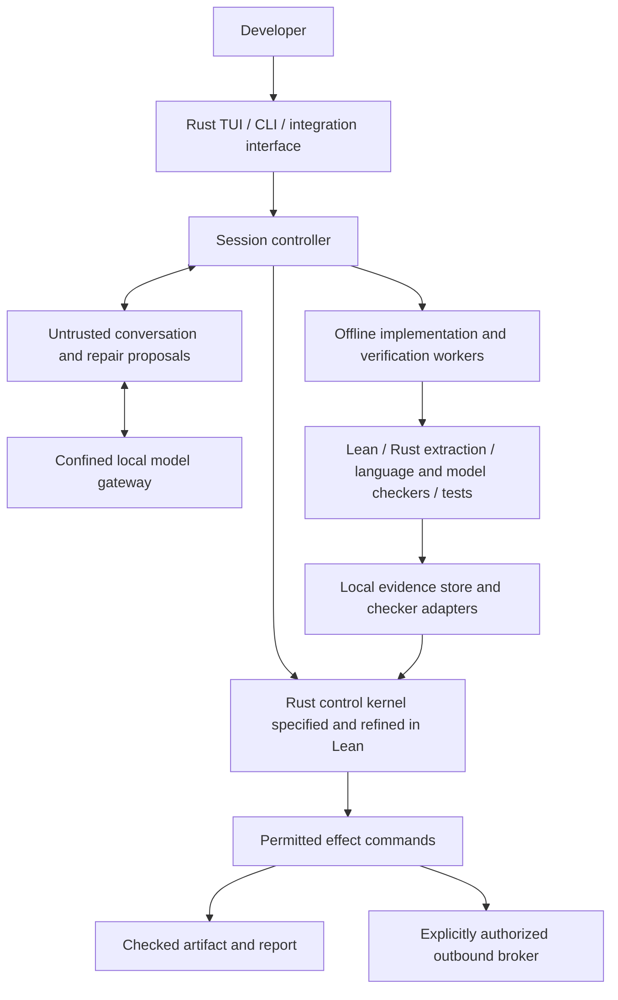

# Meden: proof-driven development, with ease

Status: target architecture, revised 2026-11-09. This describes the product
we are building, not functionality already shipped. Current checks and
implementation limits are in [verification.md](verification.md) and
[SECURITY.md](../SECURITY.md).

## Problem and product promise

A developer can describe a feature to a coding agent, but still has to
choose suitable verification tools, formulate meaningful properties,
connect them to the implementation, interpret failures and keep the
resulting proofs current. This work requires expertise that ordinary vibe
coders should not need for every change.

Meden is a local-first development orchestrator that connects natural
language to requirements, implementation, verification and delivery. The
user describes what to build and what must never go wrong. Meden maintains
the contracts, runs suitable tools, repairs counterexamples and reports
exactly which requirements are supported by which evidence for the actual
artifact. Users can inspect proof details without needing to operate Lean,
TLA+, fuzzers or language-specific verifiers themselves.

The product hypothesis is that one native, local workflow can make this
process accessible and reliable across tools. It is not a claim that no
verification interfaces exist: [PDD Kit](https://githubnext.com/projects/pdd-kit/)
already connects reviewed intent to Rust verification;
[h5i](https://github.com/h5i-dev/h5i) combines Rust/Lean application tooling;
and [Aristotle](https://aristotle.harmonic.fun/docs/overview) offers a
natural-language verification service. Meden's intended distinction is
local data control plus a shared, mechanically enforced chain from accepted
requirements to checked evidence and the artifact being delivered.

Two assurances must hold independently:

1. **For the user's project:** the delivered implementation satisfies its
   accepted contracts, to the stated scope, bounds and assumptions.
2. **For Meden itself:** its control decisions preserve authorization,
   evidence integrity and confidentiality regardless of model behavior.

A private model alone establishes neither assurance. A theorem about a
separate example implementation establishes neither assurance for the
running product. The long-term scope includes Meden's own TUI, CLI and tool
behavior, with refinement proofs connecting supported Rust implementations
to Lean specifications.

## Model deployment and implementation priority

Establish the end-to-end workflow using an explicitly authorized Ollama Cloud
model first, with code execution and verification kept local. The local
deployment target is capable models in the 100–600B parameter class. Achieving
comparable behavior on roughly 10B models is later optimization, not a gate
for the initial product. Small-model failures must not drive repeated pilots
or task-specific scaffolding at the expense of the orchestrator.

Cloud and self-hosted OpenAI-compatible inference use the same conversation,
tools, contract controller and independent checker. Model capability never
grants acceptance, changes proof requirements or creates delivery authority.
The current confined llama.cpp CPU profile is an existing backend, not the
hardware or context limit for the intended large-model deployment.

A successful cloud run establishes that workflow under external inference;
it does not establish local data control or measured 100–600B local operation.
Validate the local deployment separately with its actual server, model,
resources, context/tool-call support and confinement. An arbitrary localhost
or LAN HTTP server remains an explicitly authorized processor until that
boundary is established. R1 and the complete local deployment remain required.

## User experience

The primary entry point remains `meden tui`. One conversation can start a
project, change an existing project, inspect a counterexample and ask why
an artifact cannot yet be released. CLI automation and integration tools
use the same session commands and controller; they do not implement a
second policy or verification workflow.

For example, the user says:

> Build a local ledger. Transfers must preserve total balance, cannot
> overdraw an account, and retries must not charge twice. Keep all data here.

Meden then:

1. Drafts a short behavioral contract with examples, boundary cases and
   assumptions. It identifies questions that materially change the result,
   such as amount units, account ownership and retry identity.
2. Records the user's accepted meaning. Tool and language selection happen
   behind this interface, with an explanation available on request.
3. Builds the implementation and verification artifacts in a private
   workspace. Tests and counterexamples guide repair; the accepted contract
   is retained across iterations.
4. Shows each requirement as proved, checked within stated bounds,
   empirically tested, refuted, unknown or unsupported. It shows remaining
   assumptions and whether the required delivery checks are complete.
5. Produces the exact checked artifact and its evidence report when the
   required obligations are met. A request to publish uses a separate
   outbound authorization.

The agent may iterate on code and proofs without repeatedly asking the user
to run commands. Material ambiguity, a proposed weakening of the accepted
contract or an external data transfer needs a trusted user decision.
"Natural language only" concerns the interaction; it does not make missing
requirements or ambiguous financial/hardware behavior mathematically
well-defined automatically.

## Why use Meden as the orchestrator

Asking an existing agent to use Bend or Lean can produce useful proofs.
Meden must add enforceable behavior that survives a confused agent:

| Responsibility | Meden's required behavior |
| --- | --- |
| Preserve intent | Keep the accepted contract outside the worker's writable authority; contract changes are explicit proposals |
| Choose verification | Match a requirement to supported language/backend capabilities and a declared scope |
| Repair failures | Turn checker errors and concrete counterexamples into bounded implementation/proof iterations |
| Bind evidence | Connect requirements, source, dependencies, tool configuration, proof inputs and delivered artifacts |
| Control delivery | Reject stale, missing, unsupported or insufficient evidence under the accepted delivery requirements |
| Protect data | Keep inference and verification local; mediate any explicitly enabled external effects |
| Explain results | Report properties, limits and open obligations instead of treating every successful tool exit as a proof |

Prompts and skill files can teach tool use. The controller, isolated workers
and effect adapters must enforce these responsibilities. A separate coding
agent may be an optional worker only inside the same boundary; giving it
unrestricted host access would bypass Meden's argument.

## Architecture



All boxes are target roles, not separate services or mandatory new crates.
The kernel decides whether a transition/effect is permitted; a Rust executor
performs only that decision. The conversation chooses candidate work, not
what counts as a proof or who may receive data.

| Boundary | Responsibilities and authority |
| --- | --- |
| Interaction | Render host-derived status and review information; distinguish user decisions from model/page/tool text |
| Conversation | Propose contract changes, implementation changes, verification jobs and repairs; read ordinary tool results |
| Control kernel | Contract versioning, job lifecycle, evidence freshness, release eligibility, cancellation and authorization |
| Worker runner | Execute prepared jobs over immutable inputs or private candidate workspaces; no host credentials or external network |
| Checker adapters | Validate backend-specific results and provenance; record exact supported claims, bounds and assumptions |
| Evidence/artifact store | Preserve immutable snapshots, results and dependency edges locally; never infer success from worker prose |
| Effect executor | Execute a kernel-approved operation against its bound inputs, including exact approved outbound bytes |

There is one controller for interactive and automated use. There is no
strict/native planner split, no model with authority to waive a check and no
unrestricted fallback when isolation or a required verifier is unavailable.

## Small shared data model

Use a few typed records rather than a universal specification language:

- **Requirement:** stable identity, human-readable intent, examples,
  accepted contract revision, formal obligations and accepted assumptions.
- **Snapshot:** immutable source and verification inputs, dependencies,
  build features, targets and pinned toolchains. Candidate edits create a
  new snapshot; they do not modify an accepted result in place.
- **Job:** backend, exact inputs, expected obligations, limits and local or
  explicitly authorized external execution location.
- **Evidence:** subject snapshot, requirement/obligation, checker identity,
  evidence kind, status, assumptions, bounds and reproducible artifacts.
- **Delivery:** a specific artifact, its build recipe, required obligations,
  evidence dependency graph and control decision permitting that delivery.

Machine schemas are implemented only when the first working path needs
them. Versioning supports provenance, not compatibility with retired code.
The accepted delivery requirements cannot be downgraded by a model or by
editing repository configuration in a worker. In a regulated organization,
the organization's trusted policy also constrains what a user may change.

## Execution and evidence lifecycle

```text
instruction -> draft contract -> accepted contract
            -> candidate snapshot -> prepared jobs -> checked evidence
            -> delivery eligibility -> exact artifact + evidence report
```

Implementation and proof work may cycle between candidate snapshots. A
refuted obligation returns a counterexample to the worker. A timeout,
checker crash, unsupported feature or missing proof remains unknown or
unsupported. The controller never substitutes a weaker check silently.

Evidence is valid only for its full input closure. Editing code, a contract,
an imported lemma, a dependency, a compiler flag, a backend version or a
proof harness invalidates dependent evidence. A previous proof is not
reused merely because a filename or requirement ID is unchanged. A checked
artifact cannot be replaced by a rebuild of changed sources.

A successful verifier exit is necessary where specified but insufficient:
the adapter must establish which obligations it checked and how those
obligations reference production code. Workers cannot forge check receipts,
change trusted backend binaries or write to the controller's result store.
The accepted contract and delivery policy are outside their writable mount.

## Tool integration strategy

These are candidate integrations, not installed or supported backends today.
Pin and validate each tool before declaring an adapter supported.

| Tool | Intended role | Evidence boundary |
| --- | --- | --- |
| Lean | Control specifications, mathematical project contracts, checked proofs and refinement theorems | Only the checked statements and admitted assumptions |
| Charon + Aeneas | Extract a supported Rust implementation into Lean for proofs against the specification | Extraction/toolchain and external models remain explicit trust dependencies |
| Verus / PDD Kit | Rust verification and reviewed-intent workflow integration | Verus obligations and trusted wrappers; not automatically a Lean proof |
| [Bend](https://github.com/bendlang/bend/blob/main/guide/GUIDE.md) | Project laws and implementation proofs, with a pinned `--verdict` check | Its Lean-proved BendTT kernel checks translated terms; parser/translation and native backend correspondence are separate boundaries |
| h5i | Rust web application kernels and extraction/build recipes | Only extracted and checked application components |
| Aristotle | Optional external verification/proof-generation service | Exact exported inputs, service capabilities and locally checkable returned artifacts; unavailable in local-only sessions |
| TLA+ / TLC / TLAPS | Protocol, concurrency and retry/state-machine reasoning | TLC results are for the checked model/configuration; a source refinement needs its own argument |
| Kani | Bounded checks on actual supported Rust functions | Stated bounds and harnesses |
| Fuzzing, property tests and mutation checks | Find counterexamples, inspect specification sensitivity and test integration | Empirical or bounded evidence, not unbounded mathematical proof |

Backend results retain their own logic and trust base. A Verus result, Bend
law, TLC run or fuzz campaign is not converted into a Lean theorem by
renaming it. The shared kernel checks evidence metadata and accepted
requirements; it does not prove every external verifier correct.

For a future Bend adapter, the host would freeze the accepted `LAWS.bend`
while workers edit implementation and `PROOF.bend`. A clean offline checker
would recheck their bound input closure; worker output saying that proofs
passed would carry no authority. Bend's existing law/proof interface is a
backend capability to connect, not something Meden needs to reimplement.
The orchestration adds intent review, isolation, invalidation, artifact
binding and a common user interface across backends.

The first project path is a small Rust computation/state machine extracted
into Lean. First validate a compatible pinned Rust/Charon/Aeneas/Lean
toolchain and supported source subset; extraction failure is an explicit
blocker, not permission to substitute a hand-copied model. Add a new backend
only with a concrete requirement, a working
checker adapter and an independent example showing its exact boundary.
The goal is to hide tool operations from the user, not to run all tools for
every project or force all projects into a new language.

## Local data protection

Local inference, proof generation, checking, evidence storage and build
execution are the default target. Model weights and tools are prepared
before confidential work. A local session has no cloud fallback when the
model or prover is slow, unavailable or unable to solve an obligation.
A remote prover is an external data processor even if only proof goals are
sent; a goal or counterexample can contain confidential implementation data.

The gateway pins a host-configured local inference service. Both model
workers and coding/checker workers are confined from external networks,
host credentials and control sockets. A loopback URL by itself is not a
privacy guarantee: a local forwarding proxy or model server can still send
data elsewhere unless its own egress is controlled.

The existing requirement remains **R1**:

> Reading an external page must not enable the agent to send confidential
> files to an unapproved recipient.

All session-derived content remains confidential by default. Approved exact
documentation is prefetched independently of model choices and then read
locally. Inference, remote proving, package downloads, Git pushes, telemetry
and caches are all effects with explicit destinations and data boundaries.
The detailed broker/runner rules and sixteen acceptance scenarios are in
[confidentiality.md](confidentiality.md). There is no retired strict-mode
choice; these are common product boundaries.

## Rust, Lean and refinement

Rust implements the user interfaces, tool adapters, orchestration and
execution. Lean specifies the control state machine and proves its
invariants. A supported Rust control kernel is extracted into Lean, and a
refinement proof connects the extracted transitions to the specification.
Production uses that exact verified Rust kernel; no independent unchecked
policy implementation is permitted in the TUI, CLI or integrations.

This has a stronger completion criterion than matching examples:

1. Prove the abstract state machine's safety properties in Lean.
2. Extract the actual Rust kernel with pinned Charon/Aeneas versions.
3. Prove initialization, transition simulation and relevant observations
   against the abstract machine, including numeric/encoding boundaries.
4. Show all interfaces and tool effects route through those transitions.
5. Bind that verified source and build configuration to the delivered
   binary and identify compiler, operating-system and library assumptions.

For the broader TUI/CLI/Tool goal, enumerate behavioral contracts and extend
refinement to every first-party decision path. Rendering, parsing, file and
process operations require their own contracts and effect models; being
written in Rust is not proof of their behavior. Unsupported library, unsafe
or concurrent paths are explicit gaps, not automatically covered by a
nearby pure theorem. [assurance.md](assurance.md) defines the obligations,
trust boundaries and tests required to make each claim.

## Mission-critical use cases

Start with bounded, explicit domains rather than promising a universally
safe autonomous agent.

- **Finance:** integer/fixed-point amount semantics, conservation,
  authorization, overdraft prevention, overflow and idempotency. Connect
  persistence/transaction behavior to the proved transition; a proof about
  an in-memory ledger does not establish database or payment settlement.
- **Hardware:** bit widths, reset conditions, clocks, interface protocols,
  safety/liveness and observable ports. Connect the verified model to the
  actual RTL, and separately track synthesis/equivalence and physical
  assumptions needed for the delivered target.

Domain reviewers accept meaningful contracts and environmental assumptions.
Meden makes open obligations visible and reproducible. A passing build does
not create domain certification or prove the physical environment.

## Implementation order and exit criteria

Each increment is one complete path. Do not build an adapter marketplace,
distributed scheduler, universal IR or a second planner first.

| Increment | Required result before proceeding |
| --- | --- |
| 1. Local proof-driven coding | From one natural-language instruction, implement a small Rust ledger, extract its actual kernel, check its Lean contract/refinement and produce an input-bound evidence report locally; an injected bug is rejected. Establish the workflow with authorized Ollama Cloud inference first, then validate it on a 100–600B local deployment |
| 2. Meden's own verified controller | Route that workflow through the production Rust control kernel; prove its Lean invariants/refinement and reject stale evidence, forged results, contract weakening and delivery bypass through TUI, CLI and tools |
| 3. Complete confidential execution | Confine all workers and local inference; implement immutable exports/page cache and pass R1-01 through R1-16 with real observation and no cloud fallback |
| 4. Additional project backends | Add one justified integration at a time, with source/artifact linkage, counterexamples, honest evidence kinds and offline behavior |
| 5. Broader first-party assurance | Extend specifications/refinement across first-party TUI, CLI and adapters; publish remaining dependencies and trust assumptions before claiming whole-product coverage |
| 6. Domain acceptance | Reproducible finance and hardware examples with independent requirements, injected faults, boundary integration checks and domain review |

The prototype supplies an offline workspace and a managed CPU inference
backend. A [generic ledger cloud baseline](../results/local-generic-ledger-ollama-cloud-minimax-m3-5809a25.json)
now connects a natural-language request to actual Rust extraction/refinement
and a checked local artifact, and rejects injected faults. Increment 1 still
requires validation on the intended 100–600B local deployment.
A [checked-delivery trial](../results/checked-delivery-ollama-cloud-minimax-m3-8dea35f.json)
also exercises exact package review, one-use delivery and an independently
reproduced native library. This scoped CLI path does not complete the
session/interface correspondence required by increment 2.
Increment 3 completes the entire confidentiality boundary. Earlier
increments must not claim R1 or operate as a mission-critical release.

Measure completion without expertise (user actions and intervention count),
requirements covered by evidence, false acceptance of injected faults,
proof invalidation after edits, time/resources, unauthorized external
traffic and ordinary coding utility. Compare the end-to-end experience
against asking a general coding agent to invoke the same verifier; the
added orchestration must produce observable value.

## Migration from the prototype

The current repository contains a Rust conversation/TUI, HTTP connections,
workspace tools, a capability kernel, a Bubblewrap runner integrated with
TUI/exec file and Bash tools, and an immutable one-use HTTP export component.
Scoped Lean theorem entry points and 5,000 Rust/Lean conformance cases
are checked today; [verification.md](verification.md) lists the current audit.
The production processor authorization lifecycle and export review/dispatch
operations are extracted with pinned Charon/Aeneas and refine Lean specifications.
Processor operations preserve their full immutable local/HTTP parameters and
use distinct consuming call types. Finite traces preserve the original transport
and binding and cannot reopen revocation or observed expiry. The export-review
lifecycle has exact transition refinement and an unbounded finite-composition
dispatch bound. The evidence-completion kernel requires matching checker
receipts for exact accepted obligations on the current subject, with
progress invalidated when inputs change. Lean proves correspondence for the
lifecycle operations and acceptance observation, plus evidence coverage
across arbitrary finite compositions of lifecycle operations.
Its first production consumer is [Meden's own release gate](release.md),
which binds scoped CI checks to source and the actual staged archives under
explicit GitHub/build/OS/compiler/hash assumptions.
The application's parser, origin attribution, I/O loop and locking still
need their own correspondence; these kernel traces do not prove them.
The shared outer-turn controller now has transition and finite-trace
refinement, including bounded repair/check cycles and typed operational
stops. The inner conversation controller also owns its original calls and
results and has extracted transition, observation and finite-trace proofs
for request budgets, retained stops and valid call/result positions. The
actual status classifier connects the two through a proved inspection
bridge. These control proofs do not establish eventual coding success or
cover the surrounding JSON, model transport and tool I/O interpreters.
The first user-project path supports host-reviewed contracts for bounded
pure-u64 Rust transitions through shared TUI/CLI sessions, actual
extraction/Lean checking and exact retained library artifacts. Counter and
ledger projects use the same contract-data backend. The shared contract
controller owns accepted meaning, replacement drafts, monotonic review
revisions and issued jobs; its production operations and arbitrary finite
compositions have Rust-to-Lean refinement. Returning to identical draft bytes
after rejection requires a fresh review, and editing discards proof coverage.
[The current scope and setup](project-verification.md) exclude broader types
and backends, application persistence and authentication. Formula parsing,
rendering, host provenance and the session I/O interpreter remain adapters.
Meden's own release checklist remains fixed trusted host policy.
Inference checks a host-approved, immutable session processor binding
with the refined kernel. Local CLI/TUI inference now uses a separate offline
CPU process and dedicated inode-pinned Unix socket; it has adversarial tests,
not an OS/refinement proof. HTTP providers remain explicit, approved options.
TUI and `run` use one coding session;
the external host-tool bridge has been removed. All built-in file/Bash tools
and `exec` use retained private copies. TUI/CLI host review now connects the
refined review/dispatch kernel to immutable HTTP exports. Project contracts
require checked kernel packages, with current evidence checked again at
dispatch; a previously queued raw file cannot bypass a new contract. The
evidence and export composition share one extracted model and finite-trace
refinement. Package construction, fresh physical observations and actual
HTTP effects remain adapters. Whole-application delivery and Git/email
adapters remain work.
Host-selected documentation can now be prefetched with bounded public HTTPS
GETs and attached as an immutable TUI/CLI cache. Model selection and cache misses
perform no network operation. The fetch/cache adapter has tests, not refinement;
the prefetch command remains trusted host code rather than an OS-confined worker.

Reuse the conversation as an untrusted proposal/repair loop, move authority
to the small controller, connect every file/process tool to the private
runner and add the first local Rust-to-Lean project path. Keep existing
crates until a real boundary justifies a split. Delete obsolete paths
rather than preserving compatibility. The existing proof/test results
remain evidence only for their stated prototype kernels.

The README presents product direction separately from current behavior.
[verification.md](verification.md) records what CI actually checks;
[assurance.md](assurance.md) records what must be added for the proposed
product claims.
