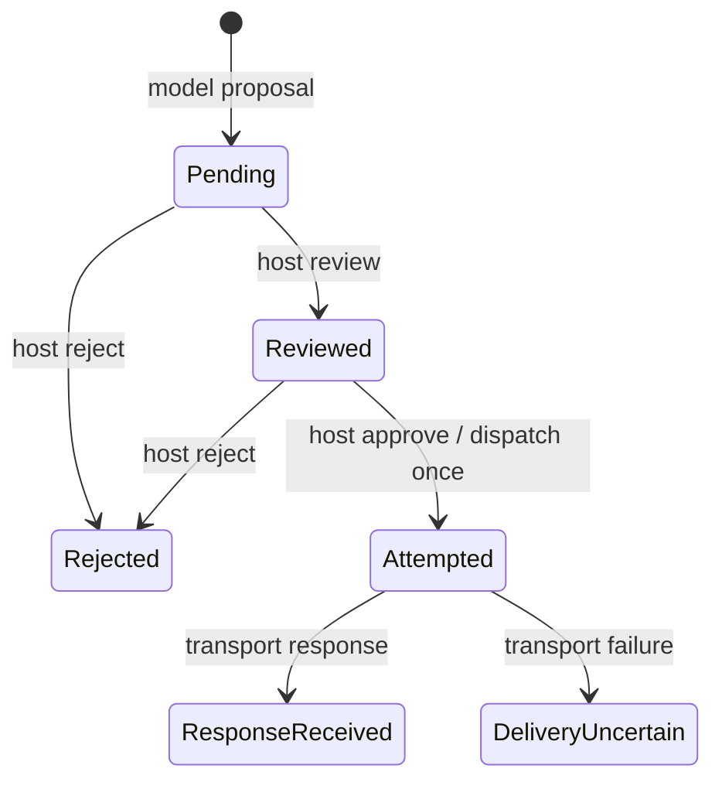

# Formal verification and CI

Meden keeps three kinds of evidence separate: mathematical proofs of a
specification, checks that the implementation agrees with it, and tests of
real operating-system effects. A green badge does not mean the whole agent
is proved secure.

This page describes checks that run today. The proposed orchestrator,
Rust extraction/refinement and artifact delivery requirements are in
[design.md](design.md) and [assurance.md](assurance.md). They are not
established by the current CI badge.

## What CI runs

[`.github/workflows/ci.yml`](../.github/workflows/ci.yml) runs on pushes to
`main`, pull requests and merge groups. There are twelve checks:

| Check | What runs | Failure condition |
| --- | --- | --- |
| Rust | `cargo fmt`, Clippy with warnings denied, workspace tests, documentation build | Formatting/lint errors, failed tests or documentation warnings |
| cargo-deny | Dependency license, advisory and source checks | A dependency violates `deny.toml` |
| Lean | Regenerate transfer/review/dispatch, evidence, issued jobs, TUI approval, scheduling and failure kernels, `lake build`, proof scan/audit, forty-three Rust mutation checks, offline ledger proof and TUI/CLI contract tests | Model drift, proof failure/hole, unapproved axiom, or a known Rust fault passes |
| Six Kani checks | One bounded Rust harness per job | A counterexample, panic, overflow, insufficient unwind bound or verification failure |
| Conformance | Execute the compiled Lean oracle on the same cases as Rust | A result or resulting transfer state differs |
| Python | Ruff and CLI/adversarial-model/PTY checks against the built binary | A request/effect/terminal behavior differs from expectations |
| npm | Launcher checks and package dry-run | Invalid launcher behavior or package layout |

CI pins cargo-deny 0.20.2 and Kani 0.68.0. Kani, Aeneas and Lean public bundles
have fixed SHA-256 checks and bounded download retries. An unavailable or
incorrect bundle fails preparation; it never skips a harness or proof.
The downloader uses fixed GitHub release-asset IDs and fresh API requests
to avoid cached gateway errors and expired redirects.
The Lean job installs Lean 4.35.0 directly rather than downloading a floating
Elan installer; it still builds the pinned Lake dependencies and all default
specification/proof targets.
This retry policy applies to public CI tool preparation, not confidential
model exchanges or file exports.

Lean is pinned in [`lean/lean-toolchain`](../lean/lean-toolchain). CI builds
the `meden-spec` executable, uploads it as an artifact and passes that exact
artifact to the conformance job. That job sets `MEDEN_SPEC_BIN`; it does not
silently substitute an older local build.

## Lean: exact transfer authorization

[`MedenSpec/Transfer.lean`](../lean/MedenSpec/Transfer.lean) models one
single-use permit and an immutable outbound request. A request contains a
host session, recipient identity and canonical complete request contents.
The intended contents include the operation, target, audience, headers and
payload. The kernel compares the complete value, not a checksum or a
model-generated assertion that two requests are equivalent.

For a request `r`, permit `p`, current session `s` and monotonic time `t`:

```text
accepted = (r.session = s)
        ∧ (p.request = r)
        ∧ (t < p.expires)
        ∧ (p.spent = false)

new_spent = old_spent OR accepted
```

All of the following theorems are checked for arbitrary mathematical inputs, not
only for a finite test set:

| Theorem in `MedenSpec.Transfer` | Proven property |
| --- | --- |
| `accepted_iff` | Reservation succeeds exactly when all four authorization conditions hold |
| `exact_request` | Every successful reservation equals the approved request, including recipient and complete contents |
| `accepted_spends` | Successful reservation returns a state in which the permit is spent |
| `no_replay` | After success, any next request/session/time is rejected using that permit's resulting state |
| `rejection_preserves` | A rejected request leaves the permit unchanged |
| `no_changed_recipient` | Changing the recipient makes reservation fail |
| `no_changed_content` | Changing the canonical contents makes reservation fail |

`no_replay` does not require time to advance. A failed network delivery must
not roll back the reservation. Permit creation, the monotonic clock,
canonical request construction, locking and actual dispatch remain the
responsibility of the host implementation.

The Rust counterpart is
[`meden-core/src/transfer.rs`](../crates/meden-core/src/transfer.rs).
The HTTP export component now reserves through it under a mutex before
dispatching its immutable request, including the TUI/CLI host review path.
The model gateway uses the same refined `allowed` predicate with processor
bindings; processor grants and exact one-use exports have separate scopes.

## Rust-to-Lean refinement of the transfer kernel

The production functions `meden_core::transfer::allowed` and `reserve`,
including the derived full-request equality and in-place spent-state
update, are extracted by Charon and translated by Aeneas. The checked-in
[generated model](../lean/MedenSpec/Generated/Control.lean) is not edited
by hand. [extract-transfer.sh](../tools/extract-transfer.sh) regenerates it
from the real crate and requires an exact diff. Unknown extracted functions
or proof holes make the script fail.
Transfer and review/dispatch share this generated module so their production
composition uses the same extracted types and functions.

The pinned chain is Rust `nightly-2026-09-17`, Charon
`8cae8fd1905946de61147a65ecdd7122cc6b491b`, Aeneas
`c5eb4a28cef65e0aa27743105308243e535a2a2b` and Lean 4.35.0.
CI downloads the corresponding extractor release with a fixed SHA-256;
Lake pins the Aeneas library and all dependencies in the manifest.

[TransferRefinement.lean](../lean/MedenSpec/TransferRefinement.lean) proves:

| Theorem | Proven property |
| --- | --- |
| `allowed_refines` | The extracted Rust decision returns successfully and equals the abstract specification for every represented request, permit, session and `u64` time |
| `reserve_refines` | The acceptance result and the complete updated permit agree with the abstract reservation transition |
| `extracted_no_replay` | Two calls of the actual extracted Rust reservation function cannot both accept the same evolving permission, for arbitrary later request/session/time |

The proof handles variable-length full byte vectors, not hashes or bounded
text samples. Rust bytes map injectively to natural-number lists in the
abstract model; only values 0–255 arise from Rust. Arbitrary binary content,
embedded NULs and Unicode encodings need no favorable string-comparison
assumption. Native integer times map to their exact natural values.

Aeneas's Rust standard-library models, extraction, compilation and platform
semantics remain trust dependencies. There are no project axioms standing
in for unknown functions in this extraction. CI regenerates the normal
x86-64 Linux build; this does not prove all release targets/configurations
or native machine-code correctness. The shipping Rust compiler is still
part of the trusted base, distinct from the pinned extraction compiler.

The [mutation check](../tools/check-refinement-mutants.py) changes actual
Rust source in four ways: invert request equality, accept an expired permit,
ignore the spent flag, and fail to record reservation. Each must produce an
observed Rust test failure, extract/compile successfully, and fail the
unchanged correctness proof. Exact original files are restored and the
normal proof is rebuilt afterwards. This checks proof sensitivity and
source linkage; it does not replace the general refinement theorems.

These theorems establish a decision/state-update refinement. They do not
establish a complete control trace or that every real network operation is
mediated. Full broker refinement and interface obligations in
[assurance.md](assurance.md) remain open; the HTTP component tests below
exercise real reservation and delivery, including concurrency.

## Export review control: actual Rust and finite traces

[`export_control.rs`](../crates/meden-core/src/export_control.rs) now owns
every proposal lifecycle update used by the TUI/CLI queue. The runtime now
owns one frozen-request/lifecycle state under a mutex and uses the combined
operation below to return the permitted request. The separate CLI phase
state and pending runtime permit have been removed. Model proposal, host review/reject/approve and actual transport-result
call sites assign typed origins; origin is not read from model arguments.
The old independent phase-update branches are removed.



Host review can inspect terminal states without reopening them. Other
invalid operations preserve state and grant no dispatch. The exact accepted,
state and dispatch semantics are specified independently in
[`ExportControl.lean`](../lean/MedenSpec/ExportControl.lean). Production Rust
is extracted to the untouched [generated model](../lean/MedenSpec/Generated/Control.lean).

| Audited theorem | Checked claim |
| --- | --- |
| `ExportControl.dispatch_iff` | Dispatch requires reviewed state, host origin and an approval event |
| `ExportControl.at_most_one_dispatch` | Any finite event stream from any phase produces at most one dispatch |
| `ExportControlRefinement.step_refines` | Actual extracted Rust matches all three specification observations |
| `ExportControlRefinement.trace_refines` | Arbitrary finite compositions of the extracted step match final state and dispatch count |
| `ExportControlRefinement.extracted_at_most_one` | The extracted Rust compositions never grant two dispatches for one evolving proposal |

The trace proofs use induction, not a bounded event search. The driver
invokes the actual extracted step with raw implementation states and maps
only its terminal observation; it is a composition theorem, **not** an
extraction/refinement of the application's I/O loop or mutex. Initial pending
state corresponds by the enum mapping, and the model-proposal step is
covered by the transition theorem. Origin attribution, reference lookup,
snapshot construction, rendering, locks, compiler/OS and actual HTTP effects
remain explicit unproved boundaries with integration tests.

The mutation check additionally breaks four actual controller rules:
approve before review, accept a model approval, reopen a terminal proposal
on review, and fail to consume approval. Each must fail the real Rust test,
generate a compiling model, and fail the unchanged refinement proof. Both
source/model pairs are restored and normal proofs rebuilt afterwards.

## Combined review and reservation: exact effect requests

Production `export_control::State` owns the immutable complete request and
its phase. `State::advance` commits the review decision, creates/spends the
exact permit and returns `Outcome.effect` only for an eligible host approval.
After a reviewed approval attempt, even an expired or foreign-session
reservation cannot reopen the proposal. No operation replaces its request.

The independent [Dispatch specification](../lean/MedenSpec/Dispatch.lean)
defines authorization by reviewed phase, host origin, approval event, exact
session and exclusive expiry. The [refinement](../lean/MedenSpec/DispatchRefinement.lean)
checks the actual extracted Rust operation, including request cloning and
the composition with `transfer::reserve`.

| Audited theorem | Checked claim |
| --- | --- |
| `Dispatch.effect_iff` | An emitted request is exactly the frozen request, and all review/session/time conditions hold |
| `Dispatch.frozen_preserved` | Every operation retains the original complete request |
| `Dispatch.trace_frozen` | Every request emitted in a finite trace equals its initial frozen request |
| `Dispatch.at_most_one_effect` | Any finite trace emits at most one request |
| `DispatchRefinement.new_refines` | Actual construction starts pending with the exact supplied request |
| `DispatchRefinement.request_refines` | The production review getter exposes the same request used for effects |
| `DispatchRefinement.phase_refines` | The production status getter reports the kernel's phase |
| `DispatchRefinement.advance_refines` | Actual Rust returns successfully and matches the complete specification outcome/state for all represented inputs |
| `DispatchRefinement.trace_refines` | Finite compositions of actual extracted operations match the specification state and complete emitted requests |
| `DispatchRefinement.extracted_trace_safe` | Actual extracted compositions preserve the request and emit at most one copy of it |

The runtime uses only the returned effect as its network input. Both host
review and dispatch decode the same complete JSON description; the decoder
requires POST, exactly the fixed content type and a target equal to the
reserved recipient. Real receiver tests check method, path, content type and
binary body, plus concurrent approvals, expiry, foreign sessions, redirects
and uncertain delivery. Four further Rust mutations forge the origin,
replace the emitted body, omit the committed phase or suppress a valid
effect. Each must fail native assertions and the unchanged refinement after
successful extraction/model compilation.

The finite driver composes the production operation; it is not an
extraction of the I/O loop. Typed-origin attribution, reference lookup,
JSON/URI decoding and encoding, presentation, mutex semantics, clocks,
HTTP/TLS, compiler and OS remain explicit trust dependencies or unproved
adapters. This narrows the executor boundary but does not establish complete
outbound routing or R1 end to end.

## Actual TUI approval input

All three approval screens (processor, export and project contract) call
[`approval::approves`](../crates/meden-cli/src/tui/approval.rs). The predicate
accepts only a `Press` event for lowercase `y` with no modifier bits. Paste,
repeat, release, Enter and other events return false.

The [generated model](../lean/MedenSpec/Generated/Approval.lean) is extracted
from the production CLI binary's real Crossterm event types, including the
bitflags and character equality implementations. Unknown library functions
cannot be substituted by assumptions: the extraction script rejects them.
The generated files remain untouched. The export kernel's event type is
named `ExportEvent` to avoid the pinned generator's anonymous-instance name
collision with Crossterm's `Event` when importing both models.

[`ApprovalRefinement.lean`](../lean/MedenSpec/ApprovalRefinement.lean) checks:

| Audited theorem | Checked claim |
| --- | --- |
| `approves_refines` | The actual predicate terminates and equals the stated condition for every represented Crossterm event |
| `paste_cannot_approve` | Any paste string returns false |
| `modified_key_cannot_approve` | Any key with nonzero modifier bits returns false |
| `nonpress_cannot_approve` | Repeat and release events return false |

Four Rust mutations admit repeats, ignore modifiers, accept Enter or accept
non-key events. Each must fail the native input assertions, compile as a
fresh extracted model and fail the unchanged refinement proof. Native tests
also enumerate all 256 modifier bit patterns. Real PTY tests exercise the
contract review, pasted text and retained project proof artifact.

This proves the predicate over decoded events. Terminal decoding, physical
input provenance, screen routing, rendering and the I/O loop still require
separate assurance; the theorem does not prove that arbitrary terminal bytes
can never be decoded as a key or establish complete outbound confidentiality.

## Checks after a model turn or tool budget stop

The shared TUI/CLI [`Session`](../crates/meden-cli/src/session.rs) uses
`needs_verification` to decide whether changed, accepted work needs a host
check after the model stops. A normal answer or exhausted tool-group budget
can continue to the independent checker. Pending review, model errors and
cancellation stop continuation. This decision schedules work; it cannot
approve a contract, accept evidence or mark a project verified.

[`RepairRefinement.lean`](../lean/MedenSpec/RepairRefinement.lean) checks the
[untouched generated model](../lean/MedenSpec/Generated/Repair.lean) over the
actual `meden_agent::conversation::Status` type, including arbitrary text
in success/error variants. Model-written claims do not change classification.

| Audited theorem | Checked claim |
| --- | --- |
| `needs_verification_refines` | The actual decision terminates and exactly matches the independent required-check predicate for all represented inputs |
| `budget_is_checked` | Accepted, changed work with no cancellation still needs a check after budget exhaustion |
| `checking_requires_authority` | A positive decision requires acceptance, a change and no cancellation |
| `terminal_does_not_check` | Failure, cancellation and pending review return false for every input flag and payload |

Five mutations skip budget checks, admit model errors, omit acceptance,
omit the change condition or ignore cancellation. Each must fail native
assertions and the unchanged Lean refinement after a fresh model compiles.
The real CLI integration test exhausts the model budget, skips its final
forged verification call, gets a fresh host checker diagnostic and repairs
to an actual eight-root proof and retained library. A skipped-call error
cannot replace the independent check. The repair loop remains bounded to
four conversation/check iterations.

Flag attribution, source inspection, the fresh-check branch, loop bounds,
job execution and cancellation races remain unproved adapters. This theorem
does not prove eventual task success or the entire session loop.

## Typed verification failures and stopping repair

The shared runtime's [failure kernel](../crates/meden-runtime/src/verification/failure.rs)
distinguishes three host-attributed outcomes. `unverified` means a completed
check did not establish the contract; it permits bounded source repair.
`unavailable` covers prepared-resource, host-I/O or checker-protocol errors.
`inconclusive` covers recorded cancellation, time/output limits, truncated
output and signal termination. The last two stop automatic repair. A normal
nonzero child exit is not a mathematical refutation; compiler/extractor
errors propagated through such an exit may still need host diagnosis.

The [raw extraction](../lean/MedenSpec/Generated/Failure.lean) includes the
actual termination type and pinned Unix `ExitStatusExt::into_raw` implementation.
[CheckFailureRefinement](../lean/MedenSpec/CheckFailureRefinement.lean) proves:

| Audited theorem | Checked claim |
| --- | --- |
| `repairable_refines` | Only `Unverified` permits automatic source repair |
| `verification_stops_refines` | The actual stop decision matches the independent failure specification for every optional failure kind |
| `operational_stops` | Unavailable and inconclusive results both stop |
| `failed_worker_refines` | For every represented Unix wait word and truncation flag, repair is allowed exactly for complete output and cleared low seven wait-status bits |
| `truncated_is_inconclusive` | Truncated output cannot be classified as a completed rejection |

Five new mutations admit operational failures, remove the stop, ignore
truncation, accept signal termination or promote a limited check. Each must
fail its native assertion and the unchanged refinement after fresh extraction.

The project adapter stores the typed failure independently of diagnostic text.
Model arguments cannot supply it. The conversation stops remaining tools in
the same assistant group and pairs their skipped results in API history; it
issues no further model request. A new host instruction can retry after an
operator repairs resources. File edits cannot clear an operational stop.
Real CLI tests cover missing bundles for model-initiated and host-initiated
checks, forged failure fields, skipped writes and absence of a verified artifact.

The theorems cover the failure kernel on the pinned Linux/Unix representation.
OS status attribution, I/O error mapping, mutexes, conversation routing/history
and new-host-turn attribution are tested adapters, not a complete session proof.

## Issued checks, cancellation and late results

The production `CheckJobs` state in
[`evidence.rs`](../crates/meden-core/src/evidence.rs) owns a session, a
monotonic `u64` sequence and at most one exact active ticket. Tickets have
private fields and no model-facing deserializer. Only the controller may
issue one, against an accepted gate and matching session/contract. Issuing
another supersedes the previous ticket; sequence exhaustion refuses further
jobs instead of wrapping or reusing an ID.

Completion requires checker origin, the exact active ticket, unchanged
prepared inputs and the same accepted session/contract. Successful completion
consumes the ticket. Invalidation clears the active ticket without resetting
the sequence. Aborting an older job cannot cancel a newer one.

The actual Rust methods are extracted into the same unedited
[`Generated/Evidence.lean`](../lean/MedenSpec/Generated/Evidence.lean) as the
evidence gate. The independent specification is
[`CheckJobs.lean`](../lean/MedenSpec/CheckJobs.lean).

| Audited theorem | Checked claim |
| --- | --- |
| `CheckJobsRefinement.new_refines` | Native initialization has an empty active slot and zero sequence in the specified session |
| `CheckJobsRefinement.start_refines` | Actual job issue, refusal and supersession agree with the specification, including `u64::MAX` |
| `CheckJobsRefinement.invalidate_refines` | Only controller invalidation clears the active slot, without resetting the sequence |
| `CheckJobsRefinement.abort_refines` | Only the matching active job can be aborted by the controller |
| `CheckJobsRefinement.finish_refines` | Completion checks origin, exact ticket/current inputs, acceptance and scope, and consumes success |
| `CheckJobsRefinement.is_active_refines` | Native active-job observation agrees with the specified state |
| `CheckJobsTrace.trace_refines` | Arbitrary finite compositions of actual extracted methods agree on state and the issued-ticket log |
| `CheckJobsTrace.extracted_no_late_result` | After invalidation or consumption, older generations cannot complete after any finite continuation, even with restored identical inputs |
| `CheckJobsTrace.extracted_result_was_issued` | Every accepted completion after native initialization names a ticket in the log of actually issued jobs |

These are symbolic proofs over supported inputs and arbitrary finite
traces, not a bound on the number of jobs. The log is proof bookkeeping;
it is not implemented crash recovery. Nine Rust mutations bypass acceptance,
origin or session checks, reuse or wrap IDs, retain cancelled or consumed
tickets, substitute inputs or let an old abort cancel a new job. Each must
fail a native regression and the unchanged refinement proof after a fresh
generated model compiles.

The ledger adapter now freezes the candidate and source/worker/checker/resource
hashes in a `PreparedLedger` before issuing its ticket. Checking consumes
that preparation. Final admission rechecks resource bindings and compares a
fresh workspace snapshot against the issued inputs. `Receipt.active` is
computed by `CheckJobs.finish`, rather than supplied as an unconditional
flag. The separate evidence gate then binds the proof to its actual output
artifact. Edits and TUI/CLI cancellation invalidate jobs; resetting the
process cancellation flag for another turn cannot restore an old ticket.

This is refinement of job operations, not extraction of the session's I/O
loop. Input construction, hashing/serialization, checker attribution,
physical process termination, mutexes, persistence and crash recovery remain
adapter obligations. The current executor runs one session turn at a time;
these proofs do not establish a concurrent backend scheduler.

## Evidence completion: exact current subject and extracted traces

[`evidence.rs`](../crates/meden-core/src/evidence.rs) is the third production
kernel. Its state keeps one subject, immutable ordered obligations, a
draft/reviewed/accepted phase and a private completion cursor. A subject binds
session, accepted contract and input bytes. Each obligation has an exact
statement, evidence kind and checker binding. Host code constructs canonical
bindings and assigns origins; no model-facing deserializer creates receipts.

Propose, review, accept, refresh, record and eligibility, together with an
acceptance observation used by the interfaces, are extracted without manual model edits to
[`Generated/Evidence.lean`](../lean/MedenSpec/Generated/Evidence.lean).
Review/accept require host origin and a nonempty reviewed contract. A
receipt advances only the next position and must be a passed, active checker-origin
result matching the gate's current subject and exact obligation. Evidence
kinds are compared, not ranked or promoted. A controller refresh may change
input bindings within the same session/contract; it resets progress. A
different contract needs a new proposal and acceptance.

| Audited theorem | Checked claim |
| --- | --- |
| `Evidence.record_iff` | Exact conditions for recording the next receipt |
| `Evidence.model_cannot_record` | Model-origin text cannot discharge an obligation |
| `Evidence.inactive_cannot_record` | A result marked inactive at host admission cannot advance progress |
| `Evidence.stale_cannot_record` | A mismatching receipt subject cannot advance progress |
| `Evidence.no_replay` | A used position cannot discharge the next obligation |
| `Evidence.no_kind_substitution` | A changed evidence kind cannot discharge the obligation |
| `Evidence.changed_inputs_invalidate` | Changed inputs reset progress |
| `Evidence.eligible_iff` | Eligibility is accepted, nonempty, complete and current |
| `Evidence.trace_covered` | Every completed position retains matching passed receipt coverage after arbitrary finite events |
| `Evidence.eligible_requires_all_evidence` | Eligibility implies coverage of every accepted obligation on the exact current subject |
| `EvidenceRefinement.propose_refines` | Extracted production initialization agrees with the specification |
| `EvidenceRefinement.review_refines` | Extracted review result and state agree |
| `EvidenceRefinement.accept_refines` | Extracted acceptance result and state agree |
| `EvidenceRefinement.is_accepted_refines` | Both interfaces observe the extracted acceptance phase |
| `EvidenceRefinement.refresh_refines` | Extracted input refresh result and state agree |
| `EvidenceRefinement.record_refines` | Extracted receipt result and complete state agree, including vector/index/overflow boundaries |
| `EvidenceRefinement.eligible_refines` | Extracted eligibility agrees |
| `EvidenceTrace.trace_refines` | Arbitrary finite compositions of actual extracted operations agree with the specification |
| `EvidenceTrace.extracted_requires_all_evidence` | Actual extracted eligibility after such compositions requires all exact current evidence |

The independent [specification](../lean/MedenSpec/Evidence.lean),
[refinement](../lean/MedenSpec/EvidenceRefinement.lean) and
[trace proofs](../lean/MedenSpec/EvidenceTrace.lean) use induction and symbolic
proofs, not a finite test search. The audit log in the trace theorem records
receipt coverage; it is not an implemented persistence/crash-recovery layer.
This is composition of extracted operations, not extraction of the host's
I/O loop. Canonical subject construction, origin attribution, checker
soundness, serialization, persistence and actual effects remain assumptions
or separate implementation obligations.

The first consumer is [Meden's own release gate](release.md). A second
consumer now connects the fixed Rust ledger contract to actual project
source, an independent Lean check and a retained library artifact; see
[project verification](project-verification.md). General contracts/backends
remain targets. The runtime reads actual staged archive
bytes, validates source/build sidecars and obtains current exact-source CI
results directly from the fixed GitHub API. The compiled twelve-check policy
is trusted host configuration. Files are reread before eligibility. Tests
reject wrong source, changed run attempt, missing/duplicate/failed checks,
changed archives even with updated checksums and malformed provenance. The
workflow connects this decision to actual publication; its manual mode is
artifact-only. GitHub/build/OS/compiler/hash trust and unproved adapters
remain explicit in the manifest and release documentation.

Eight additional actual Rust mutations disable producer checks, receipt
freshness, evidence-kind matching, position matching, reset on changed input,
current-subject delivery matching, active-job admission or review-before-accept. Each must fail
the Rust regression test, regenerate a compiling model and fail the unchanged
refinement proof. Combined with transfer/review/dispatch and TUI approval checks, CI rejects
forty-three faults, including scheduling, failure-classification and issued-job faults. Timeouts, exhausted proof
resources, unknown identifiers and missing modules do not count as semantic
rejection. All source/model pairs are
restored and normal combined proofs rebuilt afterwards.

The project adapter now serializes final evidence admission and local artifact
retention against `Control::cancel` with the same mutex used to register managed
processes. Cancellation first prevents the admission closure from executing;
admission first finishes before cancellation returns. The host constructs the
receipt's `active` observation by consuming the matching issued job only in
that critical section. Logical cancellation also invalidates the job before
stopping managed processes. The synchronous
release administration command has no managed-job cancellation and supplies an
active observation directly. The kernel proves rejection of inactive receipts
and active-receipt coverage across extracted traces; the job kernel separately
prevents old generations from completing after reset. Mutex semantics and
correct attribution by adapters remain trust
assumptions. Native tests exercise both orderings and real process cancellation.

## Lean: capability and scope rules

These specifications cover the capability kernel already used by tool
dispatch. They are separate from the new outbound-transfer permit.
The policy/glob Rust implementation still has conformance and bounded
checks, without extraction-based refinement. An extraction attempt with
the pinned tools reaches unsupported Unicode-iterator branching and
borrowed iterator operations; the upstream character-iterator model also
has an opaque `next` definition. Those gaps are not replaced by project
axioms or a byte-only interpretation of Unicode scopes.

| Audited theorem | Proven property |
| --- | --- |
| `Capability.ofString_toString` | Capability serialization parses back to the same capability |
| `Capability.toString_injective` | Different capabilities cannot share a serialized name |
| `globMatch_star` | A lone `*` matches every text |
| `globMatch_literal` | A wildcard-free pattern matches exactly itself |
| `Policy.allowed_iff` | Every requirement is granted and none is denied exactly when the call is allowed |
| `Policy.deny_wins` | A denied requirement makes a call fail, regardless of grants |
| `Policy.grants_monotone` | Adding a grant cannot turn an allowed call into a refusal |
| `Policy.denies_antitone` | Removing a deny cannot turn an allowed call into a refusal |

Definitions and additional lemmas are in
[`Capability.lean`](../lean/MedenSpec/Capability.lean),
[`Glob.lean`](../lean/MedenSpec/Glob.lean) and
[`Policy.lean`](../lean/MedenSpec/Policy.lean).

## Axiom audit

[`Audit.lean`](../lean/Audit.lean) prints the transitive axioms of the seventy-four
entry-point theorems listed above. CI permits only `propext`,
`Classical.choice` and `Quot.sound`, the project's standard Lean assumptions.
It rejects `sorryAx` and any other reported axiom. A separate source scan
rejects unfinished proofs and project axiom declarations in the spec and
oracle sources.

This does not prove the absence of bugs in Lean's kernel, its compiler or
the operating system. Those components remain part of the trusted base.

## Rust model checking and conformance

[`kani_harness.rs`](../crates/meden-core/src/kani_harness.rs) contains six
bounded model-checking harnesses:

- `glob_literal_is_identity`: wildcard-free patterns/text up to three characters.
- `star_matches_everything`: a lone wildcard and text up to three characters.
- `deny_wins`: a symbolic requirement, two grants and one deny.
- `allowed_iff_granted_and_not_denied`: two requirements, one grant and one deny.
- `grants_are_monotone`: one requirement and addition of a second grant.
- `scope_rules`: scoped/unscoped requirements and grants.

The capability is symbolic over the current enum. Scope strings come from
the small fixed menus in the source. Kani exhaustively checks these bounds;
the unbounded Lean theorems are a different form of evidence. The transfer
kernel is not currently covered by these six Kani harnesses.

[`conformance.rs`](../crates/meden-cli/tests/conformance.rs) sends one JSON
batch to the executable Lean oracle and compares with Rust:

- 400 generated policy cases.
- 600 generated glob cases.
- 4,000 generated transfer cases, comparing both acceptance and the updated
  permit. Cases include recipient/content/session changes, already-spent
  permits, exact expiry, near-expiry and `u64::MAX` times, and Unicode text.

The generator has a fixed seed. These comparisons catch implementation/specification drift. They are
regression evidence separate from the general transfer refinement proof;
policy/glob still have no extraction-based refinement theorem.
With no oracle present, the local test prints a skip notice. CI explicitly
supplies the freshly built oracle, so that escape does not apply there.

## Tests of actual isolation

The [workspace owner](../crates/meden-runtime/src/workspace.rs) imports a
project with a trusted Rust worker in a read-only source mount. Regular
files are copied, hard links become independent files, literal symlinks
are retained, and sockets/devices/FIFOs are rejected. The source is not
mounted during untrusted tool execution. Results stay in the private copy.

[Sandbox construction](../crates/meden-runtime/src/sandbox.rs) is now used
by the actual TUI file tools, Bash and `meden exec`. A dedicated
[launcher](../crates/meden-runtime/src/process.rs) closes inherited
capabilities before Bubblewrap starts. This matters: the regression test
originally demonstrated a real inherited-descriptor escape. Worker inputs
use an anonymous private stdin file; they are absent from argv/environment.

[CLI integration tests](../crates/meden-cli/tests/isolation.rs) launch the
real compiled worker, edit/read real files and run Bash/Python. They observe
host-only files, deliberately inheritable file/socket descriptors,
IPv4/IPv6/external connection attempts, a live TCP receiver, source sockets,
hard links, outside symlinks and a detached child which signals readiness
before its parent exits. They also run the public `exec` path and independently
check a changed program in another offline snapshot. Missing isolation
must prevent startup. No mocked tool refusal replaces these observations.

The Python PTY test drives read/edit/Bash, multiple turns and `/clear`,
checks retained private results and unchanged originals, and verifies
terminal restoration. Both Rust and Python CI jobs install Bubblewrap.
The live-model smoke harness's independent checker also uses `exec`;
it does not execute model-generated code on the host.

These tests cover production worker paths, not a Lean proof of OS effects.
Whole-controller refinement and the complete malicious-page acceptance suite
remain work. Local inference now has its own confinement tests below.

## Shared CLI and TUI execution

The [coding session](../crates/meden-cli/src/session.rs) owns the fixed tool
registry, policy, conversation and workspace-bound model gateway for both
interfaces. The [CLI protocol](cli.md) accepts only instruction objects;
the old arbitrary host tool/host result bridge and its AgentDojo adapters
are deleted. Historical result JSON is retained, not reported as current
runtime evidence. Python now needs only its local check dependencies.

The real PTY test compares the complete HTTP request sequence and file
effects for the same instructions through TUI and CLI, including follow-up
history. CLI tests reject legacy tools/policy/system messages, forged
approvals/results, oversized input and terminal-control injection before
model access. Observer cancellation is rechecked immediately before a model
request/tool call, so a failed protocol write cannot start that next effect.
The conversation unit test observes zero model/tool executions at both
cancellation points. Process lifetime remains checked separately.

The [adversarial CLI test](../python/tests/test_run_integration.py) imports
an HTML page fixture and confidential canary into the actual private copy.
A deliberately malicious native model reads both, fabricates send/fetch/
approval calls, creates encoded data and runs Python TCP/UDP/DNS attempts.
Real host TCP/UDP receivers observe no unauthorized traffic. Actual code
editing and tests still succeed, followed by an independent check in another
offline copy. This validates current production paths under full model
control, not general coding-model utility or the complete R1 suite. It
tests both imported page fixtures and host-supplied immutable caches. Export
review and the separate prefetcher have their own production/component tests.

Toolchain selection uses only resources visible in the public mount layout.
On Nix, a private `uv` Python shadowing a public Python is skipped rather
than binding the private cache into the sandbox. The attack test exposed
this actual execution failure before the selection was corrected.

These controller, parser, router and OS behaviors have tests; the seventy-four
Lean theorem entry points still cover their stated kernels. The shared
session has no whole-controller refinement theorem yet.

## Fixed documentation prefetch and cache

The [prefetcher](../crates/meden-runtime/src/pages.rs) accepts a fixed batch
of exact host-selected URLs in the separate `meden prefetch` command. Its
production resolver rejects nonpublic/special-use socket addresses, including
mixed public/private answers. The default direct connector receives the
checked addresses without resolving the hostname again; proxies are disabled.
HTTPS, normal TLS identity checks, no redirects/credentials/subresources and
response/count/time budgets are part of the actual fetch path.

`--pages` loads a bounded JSON snapshot before workspace import or inference.
The [shared model tools](../crates/meden-cli/src/pages.rs) only list handles
and read immutable text. A miss or URL argument cannot start network I/O.
All loaded content/metadata remain untrusted. The cache format does not
authenticate origin and the host must not turn confidential model decisions
into a new prefetch invocation. The fetcher remains trusted host code rather
than an OS-confined network worker. Its DNS/TLS/routing/library assumptions
are listed in [the CLI contract](cli.md#documentation-cache).

Rust tests check address boundaries, mixed DNS answers, exact resolved
addresses, malformed/oversized caches and Unicode pagination. The production
resolver is also tested against a real private receiver, which observes no
connection. Separate response-reader tests use an explicitly test-only local
HTTP client to exercise the shared production response path and configuration:
inert script text, size refusal, exact GET without cookies/authorization, and
no second connection on a redirect. This test client bypasses public-IP/HTTPS
guards and is never installed in the application.

The [public CLI test](../python/tests/test_pages.py) observes zero connections
to private targets or environment proxies and rejects malformed caches before
session startup. The [adversarial test](../python/tests/test_run_integration.py)
also loads a cached injection and a confidential canary, replaces the host
cache after startup, then exercises forged URL reads, cache misses, encoded
data and direct network attempts. Local coding and an independent offline
check still pass; observed TCP/UDP receivers get no unauthorized traffic.
The PTY test reads Unicode cached text and compares the entire model request
sequence with CLI, including follow-up context. These are empirical checks;
they add no Lean theorem or whole-R1 claim.

## Processor approval in production

The [gateway](../crates/meden-llm/src/gateway.rs) is the only public inference
client. Connection discovery returns metadata, not a `ChatModel`; the raw
HTTP implementation is private. TUI and `run` bind the gateway to their
actual host-created session before giving it to the conversation.

Each inference decision calls the already extracted/proved Rust
`transfer::allowed` function. Its fields have these HTTP processor meanings:

| Kernel field | Processor binding |
| --- | --- |
| Session | Retained private workspace identity for both TUI and CLI |
| Recipient | Complete prepared `/chat/completions` URL |
| Request | Exact JSON bytes of provider ID, endpoint, model and credential |
| Expiry | Exclusive monotonic deadline, eight hours after host approval |
| Spent | Revoked; an issued grant cannot be reset on the same gateway |

The existing `allowed_refines` theorem proves the production predicate's
complete equality/expiry/revocation decision. This reuse introduces no new
handwritten implementation model or axiom. Processor approval permits
conversation bodies for inference; it is **not** a one-use exact export and
does not call `reserve` or add a separate predicate proof. Binding
construction, trusted input origins, locking, actual
HTTP correspondence and UI rendering are integration-tested, not refined.
Requests already permitted before revocation can finish.

Rust gateway tests reject model-written approvals, another session, changed
endpoint/model/credential, copied internal grants, expiry and revocation
while observing zero receiver connections. CLI tests reject missing/mismatched
approval even when the opening JSON says it is approved. The real PTY test
requires a local `y` key, rejects Enter/bracketed paste as authority, and
observes that a second receiver gets no context until fresh approval; normal
file tools and multi-turn inference still work after authorization.

These tests do not prove local inference confinement: an approved loopback
service can still forward data unless the service's own egress is confined.

The [processor review screenshot](assets/processor-approval.png) is captured
from the actual TUI; no inference request is made during capture.

## Isolated local inference in production

The [local backend](../crates/meden-llm/src/local.rs) starts a persistent
llama.cpp server through the same descriptor-clean launcher and private
namespace implementation, with a separate scratch directory, read-only
engine/weights and public runtime closure. The coding copy and host secrets
are absent. This is now the default CLI/TUI path; no provider discovery or
HTTP fallback runs. Explicit HTTP connections retain their approval path.

The local gateway reuses the refined `transfer::allowed` decision with the
actual host session, local processor identity, exact configuration-path
bytes and eight-hour expiry/revocation state. Host configuration permits
this confined execution without a remote-recipient approval prompt. Binding
construction and the meaning of those paths remain trusted implementation
work; this is not a proof of engine/weight artifact identity.

The [Unix transport](../crates/meden-llm/src/unix.rs) has no DNS/TCP connector.
It opens a nonsymlink socket with `O_PATH`, checks its inode type and connects
through the held descriptor. A Rust regression replaces the name with a
symlink to another receiver after pinning: only the original receiver gets
the connection. Another regression checks a stalled peer's timeout.

[Production CLI/TUI tests](../python/tests/test_local_inference.py) run a
hostile engine that reads confidential context and attempts IPv4/IPv6,
external TCP, UDP, DNS, host Unix sockets, host files, credentials and
inheritable host descriptors. They observe zero unauthorized deliveries at
real host receivers. The same engine reads injected cached documentation,
proposes/forges an export, edits code and executes tests across several
requests/user turns. An independent offline copy checks the result. The
real PTY test also cancels pending inference and checks terminal restoration.
Separate cases reject a socket symlink, HTTP redirect, disconnect and an
oversized reply without contacting a configured HTTP fallback. No GPU or
real model weights are required for these deterministic CI tests.

A separate local smoke check used llama.cpp 0.9.0, build 12110 (`cd959ba`),
and Qwen3-0.6B Q4_K_M to return a greeting through actual `meden run`. This
confirms engine compatibility, not general coding ability. A separate live
coding pilot with the same small model changed the supplied test, left the
incorrect implementation intact and reported success; an independent test
failed. The conversation's `done` event is therefore not project-verification
evidence. Setup, limits,
failure behavior and OS/asset trust assumptions are documented in
[local inference](local-inference.md). The launcher, protocol and OS boundary
are not Lean-refined; they add no theorem roots to the seventy-four audited here.

## Tests of actual HTTP delivery

The [model transport tests](../python/tests/test_model_transport.py) drive
the actual CLI against local HTTP receivers. They observe that 302/307/308
responses do not forward confidential context, a 503 or a connection closed
after receiving the body does not trigger an automatic resend, and an
environment proxy receives neither inference context nor discovery
credentials. A legitimate direct response still completes the conversation.
Transport checks complement the processor approval tests above; they do
not establish local inference confinement.

The [HTTP export component](../crates/meden-runtime/src/transfer.rs)
uses the refined `reserve` function under a mutex. Its target and body are
owned immutable snapshots; host approval is a separate method that is not
exposed as a model tool. Dispatch uses a fresh client with proxies and
redirects disabled. Failures leave authorization spent.

Five component tests observe real TCP receivers: no send before approval or across
sessions, exact frozen binary payload after the source changes, concurrent
one-use consumption, no forwarding on a 307 redirect, and no reuse after
the receiver obtains the payload but closes without acknowledging it.
Expired approvals and ambiguous/invalid targets cannot dispatch.
These tests use literal loopback HTTP; they do not prove the HTTP/TLS stack
or establish complete controller/transport refinement. The component
supports one raw POST, not Git/email adapters or service audience discovery.
The [proposal queue](../crates/meden-cli/src/exports.rs) now connects this to
both production interfaces. A file worker snapshots at most 1 MiB without
exposing original/host paths. Full bytes stay in host memory outside the
worker's writable mount. Session references use an exact hex encoding of
the workspace path bytes, including non-UTF-8 paths, plus an unreused index.
Review exposes the immutable request and enables a subsequent host approval;
the model only has `propose_export`, which never grants authority or sends.

[Real CLI/PTY tests](../python/tests/test_exports.py) observe recipients and
actual terminal cells. They reject approval before review, another session,
model-written approval, user rejection and replay. They change the file
after proposal, then check that only original binary bytes reach the approved
recipient. A 307 does not reach the other receiver; a receiver which obtains
the body and disconnects leaves approval spent. Enter and bracketed paste
do not approve in the TUI, while the local approval key works. Review
commands issue no model calls. These are integration tests, not a refinement
proof of the queue, protocol, UI or HTTP stack. The new extracted Rust
no-replay theorem covers the two core reservation calls, not those adapters.

The canonical operation binds method, URL, content type and exact body.
Transport-generated framing/TLS and its correspondence remain trust
dependencies. Service-specific audience resolution, immutable project proof
evidence, authorization recovery after restart and complete effect mediation
remain implementation work. The current process retains no grants on exit.

## Reproduce locally

```bash
cd lean
lake build
lake env lean Audit.lean
cd ..
cargo test -p meden-core
cargo test -p meden-cli --test conformance -- --nocapture
cargo test -p meden-runtime
cargo test -p meden-cli --test isolation
# With the Kani toolchain installed:
cargo kani -p meden-core
```

Regenerate both transfer/control models with the pinned tools in `PATH` (or set
`CHARON` and `AENEAS` to their trusted paths):

```bash
bash tools/extract-transfer.sh
# After a deliberate production change:
bash tools/extract-transfer.sh --write
(cd lean && lake build && lake env lean Audit.lean)
uv run tools/check-refinement-mutants.py
```

On NixOS, `nix shell github:aeneasverif/aeneas/c5eb4a28cef65e0aa27743105308243e535a2a2b`
provides the pinned extractors without a permanent system installation.
The standard Rust/Lean conformance and proof checks remain separate.

The runtime test needs Linux, Bubblewrap, Bash and Python. On NixOS, an
ephemeral environment works:

```bash
nix-shell -p bubblewrap --run 'cargo test --workspace --all-features'
```

`MEDEN_BWRAP` can select a trusted Bubblewrap binary. It is host
configuration, not a tool/model argument. No system package installation is
performed automatically by the library.
