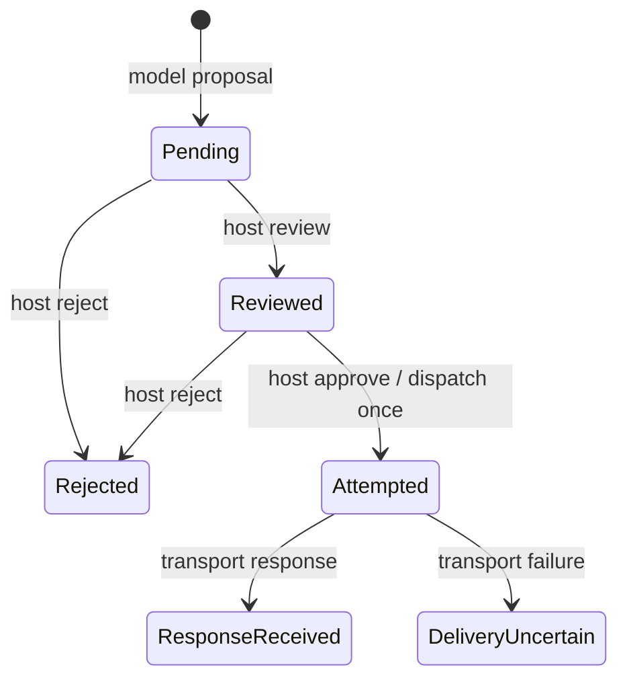

# Formal verification and CI

Meden keeps three kinds of evidence separate: mathematical proofs of a
specification, checks that the implementation agrees with it, and tests of
real operating-system effects. A green badge does not mean the whole agent
is proved secure.

This page describes checks that run today. The proposed orchestrator,
Rust extraction/refinement and artifact delivery requirements are in
[design.md](design.md) and [assurance.md](assurance.md). They are not
established by the current CI badge.

## What CI runs

[`.github/workflows/ci.yml`](../.github/workflows/ci.yml) runs on pushes to
`main`, pull requests and merge groups. There are twelve checks:

Only the Lean job is serialized per ref. Main pushes let its active job finish,
so frequent commits do not repeatedly cancel the full proof/fault suite.
Its concurrency group retains the latest pending job; other refs cancel their
older active Lean job. Rust, Python and the other checks can run immediately
while that proof suite is busy. This uses GitHub's
[conditional concurrency behavior](https://docs.github.com/en/actions/how-tos/write-workflows/choose-when-workflows-run/control-workflow-concurrency).
Release still requires successful checks for its exact source and current
attempt; an older completed run does not cover a newer commit.

| Check | What runs | Failure condition |
| --- | --- | --- |
| Rust | `cargo fmt`, Clippy with warnings denied, workspace tests, documentation build | Formatting/lint errors, failed tests or documentation warnings |
| cargo-deny | Dependency license, advisory and source checks | A dependency violates `deny.toml` |
| Lean | Regenerate production Rust models, `lake build`, proof scan/audit, 157 Rust mutation checks, 17 Lean contract-admission mutation checks, offline project proofs and TUI/CLI contract tests | Model drift, proof failure/hole, unapproved axiom, or a known implementation fault passes |
| Six Kani checks | One bounded Rust harness per job | A counterexample, panic, overflow, insufficient unwind bound or verification failure |
| Conformance | Execute the compiled Lean oracle on the same cases as Rust | A decision differs |
| Python | Ruff and CLI/adversarial-model/PTY checks against the built binary | A request/effect/terminal behavior differs from expectations |
| npm | Launcher checks and package dry-run | Invalid launcher behavior or package layout |

CI pins cargo-deny 0.20.2 and Kani 0.68.0. Kani, Aeneas and Lean public bundles
have fixed SHA-256 checks and bounded download retries. An unavailable or
incorrect bundle fails preparation; it never skips a harness or proof.
The downloader uses fixed GitHub release-asset IDs and fresh API requests
to avoid cached gateway errors and expired redirects.
The Lean job installs Lean 4.35.0 directly rather than downloading a floating
Elan installer; it still builds the pinned Lake dependencies and all default
specification/proof targets.
This retry policy applies to public CI tool preparation, not confidential
model exchanges or file exports.

Lean is pinned in [`lean/lean-toolchain`](../lean/lean-toolchain). CI builds
the `meden-spec` executable, uploads it as an artifact and passes that exact
artifact to the conformance job. That job sets `MEDEN_SPEC_BIN`; it does not
silently substitute an older local build.

## Processor authorization: actual Rust lifecycle and frozen parameters

[`Processor.lean`](../lean/MedenSpec/Processor.lean) specifies one immutable
local or HTTP connection, a host session and a three-state lifecycle:
`pending`, `granted`, `revoked`. A first host approval fixes an exclusive
eight-hour deadline; an overflowing `u64` deadline is rejected. Model-origin
approval/revocation has no effect. Host revocation closes even a pending
connection. A dispatch that observes expiry latches the revoked state, so a
later backwards clock value cannot reopen it. Approval cannot renew or reset
an issued or revoked connection.

A dispatch is returned exactly when the state is granted, the current session
matches and the time is strictly before the fixed deadline. It contains the
original transport and all original parameters: engine/weights path bytes for
local inference; provider, full URL, model and optional credential bytes for
HTTP. Conversation bodies are the grant's disclosed scope. This reusable
processor grant is separate from single-use exact artifact export.

The actual implementation is [`processor.rs`](../crates/meden-core/src/processor.rs).
Its fields and token constructors are private. Local and HTTP calls have
different types, neither cloneable nor deserializable. The HTTP executor
consumes an `HttpCall` and uses its endpoint, model and credential getters.
The local adapter consumes a `LocalCall` and checks its exact engine/weights
configuration before exchanging data. The compile-fail test rejects passing
a local call as HTTP authority. No Boolean authorization result can substitute
for these tokens. The obsolete standalone transfer predicate has been removed.

[`ProcessorRefinement.lean`](../lean/MedenSpec/ProcessorRefinement.lean) proves
successful termination and exact specification agreement for construction,
approval, revocation, authorization and dispatch, for all represented inputs,
including every `u64` time and overflow case. It also proves the actual clone,
consuming-token and getter paths preserve every parameter byte, including
`None` versus an empty credential. [`ProcessorTrace.lean`](../lean/MedenSpec/ProcessorTrace.lean)
composes the actual extracted operations for arbitrary finite traces, observing
HTTP effects through the actual adapter getters and local effects through
their token snapshots. The actual local adapter's consuming configuration
comparison is proved separately. Every effect retains the initial
binding and transport; in particular local bindings never emit HTTP calls.
Revoked executions remain closed and emit nothing, even with later host
approvals and arbitrary subsequent clock values.

| Theorem group | Proven property |
| --- | --- |
| `Processor.approve_iff`, `model_cannot_approve`, `model_cannot_revoke` | Only a first host approval with a representable deadline can grant authority |
| `authorized_iff`, `no_foreign_session`, `no_expired`, `no_revoked` | Exact session, exclusive expiry and phase checks |
| `dispatch_effect_iff`, `expired_dispatch_closes` | Exact dispatch conditions and terminal observed expiry |
| `ProcessorRefinement.*_refines`, `*_getters_refine`, `local_consume_refines` | Actual Rust operations, snapshots and adapter observations agree with the specification |
| `ProcessorTrace.trace_refines`, `extracted_frozen`, `extracted_revoked` | Arbitrary finite extracted executions preserve complete bindings and terminal revocation |

[extract-transfer.sh](../tools/extract-transfer.sh) regenerates seven raw
production models and rejects any drift or unknown function/proof hole.
Processor authorization has its own [generated module](../lean/MedenSpec/Generated/Processor.lean);
export review/dispatch, evidence and their delivery composition share
`Evidence.lean`, so their actual Rust types are generated once. Generated files are never edited
by hand. The pinned chain is Rust `nightly-2026-09-17`, Charon
`8cae8fd1905946de61147a65ecdd7122cc6b491b`, Aeneas
`c5eb4a28cef65e0aa27743105308243e535a2a2b` and Lean 4.35.0.
CI downloads the extractor release with a fixed SHA-256; Lake pins its
library and dependencies. Byte vectors map injectively to natural-number
lists without hashing or a favorable string-comparison assumption.

The [fault driver](../tools/check-refinement-mutants.py) includes twelve
processor faults: forged model approval, renewal, deadline wrap, pending
permission, a foreign session, inclusive expiry, ignored pending revocation,
revival after expiry, endpoint/credential substitution, local path substitution
and acceptance of a mismatched local resource. Each must fail an actual native
assertion, extract and compile successfully, then fail the unchanged correctness
proof. Original files are restored and the normal proof rebuilt. The driver
sets `RUSTFLAGS=-D warnings`; compiler errors, timeouts and exhausted proof
resources are operational failures and do not count as a rejected semantic fault.

Extraction, Aeneas's standard-library models, the Rust compiler and platform
remain trust dependencies. UTF-8/URI/JSON handling, host input attribution,
clock provenance, locks, process/network I/O and host review rendering are not
proved by these theorems. The runtime uses checked UTF-8 decoding and rejects
invalid parameters before HTTP; physical transport correspondence is exercised
by real TCP tests. A token already issued before revocation may finish. These
results do not establish the complete controller or outbound confidentiality
requirement. See [assurance.md](assurance.md).

## Export review control: actual Rust and finite traces

[`export_control.rs`](../crates/meden-core/src/export_control.rs) now owns
every proposal lifecycle update used by the TUI/CLI queue. The runtime now
owns one frozen-request/lifecycle state under a mutex and uses the combined
operation below to return the permitted request. The separate CLI phase
state and pending runtime permit have been removed. Model proposal, host review/reject/approve and actual transport-result
call sites assign typed origins; origin is not read from model arguments.
The old independent phase-update branches are removed.



Host review can inspect terminal states without reopening them. Other
invalid operations preserve state and grant no dispatch. The exact accepted,
state and dispatch semantics are specified independently in
[`ExportControl.lean`](../lean/MedenSpec/ExportControl.lean). Production Rust
is extracted to the untouched [generated model](../lean/MedenSpec/Generated/Evidence.lean).

| Audited theorem | Checked claim |
| --- | --- |
| `ExportControl.dispatch_iff` | Dispatch requires reviewed state, host origin and an approval event |
| `ExportControl.at_most_one_dispatch` | Any finite event stream from any phase produces at most one dispatch |
| `ExportControlRefinement.step_refines` | Actual extracted Rust matches all three specification observations |
| `ExportControlRefinement.trace_refines` | Arbitrary finite compositions of the extracted step match final state and dispatch count |
| `ExportControlRefinement.extracted_at_most_one` | The extracted Rust compositions never grant two dispatches for one evolving proposal |

The trace proofs use induction, not a bounded event search. The driver
invokes the actual extracted step with raw implementation states and maps
only its terminal observation; it is a composition theorem, **not** an
extraction/refinement of the application's I/O loop or mutex. Initial pending
state corresponds by the enum mapping, and the model-proposal step is
covered by the transition theorem. Origin attribution, reference lookup,
snapshot construction, rendering, locks, compiler/OS and actual HTTP effects
remain explicit unproved boundaries with integration tests.

The mutation check additionally breaks four actual controller rules:
approve before review, accept a model approval, reopen a terminal proposal
on review, and fail to consume approval. Each must fail the real Rust test,
generate a compiling model, and fail the unchanged refinement proof. Both
source/model pairs are restored and normal proofs rebuilt afterwards.

## Combined review and reservation: exact effect requests

Production `export_control::State` owns the session, original destination
`String`, body bytes and phase. `State::advance` commits the review decision
and returns a borrowed `Dispatch` only for an eligible host approval. After
a reviewed approval attempt, even an expired or foreign-session request
cannot reopen the proposal. No operation replaces its frozen inputs.

The independent [Dispatch specification](../lean/MedenSpec/Dispatch.lean)
defines authorization by reviewed phase, host origin, approval event, exact
session and exclusive expiry. The [refinement](../lean/MedenSpec/DispatchRefinement.lean)
checks the actual extracted Rust operation, the consuming dispatch accessor,
and both destination/body getters used by review and HTTP delivery.

| Audited theorem | Checked claim |
| --- | --- |
| `Dispatch.effect_iff` | An emitted request is exactly the frozen request, and all review/session/time conditions hold |
| `Dispatch.frozen_preserved` | Every operation retains the original complete request |
| `Dispatch.trace_frozen` | Every request emitted in a finite trace equals its initial frozen request |
| `Dispatch.at_most_one_effect` | Any finite trace emits at most one request |
| `DispatchRefinement.new_refines` | Actual construction starts pending with the exact supplied request |
| `DispatchRefinement.request_refines` | The production review getter exposes the same request used for effects |
| `DispatchRefinement.target_refines` | The actual destination getter returns the original full string |
| `DispatchRefinement.body_refines` | The actual body getter returns the original exact byte slice |
| `DispatchRefinement.dispatch_refines` | Consuming the token and calling both actual getters returns exactly its frozen destination/body |
| `DispatchRefinement.phase_refines` | The production status getter reports the kernel's phase |
| `DispatchRefinement.advance_refines` | Actual Rust returns successfully and matches the complete specification outcome/state for all represented inputs |
| `DispatchRefinement.trace_refines` | Finite compositions of actual extracted operations match the specification state and complete emitted requests |
| `DispatchRefinement.extracted_trace_safe` | Actual extracted compositions, including consuming/getter observations, preserve the request and emit at most one request |

The runtime consumes the returned token by value as its only dispatch input.
`Dispatch` has a private constructor and no `Clone`, `Copy` or deserializer.
Its shared borrow exposes immutable `String`/byte-vector storage without
interior mutability. The runtime holds the per-export lock through the HTTP
call with its configured five-second timeout. There is no JSON encoding/decoding between
approval and send; the HTTP method and content type are fixed in the adapter.

Rust's type checker enforces ownership and shared borrowing; Aeneas's value
model does not prove token linearity or how many physical sends an arbitrary
consumer performs. A compile-fail example rejects cloning the production
token. Real receiver tests check method, path, content type and binary body,
plus concurrent approvals, expiry, foreign sessions, redirects and uncertain
delivery. Six further Rust mutations forge the origin, corrupt the actual
body getter, omit the committed phase, suppress a valid effect, ignore the
export session or admit approval at the exclusive deadline. Each must
fail native assertions and the unchanged refinement after successful
extraction/model compilation.

The finite driver composes the production operation; it is not an
extraction of the I/O loop. Typed-origin attribution, reference lookup,
URI normalization, presentation, mutex semantics, clocks,
HTTP/TLS, compiler and OS remain explicit trust dependencies or unproved
adapters. This narrows the executor boundary but does not establish complete
outbound routing or R1 end to end.

## Project evidence and outbound reservation

[`Delivery`](../lean/MedenSpec/Delivery.lean) composes current contract/evidence
eligibility with the reviewed, single-use export state. The production
[`Delivery`](../crates/meden-core/src/evidence.rs) freezes the complete
contract view: revision, session, meaning, inputs and required obligations.
At approval it compares that view with the current controller and checks
complete current evidence. Raw file proposals have no contract binding and
can dispatch only while the controller still has no project contract.

| Audited theorem | Checked claim |
| --- | --- |
| `ContractsRefinement.view_eq` | Actual comparison matches the complete abstract view, including its ordered obligations |
| `Delivery.effect_iff` | Dispatch requires current permission and all host review/session/time conditions for exactly the frozen request |
| `Delivery.raw_cannot_bypass_contract` | A plain-file proposal cannot bypass a proposed or accepted project contract |
| `Delivery.frozen_preserved`, `trace_filters_denied`, `trace_safe` | Changing controller snapshots cannot replace the binding/request or produce more than one dispatch |
| `DeliveryRefinement.permitted_refines`, `prepare_refines`, `advance_refines` | The actual Rust context check, constructor and complete transition match the specification |
| `DeliveryRefinement.getters_refine` | The actual context, request and phase getters report the same state used by dispatch |
| `DeliveryRefinement.trace_refines`, `extracted_trace_safe` | Arbitrary finite extracted compositions retain the original request and emit at most one |
| `DeliveryRefinement.dispatch_requires_current` | Every actual returned dispatch has current matching permission and the full reviewed request authorization |

Export and evidence operations share one raw extracted model, avoiding an
independent copy of either controller in this composition. The TUI and CLI
share one project instance with the proposal queue. `propose_artifact_export`
builds its payload only from the retained checked files and host-held report;
the model supplies a destination, never replacement proof files or a result.
Before approval, the adapter inspects current source and retained storage
again while holding the project state lock. Both interfaces then use the
same guarded runtime dispatch. Ordinary file export is refused when a
contract exists, including for a raw proposal prepared earlier.

The [real delivery test](../python/tests/test_project_delivery.py) uses a
checked counter and an observed HTTP receiver. It rejects raw-file bypass,
fake artifact flags, changed/restored source, pending/new accepted meanings,
corrupted/restored library storage and replay. One authorized POST is checked
byte for byte against the reviewed package and every retained file hash.
Four additional real Rust faults bypass current evidence, frozen-context
comparison, the plain-file boundary or completed evidence; each must fail
the unchanged native regression and refinement proof after successful
extraction/model compilation.

The payload is a bounded JSON envelope of exact file bytes; it is not a
compiler correctness proof or general project certification. Packaging,
fresh physical observations, canonical bytes, instance attribution, host
origin, clocks, locks and HTTP remain tested/trusted adapters. These
composition proofs do not establish the complete session I/O loop, atomic
storage against concurrent host mutation, all outbound adapters or R1.

## Actual TUI approval input

All three approval handlers (processor, export and project contract) use
[`approval::route`](../crates/meden-cli/src/tui/approval.rs) with the actual
host `Screen` and decoded event. It returns a typed target only for that
target's own review screen, and each handler matches its expected target.
The underlying private predicate accepts only a `Press` event for lowercase
`y` with no modifier bits. Paste, repeat, release, Enter and other events
grant no approval. Picking, instructing and running screens grant none.

The [generated model](../lean/MedenSpec/Generated/Approval.lean) is extracted
from the production CLI binary's real Crossterm event types, including the
bitflags, character equality implementations and the actual six-state
`Screen` enum. Unknown library functions
cannot be substituted by assumptions: the extraction script rejects them.
The generated files remain untouched. The export kernel's event type is
named `ExportEvent` to avoid the pinned generator's anonymous-instance name
collision with Crossterm's `Event` when importing both models.

[`ApprovalRefinement.lean`](../lean/MedenSpec/ApprovalRefinement.lean) checks:

| Audited theorem | Checked claim |
| --- | --- |
| `approves_refines` | The actual predicate terminates and equals the stated condition for every represented Crossterm event |
| `paste_cannot_approve` | Any paste string returns false |
| `modified_key_cannot_approve` | Any key with nonzero modifier bits returns false |
| `nonpress_cannot_approve` | Repeat and release events return false |
| `route_refines` | The actual review-target selector terminates and matches the complete event/screen specification |
| `route_iff` | A target is returned exactly for an eligible key, that target's own review-screen state, content cells and enough rows for the complete authority heading |
| `paste_cannot_route` | No paste string grants any target in any screen |
| `nonreview_cannot_route` | Picking, instructing and running screens grant no approval for any event |
| `hidden_review_cannot_route` | Every event in every screen returns no target when the panel width or height is at most two cells |
| `clipped_heading_cannot_route` | No event grants a target with zero heading rows, a one-column content area or fewer content rows than the heading needs |

Four Rust mutations admit repeats, ignore modifiers, accept Enter or accept
non-key events. Each must fail the native input assertions, compile as a
fresh extracted model and fail the unchanged refinement proof. Native tests
also enumerate all 256 modifier bit patterns. Real PTY tests exercise the
contract review, pasted text and retained project proof artifact. Three
additional actual Rust mutations allow approval outside review, substitute
the processor target for export, or ignore the input predicate. The native
routing matrix and unchanged refinement must reject all three after
successful extraction/model compilation. A real gateway regression also
calls the processor handler while each other screen is active and checks
that no processor grant is issued.

The TUI records the actual review panel from its most recent draw, clearing
it when a processor, export or contract review is opened. All three handlers
pass its dimensions to the same extracted selector. A terminal-size change
between drawing and input postpones review-key handling until another draw.
An actual two-column rendering previously allowed a processor grant despite
having no content cells. The regression now rejects it, resizes, checks that
the endpoint was painted and then successfully authorizes. Processor changes
also discard the previous frame's readiness. A new Rust fault removes the
dimension guard; native assertions and unchanged refinement must reject it.
A second actual regression uses a long processor destination: the old TUI
approved it even though its end was clipped. Reviews now keep the authority
heading fixed above the scrolling details. The processor heading includes
the endpoint, connection/model, credential presence and session scope; export
review retains the target, method, payload length and accepted contract;
contract review retains its revision/hash. The row count comes from the
same wrapped Paragraph used for rendering, before adding the border. The
selector also requires nonzero heading rows, two content columns and enough
content rows for that heading. A count larger than u16 is saturated to a
value that cannot fit. Details keep their own scroll viewport and page size.
The gateway regression checks rejection while clipped, then normal approval
after resizing, including with details scrolled away. A ninth actual
approval fault bypasses the heading guard; its native assertions and unchanged
Lean refinement must both reject it after successful extraction.
The real export PTY test also shrinks the terminal until the heading is
clipped, presses `y` followed by rejection and observes no received body.
After resizing back, another exact host approval still delivers its frozen
body once. The rejection acknowledgment prevents a timing-only assertion.

These are necessary numeric viewport conditions, not a proof that every
review byte was visible or read. Frame attribution, layout, rendering, physical input and
the complete screen-transition interpreter remain adapter obligations.

This proves the predicate and target selection over decoded events and a
given host screen state. Terminal decoding, physical input provenance,
screen transitions, displayed-review correspondence, target/reference lookup,
handler effect interpretation and the I/O loop still require
separate assurance; the theorem does not prove that arbitrary terminal bytes
can never be decoded as a key or establish complete outbound confidentiality.

## Display transformation: actual Rust code points

Human-facing CLI messages, TUI text, processor metadata, export destination/source
labels and instruction input use [`text::visible`](../crates/meden-cli/src/text.rs).
Its actual `visible_codepoint(u32)` helper is extracted in the sixth generated
module, [Text.lean](../lean/MedenSpec/Generated/Text.lean). The independent
[specification](../lean/MedenSpec/Text.lean) defines the exact numeric policy:

- Preserve newline U+000A; replace tab with a space and ESC with the visible U+241B symbol.
- Replace the remaining C0/C1 values U+0000–001F and U+007F–009F with U+FFFD.
- Replace U+061C, U+200E/F, U+202A–202E and U+2066–2069 with U+FFFD.
- Preserve every other value. This is an explicit set of values, not a claim
  to prevent every Unicode visual ambiguity or terminal attack.

[TextRefinement.lean](../lean/MedenSpec/TextRefinement.lean) checks the actual
production numeric operation, without a favorable substitute for an unsupported
String function. The constructor-value lemma relates the generated `u32`
patterns to their exact natural values.

| Audited theorem | Checked claim |
| --- | --- |
| `Text.safe` | Output excludes the specified control/directional values, allowing newline |
| `Text.preserves_safe` | Values outside that forbidden set are unchanged |
| `Text.valid_output` | A valid Unicode scalar maps to another valid scalar |
| `Text.idempotent` | A second application does not change the result |
| `Text.newline_iff` | Exactly the original newline values produce newlines |
| `TextRefinement.scalar_refines` | Actual Rust terminates and agrees with the specification for every represented `u32` |
| `TextRefinement.extracted_safe` | Actual extracted output excludes the forbidden set |
| `TextRefinement.extracted_scalar` | Actual extracted output is a valid scalar when its input is valid |
| `TextRefinement.stream_refines` | Every finite composition of the extracted operation matches the specified pointwise transformation |
| `TextRefinement.stream_safe` | Those compositions preserve length and produce only permitted values |

The native regression checks both the numeric result and real String wrapper
for all 1,112,064 valid Unicode scalars against the previous display policy, including
Rust's `char::is_control`. Four semantic faults retain ESC, drop newlines,
retain a directional override or replace ordinary text. Each must compile
under `-D warnings`, fail native assertions and fail the unchanged refinement.
These checks cover usefulness as well as rejecting control values.

The finite driver composes the extracted numeric function. It does not extract
the String iterator/collector, `char` conversion, UTF-8 handling or terminal
renderer. Extracting the complete wrapper with the pinned tool currently fails
because the iterator model lacks `map`; the earlier direct `char` match is also
unsupported. No replacement model or new assumption was introduced to hide
those limitations. Physical input/output, glyph/cell layout, review authenticity
and end-to-end R1 remain separate obligations. The length theorem counts numeric
code points; byte counts and terminal-cell widths have separate semantics.

## Extracted outer session control

TUI and CLI share [`Session`](../crates/meden-cli/src/session.rs), which
executes the next operation returned by the runtime's
[`Turn`](../crates/meden-runtime/src/verification/turn.rs). Its private state
owns the remaining conversation budget and protocol stage. Returned effects
select a conversation invocation, current-source inspection, independent
check, repair instruction or terminal result. An out-of-order signal stops
the turn instead of authorizing another operation.

A normal or budget-exhausted conversation with accepted, changed work reaches
host evidence inspection. Current proof can finish the turn. Otherwise,
a budget stop always obtains a fresh checker result; a skipped tool call or
older rejection cannot substitute for it. A completed rejection may trigger
repair while cycles remain. Cancellation, operational failure or pending
review stops the turn. Unclassified check failure also stops automatic
repair. A stopped controller remains stopped even when flags are later cleared;
a new host instruction creates a new controller.

Before acceptance, the session retains a failed proposal observation and its
bounded diagnostic independently of file edits. After a normal or
budget-exhausted conversation, that observation permits another proposal
repair within the same four-invocation budget. No successful draft, host
acceptance, source inspection or proof is inferred from a repair request.
A failed/cancelled model outcome cannot start proposal repair. Capturing the
tool observation and constructing its diagnostic remain tested session
adapters; the extracted controller consumes the typed Boolean observation.

Inspection and check signals carry `Result<bool, FailureKind>`. Failed source
inspection preserves its failure kind instead of becoming `false`. Unavailable
or inconclusive inspection stops even with a cached completed rejection.
An unverified inspection requests a fresh check: it cannot establish the source
identity needed to reuse the earlier diagnostic. A successful check whose
current evidence is ineligible also stops; only an explicitly classified
completed rejection permits repair.

[`Repair.lean`](../lean/MedenSpec/Repair.lean) specifies this protocol.
[`RepairRefinement.lean`](../lean/MedenSpec/RepairRefinement.lean) proves
initialization and the actual extracted transition, including `u8` budget
boundaries and every represented protocol state. A separately extracted
`Status::inspection` classifies actual conversation outcomes, including arbitrary
text, and its composition with this transition is proved below. The
[unedited generated module](../lean/MedenSpec/Generated/Repair.lean) also
contains the real runtime failure classifier. Control and process classification
share that actual extracted failure type.

| Audited theorem | Checked claim |
| --- | --- |
| `RepairRefinement.begin_refines` | Actual initialization starts in the ready stage with four conversation invocations available |
| `RepairRefinement.advance_refines` | Every native effect and complete resulting state match the independent protocol specification |
| `RepairRefinement.inspection_requires_acceptance` | Inspection requires an accepted, changed-work conversation signal with a normal or budget outcome; model text cannot replace these flags |
| `RepairRefinement.budget_gets_fresh_check` | A budget outcome followed by missing current proof requests an independent check even when an older rejection exists and no further conversation budget remains |
| `RepairRefinement.proposal_repair` | An unaccepted conversation with an observed failed proposal and a normal or budget outcome requests repair while budget remains |
| `RepairRefinement.draft_repair_requires_failure` | An unaccepted conversation can request repair only with an observed failed proposal and a normal or budget outcome |
| `RepairRefinement.inspection_error` | Every typed inspection failure with a cached rejection either obtains a fresh check (`Unverified`) or stops (`Unavailable`/`Inconclusive`), after normal or budget-exhausted conversation and for every remaining budget |
| `RepairTrace.trace_refines` | Arbitrary finite compositions of actual extracted transitions agree on state and the number of conversation invocations |
| `RepairTrace.extracted_conversation_budget` | Every such trace from actual initialization emits at most four conversation invocations |
| `RepairTrace.extracted_stopped` | Every finite continuation from a stopped native state preserves it and emits no further conversation invocation |

One conversation invocation can make multiple LLM requests and tool calls.
The bound is four outer conversation/check cycles, not four total LLM
requests. Neither the model's final answer nor a controller finish effect
establishes project proof; that still requires exact current evidence.

Fourteen Rust mutations skip budget verification, admit failed outcomes, omit
acceptance or change checks, reuse an older budget rejection, ignore
cancellation, reopen a stopped turn, remove budget consumption or repair an
unattributed failure, repair an unavailable inspection or reuse an older
diagnostic after a rejected inspection. Proposal faults also
invent a failure, redirect accepted work or restart a failed conversation.
Each must fail native assertions and the unchanged refinement after a freshly
generated model compiles. Real CLI tests exercise
budget recovery and operational stops through the independent checker and
retained artifact path.

Host attribution of signals, file-change observation, current-subject
inspection, JSON history behavior, physical dispatch, locks and
cancellation races remain adapter obligations. These are finite compositions
of extracted controller operations, not extraction of the complete I/O loop
or a theorem of eventual task success.

## Inner conversation effects and call/result binding

The production [conversation interpreter](../crates/meden-agent/src/conversation.rs)
uses [Flow](../crates/meden-agent/src/flow.rs) to choose its next operation.
Flow owns the original assistant reply, tool-call vector, current position,
typed result, request budget and latched stop. The interpreter looks up the
call in that state for both execution and result publication; it does not
supply a replacement call ID when returning a result.

The independent [protocol specification](../lean/MedenSpec/Conversation.lean)
has seven phases: ready, request notification, model response, assistant
publication, tool execution, result publication and halted. The production
controller, getters, outcome classifier and shared final interruption guard
are extracted as a local `meden-agent` unit into
[`Generated/Conversation.lean`](../lean/MedenSpec/Generated/Conversation.lean).
The regeneration script checks that every requested entry point is present;
an extraction containing only helper definitions is rejected. String creation
and diagnostic formatting stay in the interpreter. The model retains actual
string fields without adding opaque string-operation assumptions.

| Audited theorem | Checked claim |
| --- | --- |
| `ConversationRefinement.begin_refines` | Actual initialization agrees with the specification, including saturating `usize` arithmetic |
| `ConversationRefinement.advance_refines` | Every actual effect and complete resulting control state agree, for every represented phase, input and interruption |
| `ConversationRefinement.interrupt_refines` | Cancellation takes priority over the host stop in the shared final guard |
| `ConversationRefinement.inspection_refines` | Normal completion permits inspection, budget exhaustion requires a fresh check, and failure/cancellation/review do not request inspection |
| `ConversationObservations.pending_refines` | The actual call getter returns the original ID, tool and argument text at the selected position |
| `ConversationObservations.reply_refines` | The assistant observer reads the reply owned by the controller |
| `ConversationObservations.result_refines` | The result observer reads the stored typed result only in the result-publication phase |
| `ConversationObservations.outcome_refines` | The actual final status/content agrees with the independent outcome rules |
| `ConversationObservations.inspection_bridge` | The actual status classifier composed with the outer turn transition agrees with its specification |
| `ConversationTrace.trace_refines` | Arbitrary finite compositions agree on final state and model-request count |
| `ConversationTrace.extracted_request_budget` | Such a trace from actual initialization makes at most `groups + 1` model requests |
| `ConversationTrace.extracted_halted` | Every finite continuation from a halted native state preserves it and makes no model request |
| `ConversationTrace.extracted_stop_blocks` | A latched stop prevents both model requests and executable tool effects |
| `ConversationTrace.extracted_stop_persists` | Later observations cannot clear or replace the latched native stop reason |
| `ConversationTrace.extracted_wellFormed` | Every finite continuation preserves valid call/result positions from a well-formed state; native vector bounds discharge reply-size assumptions |
| `ConversationTrace.initialized_wellFormed` | The same invariant holds from actual initialization for every finite observation sequence |
| `ConversationTrace.extracted_record_pairing` | A record effect observes the original pre-transition call slot, with an existing selected call and stored result |

Ordinary conversations allow fifteen executable tool groups and a final
model request. Calls returned on that final request are recorded as skipped;
they cannot execute. This gives at most sixteen model requests per invocation,
within the separate four-invocation outer-turn budget. These are safety bounds,
not a theorem that a task succeeds or that a host always supplies another input.
An out-of-order host observation faults the controller and drains the original
group without starting another model request or executable tool.

A native regression reproduces a previous dispatch bug: the decision observer
raised a host stop, but the tool still ran once. `execute` now passes fresh
cancellation/host-stop observations to the bound invocation controller after
that observer, immediately before dispatch;
the typed stop returned to Flow remains latched even when a later callback
clears the external flag. Native tests also exercise multiple original call
slots, budget exhaustion, malformed host order and `usize::MAX` saturation.
Seven added Rust faults remove these guards, budget/cursor updates or the
correct call lookup; the existing two status-classification faults now mutate
the actual extracted classifier.

Another native regression stops before model access, both before the request
notification and inside its observer. For review and infrastructure failures,
the scripted model's reply must remain unused and no assistant/tool history
may be added. The `ignored_host_stop` mutation uses this witness: a test that
only stops during a tool decision can pass because the separate invocation
controller still blocks dispatch. CI refuses to count a fault without an
observed native assertion failure; the regenerated model must then compile
and fail the unchanged refinement proof. This corrects the witness without
removing a mutation or weakening a theorem.

This is refinement of the actual inner effect controller and its observations.
It does not prove JSON parsing/history serialization, model transport,
observer provenance, registered tool implementations, physical dispatch or
the complete session I/O loop. Call positions retain the IDs supplied by the
model; this does not assert that those IDs are unique. Confidentiality still
requires the separate operating-system and outbound-adapter argument.

## Prepared tool invocation

Model-selected tools, the outer controller's `verify_project` call and
one-shot `meden exec` use the same `execute` function. A host tool's `prepare`
method consumes the argument map and binds owned request data and declared
requirements to a one-use executor. Its public interface exposes no direct
execution method; the old independent `requirements`/`call` methods are removed.
The public `Attempt::with_policy` constructor in
[`invocation.rs`](../crates/meden-core/src/invocation.rs) binds the exact immutable
policy reference into an opaque `Call`, then uses its private checked constructor
to evaluate that policy against those requirements before retaining the call.
It accepts no external permission bit. Failed preparation retains its original
refusal; denied requirements retain the supplied policy refusal. The decision observer
receives that admission result before dispatch. This is an existing
policy-decision notification, not another user-approval interaction.
Cancellation and the host stop are read again after an allowed notification.
The executor is called only after `Attempt.dispatch` returns that `Call` and
`Call::into_parts` consumes it into the original executor/policy pair.
The conversation neither looks up the tool nor decodes the model's argument
JSON a second time after permission. Tool-specific validation and worker
transport remain adapters.

[`Invocation.lean`](../lean/MedenSpec/Invocation.lean) specifies notification,
resolution and the consumed preparation. The actual generic Rust constructors
and methods are extracted with the policy into `Generated/Policy.lean`. The
agent's actual failure mapping is extracted into `Generated/Conversation.lean`.
The private failure carrier has the same standard `Result`/`Option` sum in both
models; its actual consuming projection and mapping preserve all four outcomes.
[`InvocationRefinement.lean`](../lean/MedenSpec/InvocationRefinement.lean)
connects all represented states and arbitrary finite method compositions to
that specification, for every payload type. Thus its exact-payload claim
applies to the prepared executor value returned by admission. Its binding to
the captured request still needs the Rust boxing/closure adapter's semantic
correspondence.

| Audited theorem | Checked claim |
| --- | --- |
| `Invocation.dispatch_iff` | Success requires a notified, successful preparation and no cancellation or host stop |
| `Invocation.dispatch_consumes` | Every dispatch attempt removes the queued preparation, including denied, stopped and malformed attempts |
| `Invocation.trace_exact` | Returned payloads and any retained preparation form a sublist of the original payload; the controller cannot substitute or duplicate it |
| `Invocation.trace_budget` | Dispatches plus remaining notification credit never exceed prior credit and allowed notifications |
| `Invocation.trace_safe` | From initialization, every finite prefix returns at most one original successful preparation, after an allowed notification |
| `InvocationRefinement.new_refines`, `admission_iff` | Actual construction evaluates the owned policy, retains exactly the supplied successful request only when its original declared requirements are allowed, and starts unannounced |
| `InvocationRefinement.execution_error_refines` | The actual agent adapter preserves the exact refusal text, cancellation and host stop, and treats invalid invocation order as incomplete |
| `InvocationRefinement.announce_refines` | Actual notices, refusal kind/text and complete resulting state agree; repeated notification discards preparation |
| `InvocationRefinement.dispatch_refines` | Actual permission/refusal/stop result and complete resulting state agree |
| `InvocationRefinement.one_refines` | Either actual method agrees with the corresponding specified operation |
| `InvocationRefinement.trace_refines` | Arbitrary finite compositions agree on final state, exact returned payloads and allowed-notification count |
| `InvocationRefinement.extracted_safe` | Every finite composition from actual initialization returns at most one original request with its original policy-admitted requirements, after an allowed notification, including malformed method order |
| `InvocationRefinement.extracted_policy_refusal`, `extracted_prepare_refusal` | Denied requirements or failed preparation produce no payload across any finite method composition |
| `InvocationRefinement.extracted_dispatch_condition` | Every actual successful dispatch requires the same notified preparation and clear stop observations |

Seven native/extraction/proof mutations bypass actual policy admission, replace a
preparation refusal, remove notification, repeated-notice invalidation, cancellation,
host stop or the original refusal classification. Three adapter mutations change
refusal to tool failure, cancellation to incomplete, or discard the host stop.
Native integration tests also raise cancellation/host stops inside the actual
decision observer and check that the immediately following tool never runs.

Preparation still includes registry lookup, JSON/schema handling and declaration
of requirements. Their correctness and attribution to actual resources, notification interpretation/labels,
physical stop attribution, trait implementations and I/O are separate
obligations. A proof that the controller returns the selected pair does not
prove the tool's effects or concurrent external state. It does not establish
whole-session/interface correspondence or full confidentiality.

### Retaining the admission policy through dispatch

The agent previously supplied `policy` again when calling the returned executor.
It now obtains both executor and context from the controller's consuming `Call`.
There is no replacement-policy parameter on that accessor, cloning,
deserialization, unchecked public constructor or mutable field access. The held
Rust reference prevents changing the policy while the call may use it. Policy
serialization and the callback body remain separate adapters.

[`InvocationContextRefinement.lean`](../lean/MedenSpec/InvocationContextRefinement.lean)
checks the actual borrowed constructor and accessor in `Generated/Policy.lean`.
It composes the new constructor with the existing notification/dispatch model;
the entire original native policy is part of the preserved payload, including
name, grants/scopes and denies. This is a value correspondence in Aeneas's borrow
model; pointer identity and borrowing restrictions are additionally tested by
native and compile-fail tests.

| Audited theorem | Checked claim |
| --- | --- |
| `InvocationContextRefinement.constructor_refines`, `admission_iff` | Actual public construction freezes the supplied request/policy pair, checks the original requirements and starts unannounced; failed preparation preserves its original refusal |
| `consume_refines` | Actual consuming access returns exactly the stored request and complete policy |
| `trace_safe`, `trace_context` | Every finite method composition returns at most one original call after notification; consuming any returned call obtains its original request and policy, whose original requirements were allowed |
| `policy_refusal_empty`, `prepare_refused` | Denial or failed preparation returns no call across any finite composition |
| `FileRefinement.bound_admitted_trace_safe` | Actual file preparation followed by bound invocation returns at most one original file request with that exact policy; permission covers every original declared content effect |

Native tests retain a restrictive policy while another broader policy exists,
check the exact returned policy reference and show the returned context still
rejects a forbidden canonical file target. Separate calls retain their own
contexts, and the actual agent callback receives that same reference. Compile-fail
cases reject constructing a Call or mutating its retained policy.

Four Rust faults discard requirements, mark a new call as already notified, replace
the original preparation refusal or refuse an otherwise permitted request. Each
must fail its native assertion, extract into a compiling model and fail the
unchanged context refinement. File refinement mutation checks explicitly rebuild
this new prerequisite before checking the file proofs. These facts do not prove
registry/workspace attribution, JSON, boxing/closure semantics, physical stops
or the complete session interpreter.

## File requests: declared effects and worker fields

[`file::Request<T>`](../crates/meden-core/src/file.rs) owns one operation,
Unicode scalar path and opaque operation data. File-tool preparation normalizes
the requested path once, removes it from the remaining argument map, and derives
requirements from that request. The worker receives this same typed transport
shape and consumes its operation/path/data fields. It chooses neither operation
nor path from the remaining payload or a model-facing tool description.
File reads, directory listing and byte snapshots require `fs.read`; writes
require `fs.write`; editing requires both because it reads the old contents.
Raw-file export and project snapshots use this same worker protocol.

[`File.lean`](../lean/MedenSpec/File.lean) specifies these content effects and
their exact requested scopes. [`FileRefinement.lean`](../lean/MedenSpec/FileRefinement.lean)
checks the actual methods in `Generated/Policy.lean`. Scope cloning includes
the extracted Rust `char` clone, not an opaque assumed scalar copier. Native
vector growth is checked for the at-most-two requirements in Aeneas's model.
Optional requirement provenance is diagnostic metadata; missing provenance
uses `None` and never changes permission.

| Audited theorem | Checked claim |
| --- | --- |
| `File.all_scoped`, `permission_iff` | Every declared content effect has the original requested path; permission requires a covering grant and no deny for every effect |
| `File.edit_requires_both` | Editing requires read and write permission for that same path |
| `FileRefinement.scope_clone` | The actual scalar-vector clone terminates with every scalar unchanged |
| `FileRefinement.new_refines`, `prepare_refines` | Actual construction and preparation preserve the exact native operation/path/data request and derive the specified requirements |
| `FileRefinement.consume_refines` | The actual consuming worker accessor returns those original operation/path/data fields |
| `FileRefinement.prepare_preserves_request`, `prepared_allowed_iff` | Successful preparation preserves the native request and its actual policy evaluation agrees with the specified effects |
| `FileRefinement.admitted_trace_safe`, `denied_trace_empty` | Composition of actual preparation and invocation control returns at most one original permitted file request after notification; denied effects return no request across any finite method composition |

Six faults omit either edit authority, misclassify a read, remove its scope,
replace the prepared path or substitute the worker operation. Each must fail
the native regression, extract/compile and fail the unchanged refinement.
Native isolation tests send conflicting operation/path values in payload data
and inspect the real files and returned bytes. The core integration test
rejects editing under read-only or write-only grants and admits it under both.

The declaration results above concern decoded requested paths. The resolved
resource check below additionally checks canonical names. JSON/UTF-8 transport, the boxed
executor's capture, OS path resolution, symlinks, concurrent filesystem changes
and physical effects remain separate correspondence obligations. In particular,
a scope for a requested pathname is not yet a proof about the inode eventually
opened. The project guard further below checks context identity; parsing that context
into file effects and physical snapshot attribution remain separate. The current
tests and proofs do not complete CTL-01, the full interface, or R1.

### Physical file handles in the Linux worker

The worker previously canonicalized a path, checked its workspace prefix and
then reopened that pathname for content I/O. A parent changed to a symlink
between those steps could redirect the later open. The production worker now
uses [`worker_file/pinned.rs`](../crates/meden-cli/src/worker_file/pinned.rs):

1. Resolve existing internal symlinks and reject an observed target outside
   `/workspace`. Relative and absolute internal symlinks remain supported.
2. Open the workspace root as a directory handle. Resolve the canonical relative
   target with `openat2(RESOLVE_BENEATH | RESOLVE_NO_SYMLINKS)`. A newly introduced
   intermediate symlink fails. A final symlink is either refused by the directory
   open or opened with `O_PATH | O_NOFOLLOW` and refused by its actual inode type.
3. Retain `O_PATH` handles and inspect their inode types without opening file
   content. The resolved-resource check below must return those held handles
   before reads or snapshots reopen a regular inode through `/proc/self/fd`,
   listing opens the directory entries, or replacement creates a temporary file.
   Writing/editing retain the parent, basename and original inode when present.
4. Create and persist the replacement via the held parent's descriptor path,
   preserving permissions from the held original. Renaming an existing leaf
   symlink into place after pinning does not cause a write through that symlink.
   Only an actual `ENOENT` on the final lookup admits a new write target; other
   lookup errors never become permission to create. Unsupported `openat2` fails;
   there is no path-based fallback.

The [Linux `openat2` contract](https://man7.org/linux/man-pages/man2/openat2.2.html)
and [rustix's safe wrapper](https://docs.rs/rustix/1.1.6/rustix/fs/fn.openat2.html)
are trusted OS/library behavior. First-party code adds no unsafe Rust or assumed
Lean filesystem primitive. The 327 audited roots concern their documented
first-party functions, including the resolved-resource check, rather than Linux internals.

Native adversarial tests deterministically substitute both parents and final
entries between canonicalization and handle acquisition, including an initially
missing write target. They also substitute both after acquisition and check the
actual returned bytes, directory names and written files for all five operations.
They preserve useful internal links, reject FIFOs without blocking, and reject
an overlong lookup instead of preparing a new file. An integration test invokes
the actual isolated CLI worker for all five operations with internal links and
a real FIFO, and observes its exit status and retained workspace files.

These handles pin object identity, not immutable file contents or a snapshot
of directory entries. The correspondence between a canonical name and its
held handle, hard-link identities, concurrent modifications of the same inode
or destination directory, parent relocation by an outside host and the complete
physical effect correspondence remain obligations. This improvement does not
establish whole-application confidentiality or complete R1.

### Original and resolved file authority

The invocation controller returns its retained immutable `Policy` together with
the consuming prepared executor. File tools, raw export snapshots and model
project verification/status/artifact callbacks propagate it to the worker as a
separate tuple field, outside model arguments. The worker checks the original
request before filesystem lookup. It then binds the resolved UTF-8 name and
held `O_PATH` resources with the original operation/path/data into core
[`Resolved`](../crates/meden-core/src/file.rs). Non-UTF-8 canonical names fail;
lossy string replacement must not choose the permission scope.

`Resolved::consume` derives the operation's effects at both names and evaluates
both complete requirement sets against that one actual policy. Only then can
the caller obtain the original request and held resource. Fields are private;
there is no unchecked resource getter, cloning, deserialization or input
allowance bit. Host status and freshness for a host-approved send deliberately
use the fixed host workspace file policy; model callbacks use their admitted
policy and have no broad-policy fallback. This host authority is distinct
from a model proposal.

[`File.lean`](../lean/MedenSpec/File.lean) specifies the two-path rule, and
[`FileRefinement.lean`](../lean/MedenSpec/FileRefinement.lean) proves the actual
constructor and consuming implementation from `Generated/Policy.lean`:

| Audited theorem | Checked claim |
| --- | --- |
| `File.consume_iff`, `resolved_effects`, `refused_path_empty` | Success returns the exact original request/name/resource; every content effect needs authority at both names; refusal at either name returns no resource |
| `FileRefinement.bind_refines` | The native constructor preserves the complete supplied request, canonical scalar vector and generic resource |
| `resolved_consume_refines`, `extracted_resolved_iff` | The actual policy calls, effect construction and return fields implement that rule for every operation and arbitrary well-formed inputs |
| `extracted_resolved_effects`, `extracted_resolved_refused` | Each native successful result has both grants and no denied effect; failure at either supplied name releases no resource |

Native tests cover all five operations with original-only, canonical-only,
read-only, write-only, combined and explicit-deny policies. Real worker tests
check those grants through a directory alias, exact bytes/file changes and
typed refusal without file content; a forged policy/path/operation in payload data cannot
replace the host fields. Another regression checks the prepared executor
receives the exact admission-policy reference. Compile-fail cases reject a
resource accessor and reuse after consumption.

Six semantic Rust faults skip either policy check, accept either name, check
the wrong canonical operation, substitute the alias for the canonical name or
return another operation. Each must fail its native assertion, extract into a
compiling model and fail the unchanged refinement. They are part of the
157-fault CI corpus. JSON/policy serialization, callback interpretation,
UTF-8/OS decoding and canonical path/handle attribution remain tested adapters;
these kernel proofs do not establish whole-session physical-effect refinement.

## Typed file-worker outcomes

File tools, raw export snapshots and project source snapshots now share
[`runtime::file`](../crates/meden-runtime/src/file.rs). A completed worker
writes one `Result<Value, ToolError>` envelope. Ordinary operation failures
and permission refusals are typed `Err` values even when the worker process
exits zero; malformed input or a failed worker cannot masquerade as a source
rejection. There is no bare-value compatibility protocol. JSON-shaped strings
inside a successful response remain file data.

The host admits the response in this order: observed cancellation; truncation
or a host time/output limit; actual Unix termination; the parsed response.
Only raw exit status zero with complete output can return the original success
payload. A signal is inconclusive, another nonzero termination or malformed
frame is unavailable. Worker-supplied cancellation/limit tags are unavailable:
worker output cannot assert host process observations. Diagnostics are never
searched for classification words.

| Typed error | Conversation result | Project source inspection |
| --- | --- | --- |
| `failed(message)` | Tool error | Unverified, eligible for source repair |
| `refused(message)` | Refusal | Unavailable, stop repair |
| `unavailable(message)` | Failed stop | Unavailable, stop repair |
| `inconclusive(message)` | Failed stop | Inconclusive, stop repair |
| `cancelled()` | Cancelled stop | Inconclusive, stop repair |

[`ToolOutcome.lean`](../lean/MedenSpec/ToolOutcome.lean) specifies these
rules; [`ToolOutcomeRefinement.lean`](../lean/MedenSpec/ToolOutcomeRefinement.lean)
checks the actual Rust functions in the conversation and repair models.
The private error carrier uses standard sum types so both extracted models
can compose; the public wire tags remain explicit.

| Audited theorem | Checked claim |
| --- | --- |
| `ToolOutcome.report_success_iff`, `complete_success_iff` | Success requires a complete zero-exit host observation and the exact original successful response |
| `cancellation_wins`, `worker_stop_refused` | Host cancellation takes precedence; worker tags cannot claim a host stop |
| `repair_iff` | Only a completed operation failure is eligible for source repair |
| `ToolOutcomeRefinement.agent_build_refines`, `worker_build_refines`, `accessors_refine` | Both actual error constructors and borrowed/consuming accessors preserve the class and complete diagnostic |
| `agent_refines`, `complete_refines`, `verification_refines` | The actual agent mapper, host result admission and source-failure mapper implement those rules |
| `success_iff`, `repair_iff` | The extracted admission preserves the original success payload, and extracted source classification cannot repair a refusal |

Native checks cover strict framing, all error classes, misleading diagnostics,
forged stop tags, exit words, truncation and cancellation precedence. Namespace
integration tests exercise actual permission refusals, JSON-shaped file data
and the largest permitted 1 MiB byte snapshot, including its envelope overhead.
Eight added Rust mutations change constructors, refuse/stop mapping, truncation,
nonzero-exit handling or worker cancellation admission. Each must fail a native
assertion, extract a compiling model and fail the unchanged refinement.

Process-observation provenance, JSON/serde interpretation and workspace/held-file
attribution remain tested adapters. The worker still reports many filesystem
errors as ordinary operation failures; this is not a proof of OS error taxonomy,
physical I/O, every tool backend or complete R1. The pure classification does
not grant execution or outbound authority.

## Prepared project reads and contract context

Verification, model-facing status and artifact preparation used to derive read
requirements and select the executing contract in separate state observations.
They now prepare an `Access` containing one frozen parsed agreement and a core
[`Inspection`](../crates/meden-core/src/evidence.rs). Requirements come from
that agreement. After capability admission, `Project.with_access` consumes the
inspection while holding the state mutex and checks the agreement's view against
the returned original view before invoking the I/O callback. Verification uses
this frozen agreement for initial and fresh source reads. A newly selected
contract cannot replace its source path after permission preparation.

An inspection contains the exact session, proposal sequence, retained accepted
view, displayed view and acceptance readiness. Views include revision, complete
subject bytes and obligations; equality compares the actual byte vectors and
typed obligation fields. An unchanged empty context returns `Some(None)`.
A changed context returns `None`, including a new contract after an empty
preparation. Proposal sequences never decrease, so rejecting a newer proposal
and restoring old visible meaning cannot revive an older inspection.
Only the controller creates inspections; their fields are private and they
expose no mutable view, clone or deserializer.
It is an observation guard; capability admission remains independently required.
Host-requested status reads still inspect current state directly.

[`Inspection.lean`](../lean/MedenSpec/Inspection.lean) specifies capture and
consumption. [`InspectionRefinement.lean`](../lean/MedenSpec/InspectionRefinement.lean)
checks the actual constructor, getter, whole-option view comparison and consuming
guard in `Generated/Evidence.lean`, using the existing complete view equality.
The explicit option comparison avoids the pinned extractor's opaque `as_ref`
definition; the model is regenerated from the actual Rust match branches.

| Audited theorem | Checked claim |
| --- | --- |
| `Inspection.consume_iff`, `original_only`, `changed_refused` | Success requires the original complete observation and returns only its original accepted view; a changed observation is refused |
| `Inspection.generation_refused`, `stays_stale` | A higher proposal generation prevents consumption, including every finite continuation of controller operations |
| `Inspection.no_new_accepted` | An empty prepared context cannot return a newly accepted contract |
| `InspectionRefinement.capture_refines`, `accepted_refines` | Actual capture and immutable getter preserve the specified complete context and original accepted view |
| `InspectionRefinement.matches_refines`, `consume_refines` | The actual field comparisons and result agree with the specification for every represented state |
| `InspectionRefinement.extracted_original`, `extracted_stale`, `extracted_empty` | Actual successful consumption has the same complete context and original view; stale and newly populated contexts cannot substitute values |
| `InspectionRefinement.extracted_generation`, `extracted_stays_stale` | Actual generation advancement remains refused across arbitrary finite extracted controller compositions |

Eight semantic faults bypass session, generation, readiness or either view
comparison, capture the wrong display, hide the accepted view or skip the
consuming guard. Each must fail native assertions, extract/compile and fail the
unchanged refinement. The native project-adapter test changes accepted source
paths between preparation and execution and checks that the actual shared
callback helper never invokes its callback; it also rejects a mismatched parsed
agreement and admits an unchanged fresh one. Compile-fail tests reject cloning
and mutation through the inspection getter.

The proof covers decoded observations and core consumption, including existing
controller trace semantics. Agreement JSON parsing/canonicalization, deriving
filesystem names, boxing, call routing, mutex ordering, cancellation observation,
workspace identity and the actual filesystem/process interpreter remain adapter
obligations. The callback test and ordinary real project tests exercise those
paths; they do not establish whole-session or physical-I/O refinement.

## Typed verification failures and stopping repair

The shared runtime's [failure kernel](../crates/meden-runtime/src/verification/failure.rs)
distinguishes three host-attributed outcomes. `unverified` means a completed
check did not establish the contract; it permits bounded source repair.
`unavailable` covers prepared-resource, host-I/O or checker-protocol errors.
`inconclusive` covers recorded cancellation, time/output limits, truncated
output and signal termination. The last two stop automatic repair. A normal
nonzero child exit is not a mathematical refutation; compiler/extractor
errors propagated through such an exit may still need host diagnosis.

The [raw extraction](../lean/MedenSpec/Generated/Repair.lean) includes the
actual termination type and pinned Unix `ExitStatusExt::into_raw` implementation.
[CheckFailureRefinement](../lean/MedenSpec/CheckFailureRefinement.lean) proves:

| Audited theorem | Checked claim |
| --- | --- |
| `repairable_refines` | Only `Unverified` permits automatic source repair |
| `verification_stops_refines` | The actual stop decision matches the independent failure specification for every optional failure kind |
| `operational_stops` | Unavailable and inconclusive results both stop |
| `failed_worker_refines` | For every represented Unix wait word and truncation flag, repair is allowed exactly for complete output and cleared low seven wait-status bits |
| `truncated_is_inconclusive` | Truncated output cannot be classified as a completed rejection |

Five new mutations admit operational failures, remove the stop, ignore
truncation, accept signal termination or promote a limited check. Each must
fail its native assertion and the unchanged refinement after fresh extraction.

The project adapter stores the typed failure independently of diagnostic text.
Model arguments cannot supply it. The conversation stops remaining tools in
the same assistant group and pairs their skipped results in API history; it
issues no further model request. A new host instruction can retry after an
operator repairs resources. File edits cannot clear an operational stop.
Real CLI tests cover missing bundles for model-initiated and host-initiated
checks, forged failure fields, skipped writes and absence of a verified artifact.
Two further cases first retain a real verified artifact, then obtain an actual
rejection of an edited source and remove a private copy of the worker executable.
Both host inspection and the model's status tool must retain the resulting
unavailable failure, stop new inference and skip any queued write. The old
artifact remains intact but cannot verify the current edited source. The status
adapter latches inspection errors just as the checker adapter latches failures.

The theorems cover the failure kernel on the pinned Linux/Unix representation.
OS status attribution, I/O error mapping, mutexes, conversation routing/history
and new-host-turn attribution are tested adapters, not a complete session proof.

## Issued checks, cancellation and late results

The production `CheckJobs` state in
[`evidence.rs`](../crates/meden-core/src/evidence.rs) owns a session, a
monotonic `u64` sequence and at most one exact active ticket. Tickets have
private fields and no model-facing deserializer. Only the controller may
issue one, against an accepted gate and matching session/contract. Issuing
another supersedes the previous ticket; sequence exhaustion refuses further
jobs instead of wrapping or reusing an ID.

Completion requires checker origin, the exact active ticket, unchanged
prepared inputs and the same accepted session/contract. Successful completion
consumes the ticket. Invalidation clears the active ticket without resetting
the sequence. Aborting an older job cannot cancel a newer one.

The actual Rust methods are extracted into the same unedited
[`Generated/Evidence.lean`](../lean/MedenSpec/Generated/Evidence.lean) as the
evidence gate. The independent specification is
[`CheckJobs.lean`](../lean/MedenSpec/CheckJobs.lean).

| Audited theorem | Checked claim |
| --- | --- |
| `CheckJobsRefinement.new_refines` | Native initialization has an empty active slot and zero sequence in the specified session |
| `CheckJobsRefinement.start_refines` | Actual job issue, refusal and supersession agree with the specification, including `u64::MAX` |
| `CheckJobsRefinement.invalidate_refines` | Only controller invalidation clears the active slot, without resetting the sequence |
| `CheckJobsRefinement.abort_refines` | Only the matching active job can be aborted by the controller |
| `CheckJobsRefinement.finish_refines` | Completion checks origin, exact ticket/current inputs, acceptance and scope, and consumes success |
| `CheckJobsRefinement.is_active_refines` | Native active-job observation agrees with the specified state |
| `CheckJobsTrace.trace_refines` | Arbitrary finite compositions of actual extracted methods agree on state and the issued-ticket log |
| `CheckJobsTrace.extracted_no_late_result` | After invalidation or consumption, older generations cannot complete after any finite continuation, even with restored identical inputs |
| `CheckJobsTrace.extracted_result_was_issued` | Every accepted completion after native initialization names a ticket in the log of actually issued jobs |

These are symbolic proofs over supported inputs and arbitrary finite
traces, not a bound on the number of jobs. The log is proof bookkeeping;
it is not implemented crash recovery. Nine Rust mutations bypass acceptance,
origin or session checks, reuse or wrap IDs, retain cancelled or consumed
tickets, substitute inputs or let an old abort cancel a new job. Each must
fail a native regression and the unchanged refinement proof after a fresh
generated model compiles.

The project adapter freezes the candidate, accepted mathematical contract and
source/worker/checker/resource hashes in a `PreparedKernel` before issuing its ticket. Checking consumes
that preparation. Final admission rechecks resource bindings and compares a
fresh workspace snapshot against the issued inputs. `Receipt.active` is
computed inside `CheckJobs.complete` by consuming the job, rather than
supplied by an adapter. The evidence gate binds the proof to its actual output
artifact. Edits and TUI/CLI cancellation invalidate jobs; resetting the
process cancellation flag for another turn cannot restore an old ticket.

This is refinement of job operations, not extraction of the session's I/O
loop. Input construction, hashing/serialization, checker attribution,
physical process termination, mutexes, persistence and crash recovery remain
adapter obligations. The current executor runs one session turn at a time;
these proofs do not establish a concurrent backend scheduler.

## One production transition from jobs to evidence

`CheckJobs.complete` now joins job consumption, output-subject refresh and
exact evidence recording in one extracted Rust operation. `Gate.record` and
`Receipt` are private to the core module. External callers provide a
`CheckResult` without an activity flag; they cannot construct an active
receipt or record one through a separate public operation.

The transition first consumes the exact active ticket for the current
prepared inputs. It then checks the output's session/contract and records
only a passed result at the expected position, statement, kind and checker.
The prepared subject and output subject are distinct: the output also binds
the library/artifact that did not exist when the job was issued. The validated
checker adapter remains responsible for connecting that output to its inputs.
Failed output admission does not restore the consumed ticket.

[`Completion.lean`](../lean/MedenSpec/Completion.lean) specifies this
composition; [`CompletionRefinement.lean`](../lean/MedenSpec/CompletionRefinement.lean)
proves the actual extracted implementation, including both mutated states.

| Audited theorem | Checked claim |
| --- | --- |
| `CompletionRefinement.complete_refines` | Native success/refusal, job state and evidence state agree with the composition of the independent specifications |
| `CompletionRefinement.success_requires_current_job` | Success requires checker origin, the exact active ticket and current inputs, a passed result, a consumed job and the exact output subject |
| `CompletionRefinement.model_cannot_complete` | Model-origin completion returns false and preserves both native states |
| `CheckJobsTrace.extracted_completion_was_issued` | Accepted native completion after any finite trace names an actually issued ticket, including traces containing prior completion operations |

The existing job trace driver now also executes the actual composed
completion operation. Its issued-log correspondence and rejection of older
generations therefore cover these operations too. Evidence-state effects
are proved by `complete_refines`; a combined session I/O trace remains open.

Both the ledger adapter and Meden's release checklist use this operation.
The release checker issues local validation tickets for the exact staged
subject; these are not claims that Meden launched GitHub's remote CI jobs.
Four additional Rust faults forge activity, turn failure into success,
substitute the output artifact or report a refused output as accepted.
Each must fail a native regression and the unchanged refinement proof after
fresh model compilation. Actual adapter routing, locks, persistence and
backend soundness still require their own correspondence; this does not
extract or prove the complete session I/O loop.

## Evidence completion: exact current subject and extracted traces

[`evidence.rs`](../crates/meden-core/src/evidence.rs) is the third production
kernel. Its state keeps one subject, immutable ordered obligations, a
draft/reviewed/accepted phase and a private completion cursor. A subject binds
session, accepted contract and input bytes. Each obligation has an exact
statement, evidence kind and checker binding. Host code constructs canonical
bindings and assigns origins; no model-facing deserializer creates receipts.

Propose, review, accept, refresh, record and eligibility, together with an
acceptance observation used by the interfaces, are extracted without manual model edits to
[`Generated/Evidence.lean`](../lean/MedenSpec/Generated/Evidence.lean).
Review/accept require host origin and a nonempty reviewed contract. A
receipt advances only the next position and must be a passed, active checker-origin
result matching the gate's current subject and exact obligation. Evidence
kinds are compared, not ranked or promoted. A controller refresh may change
input bindings within the same session/contract; it resets progress. A
different contract needs a new proposal and acceptance.

| Audited theorem | Checked claim |
| --- | --- |
| `Evidence.record_iff` | Exact conditions for recording the next receipt |
| `Evidence.model_cannot_record` | Model-origin text cannot discharge an obligation |
| `Evidence.inactive_cannot_record` | A result marked inactive at host admission cannot advance progress |
| `Evidence.stale_cannot_record` | A mismatching receipt subject cannot advance progress |
| `Evidence.no_replay` | A used position cannot discharge the next obligation |
| `Evidence.no_kind_substitution` | A changed evidence kind cannot discharge the obligation |
| `Evidence.changed_inputs_invalidate` | Changed inputs reset progress |
| `Evidence.eligible_iff` | Eligibility is accepted, nonempty, complete and current |
| `Evidence.trace_covered` | Every completed position retains matching passed receipt coverage after arbitrary finite events |
| `Evidence.eligible_requires_all_evidence` | Eligibility implies coverage of every accepted obligation on the exact current subject |
| `EvidenceRefinement.propose_refines` | Extracted production initialization agrees with the specification |
| `EvidenceRefinement.review_refines` | Extracted review result and state agree |
| `EvidenceRefinement.accept_refines` | Extracted acceptance result and state agree |
| `EvidenceRefinement.is_accepted_refines` | Both interfaces observe the extracted acceptance phase |
| `EvidenceRefinement.refresh_refines` | Extracted input refresh result and state agree |
| `EvidenceRefinement.record_refines` | Extracted receipt result and complete state agree, including vector/index/overflow boundaries |
| `EvidenceRefinement.eligible_refines` | Extracted eligibility agrees |
| `EvidenceTrace.trace_refines` | Arbitrary finite compositions of actual extracted operations agree with the specification |
| `EvidenceTrace.extracted_requires_all_evidence` | Actual extracted eligibility after such compositions requires all exact current evidence |

The independent [specification](../lean/MedenSpec/Evidence.lean),
[refinement](../lean/MedenSpec/EvidenceRefinement.lean) and
[trace proofs](../lean/MedenSpec/EvidenceTrace.lean) use induction and symbolic
proofs, not a finite test search. The audit log in the trace theorem records
receipt coverage; it is not an implemented persistence/crash-recovery layer.
This is composition of extracted operations, not extraction of the host's
I/O loop. Canonical subject construction, origin attribution, checker
soundness, serialization, persistence and actual effects remain assumptions
or separate implementation obligations.

The first consumer is [Meden's own release gate](release.md). A second
consumer connects host-reviewed pure-u64 Rust transition contracts to project
source, an independent Lean check and a retained library artifact; see
[project verification](project-verification.md). The bounded mathematical-term
adapter has syntax-tree admission proofs described below, separately from the
contract controller. Parsing and elaboration remain tested adapters.
The same backend accepts binary multiplication, division and remainder.
The [integer fee quote](../verification/examples/fee_quote.contract.json)
checks constant-rate rounding, exact quotient/remainder reconstruction and
overflow preservation with an extracted native implementation. CLI tests use
the shared host-review, repair, artifact binding and edit-invalidation path for
both ledger and fee contracts. Additional arithmetic cases require rejection
of an unseen wrong result, zero divisor and overflowing product even when all
fixed native examples pass. The source syntax boundary and text parser remain tested
adapters; no new first-party controller theorem roots or proof assumptions are
introduced by these operators.
Broader contracts/backends
remain targets. The release runtime reads actual staged archive
bytes, validates source/build sidecars and obtains current exact-source CI
results directly from the fixed GitHub API. The compiled twelve-check policy
is trusted host configuration. Files are reread before eligibility. Tests
reject wrong source, changed run attempt, missing/duplicate/failed checks,
changed archives even with updated checksums and malformed provenance. The
workflow connects this decision to actual publication; its manual mode is
artifact-only. GitHub/build/OS/compiler/hash trust and unproved adapters
remain explicit in the manifest and release documentation.

Eight additional actual Rust mutations disable producer checks, receipt
freshness, evidence-kind matching, position matching, reset on changed input,
current-subject delivery matching, active-job admission or review-before-accept. Each must fail
the Rust regression test, regenerate a compiling model and fail the unchanged
refinement proof. Combined with processor/review/dispatch and TUI approval checks, CI requires rejection of
157 faults, including file-request, contract revision, outer/inner conversation, scope matching, failure-classification, issued-job and completion faults. Timeouts, exhausted proof
resources, unknown identifiers and missing modules do not count as semantic
rejection. All source/model pairs are
restored and normal combined proofs rebuilt afterwards.

The project adapter now serializes final evidence admission and local artifact
retention against `Control::cancel` with the same mutex used to register managed
processes. Cancellation first prevents the admission closure from executing;
admission first finishes before cancellation returns. The host constructs the
receipt's `active` observation by consuming the matching issued job only in
that critical section. Logical cancellation also invalidates the job before
stopping managed processes. The synchronous
release administration command has no managed-process cancellation; it now
issues and consumes local validation tickets through the same completion
transition. The kernel proves rejection of inactive receipts
and active-receipt coverage across extracted traces; the job kernel separately
prevents old generations from completing after reset. Mutex semantics and
correct attribution by adapters remain trust
assumptions. Native tests exercise both orderings and real process cancellation.

## Lean: capability and scope rules

These specifications cover the capability kernel already used by tool
dispatch. They are separate from the new outbound-transfer permit.
The owned policy evaluator and Unicode scalar scope kernel have extraction-based
refinement as described above. Scopes are stored as immutable scalar vectors;
the authority path does not iterate Rust strings during policy evaluation.
String decoding, serialization and resource attribution remain adapter gaps;
the proof does not substitute byte matching for Unicode matching.

| Audited theorem | Proven property |
| --- | --- |
| `Capability.ofString_toString` | Capability serialization parses back to the same capability |
| `Capability.toString_injective` | Different capabilities cannot share a serialized name |
| `globMatch_star` | A lone `*` matches every text |
| `globMatch_literal` | A wildcard-free pattern matches exactly itself |
| `Policy.allowed_iff` | Every requirement is granted and none is denied exactly when the call is allowed |
| `Policy.deny_wins` | A denied requirement makes a call fail, regardless of grants |
| `Policy.grants_monotone` | Adding a grant cannot turn an allowed call into a refusal |
| `Policy.denies_antitone` | Removing a deny cannot turn an allowed call into a refusal |

Definitions and additional lemmas are in
[`Capability.lean`](../lean/MedenSpec/Capability.lean),
[`Glob.lean`](../lean/MedenSpec/Glob.lean) and
[`Policy.lean`](../lean/MedenSpec/Policy.lean).

## Contract selection, review and evidence lifecycle

The CLI and TUI project adapter use the shared Rust
[`Contracts`](../crates/meden-core/src/evidence.rs) controller. It owns accepted
meaning, a replacement draft, monotonically increasing proposal revisions
and the issued-job registry. Returned contract views are owned copies; no
mutable gate or obligation set escapes the controller. These operations are
extracted from the production source under a separate model namespace, so
the combined proof build also checks for incompatible extracted definitions.

The independent [specification](../lean/MedenSpec/Contracts.lean),
[meaning invariant](../lean/MedenSpec/ContractsInvariant.lean), actual
[Rust refinement](../lean/MedenSpec/ContractsRefinement.lean) and
[finite-composition proofs](../lean/MedenSpec/ContractsTrace.lean) check:

| Audited theorem | Checked claim |
| --- | --- |
| `Contracts.acceptance_requires_review`, `ContractsTrace.reviewed_acceptance` | Successful acceptance requires host origin, the exact session/revision, a reviewed draft and nonempty obligations; the resulting accepted meaning is that exact draft |
| `Contracts.review_requires_host` | Successful review requires host origin |
| `Contracts.fresh_proposal_has_new_revision` | A changed draft uses the previous sequence plus one and updates the sequence to that revision |
| `Contracts.propose_preserves_accepted`, `Contracts.reject_preserves_accepted` | Proposing or rejecting a replacement preserves the retained accepted contract and its evidence state |
| `Contracts.edit_discards_eligibility` | A development edit discards proof coverage, even if old source/input bytes are restored |
| `Contracts.pending_blocks_completion` | Pending replacement meaning cannot receive a successful completion |
| `ContractsRefinement.new_refines`, `propose_refines`, `displayed_refines`, `accepted_refines`, `pending_refines`, `is_accepted_refines` | Construction, idempotent proposal and read-only views agree with the specification |
| `ContractsRefinement.review_refines`, `accept_refines`, `reject_refines`, `refresh_refines` | Review binds the current generation; only reviewed host acceptance replaces meaning, while refresh changes only input bindings |
| `ContractsRefinement.start_refines`, `invalidate_refines`, `edit_refines`, `abort_refines`, `is_active_refines`, `complete_refines`, `eligible_refines` | Issuing, cancelling, editing, admitting checker output and current eligibility agree with the specification, including stale revisions and exhausted counters |
| `ContractsTrace.one_refines`, `trace_refines` | Any finite composition of actual production contract mutations agrees with the mathematical transitions |
| `Contracts.run_sequence_monotone`, `ContractsTrace.extracted_sequence_monotone` | Proposal sequences never decrease across those compositions |
| `Contracts.step_preserves_meaning`, `run_preserves_meaning`, `ContractsTrace.extracted_meaning_preserved` | Without a host acceptance operation, any finite composition preserves the accepted revision, session, contract bytes and obligations; input bindings, coverage and jobs can change separately |

Identical current proposals are idempotent. Rejection followed by an identical
proposal creates a fresh revision and requires a fresh review. A pending
replacement blocks checking/eligibility and invalidates older active jobs;
rejecting it can retain already completed evidence for the prior accepted
contract, subject to the separate current-input check.

Six additional semantic Rust faults exercise reused revisions, stale review,
stale acceptance, pending eligibility, discarded accepted state and revived
evidence after editing. Each must fail its native regression and the unchanged
refinement after successful extraction/model compilation. They are part of
the 157-fault CI corpus above.

Formula validation, canonical byte encoding, source/artifact input construction,
host-origin attribution, JSON decoding, review rendering, locking, physical
effects and checker soundness remain separate adapters. The trace proof is
about the extracted controller operations; it does not prove the complete
session I/O loop or natural-language/formula equivalence.

## Owned project-check transaction

The production CLI uses [`check.rs`](../crates/meden-core/src/check.rs) to
retain the exact accepted agreement and original host data through preparation,
job issue and completion. Beginning a check discards earlier coverage before
source preparation or persistence can fail. Issue checks the original accepted
revision, session, meaning and obligations; input freshness is observed and
bound separately. Completion consumes the transaction and admits the unchanged
output only for its original job, checker and current eligible input binding.
Refusal aborts only that ticket, so an older transaction cannot cancel a newer job.

[`CheckTransactionRefinement.lean`](../lean/MedenSpec/CheckTransactionRefinement.lean)
connects the extracted production methods to the independent
[`CheckTransaction.lean`](../lean/MedenSpec/CheckTransaction.lean) specification.
The nine new audited roots cover original agreement/data, unchanged eligible
output, all three getters and the begin/issue/complete operations. The existing
contract/job trace proofs cover compositions of their underlying operations;
these new theorems do not prove the whole CLI transaction or session I/O loop.
Five Rust faults exercise foreign agreements, substituted issue context,
ignored checker identity, reused old inputs and cancellation of an unrelated
job. Each must fail a native assertion and the unchanged refinement after
successful extraction/model compilation.

The runtime stages validated artifact bytes before evidence admission and
retains them only after successful completion. Dropping a refused stage removes
its directory. A real CLI regression first verifies a counter, makes its artifact
store unwritable, then checks that failed staging cannot revive the previous
coverage. Restoring permissions alone stays unverified; a new successful check
is required. Filesystem persistence, byte/hash attribution, checker soundness,
locking and physical cancellation remain tested adapters.

## Canonical decimal example inputs

The contract deserializer passes each example string's bytes to the actual
[`parse_u64`](../crates/meden-runtime/src/verification/contract.rs) function.
It replaces the former standard-library parse/reformat comparison. The
production function is extracted into `Generated/Repair.lean`; its loop,
index accesses, conversion and every arithmetic operation are included.
[`DecimalRefinement.lean`](../lean/MedenSpec/DecimalRefinement.lean) specifies
ASCII decimal syntax and an unbounded Nat fold with place value ten, rather
than using a second machine-integer parser as its oracle.

| Audited theorem | Checked claim |
| --- | --- |
| `parse_u64_refines` | Every represented input slice terminates and its decoded value equals the mathematical specification |
| `accepted_value_exact` | Every accepted byte string is canonical ASCII decimal and denotes exactly the returned u64 |
| `noncanonical_rejected` | Empty input, leading zeroes and every non-decimal byte are refused |
| `overflow_rejected` | A mathematical value above u64 maximum returns no value, without wrapping or truncating |

The loop proof uses remaining input length as its decreasing measure, with
an invariant connecting the original mathematical result to the current
accumulator and suffix. It establishes every access and arithmetic bound
without a fixed input-length limit. The specification separately requires
nonempty input, digits only, no leading zero except `0`, and a value at most
`18446744073709551615`.

Native tests cover all 256 one-byte inputs, values above binary64's exact
integer range and the u64 boundary. Four actual Rust faults accept leading
zeroes, admit an extra digit, reject the valid overflow boundary or change
place value to nine. Each must fail a native assertion, extract into a
compiling model and fail the unchanged refinement proof. They belong to the
157-fault corpus. The real project test retains adjacent values above 2^53
and the u64 maximum through native examples, Lean numerals and artifacts.

These theorems cover the byte parser used before contract validation and
canonicalization. Serde/JSON string decoding, the native UTF-8 byte view,
vector traversal, decimal formatting and transport remain adapters. They
are not a complete proof of JSON, the CLI or accepted natural-language meaning.

## Contract syntax: the actual Lean admission checker

[`ContractSyntax.lean`](../lean/MedenSpec/ContractSyntax.lean) imports the actual
[`Terms.lean`](../verification/kernel/Terms.lean) used by the offline checker,
through a proof-only Lake library. There is no translated substitute or new
runtime dependency. Its independent `Admissible` relation specifies permitted
syntax trees, expression names, exact single-field labels and record guards.
The normative grammar list is separate from the executable whitelist.

| Audited theorem | Checked property |
| --- | --- |
| `kinds_exact` | The executable whitelist equals the independent grammar list |
| `hasAtom_iff` | Bounded token search agrees with the structural `AtomWithin` relation |
| `accepted_admissible` | Successful admission implies `Admissible`, for every represented syntax tree, allowed-name/field list and recursion budget |
| `accepted_identifier` | An admitted expression identifier belongs to the allowed-name list |
| `accepted_node_kind` | An admitted node is parser hygiene metadata or a normative grammar kind |
| `accepted_label` | An admitted label is exactly one declared name with an empty projection/index tail |
| `accepted_record_field` | An admitted record field contains `:=` within the token-search budget |
| `accepted_no_defaults` | An admitted optional-default node has no `..` within that budget |

The implementation recurses on decreasing fuel and checks every ordinary
child. Its production budget is 128, as is the token-search budget. The
proof models the existing exception for opaque parser-generated `hygieneInfo`
and the separate label grammar explicitly; it does not inspect those nodes
as expression subtrees. Atoms themselves are opaque token strings. The fixed
Lean parser, its syntax tables, JSON/name construction, UTF-8, elaboration,
native compilation and the recipe's actual invocation remain dependencies.
In particular this is not a theorem about arbitrary text executing no code,
parser correctness or natural-language intent.

[`ContractSyntaxTest.lean`](../lean/ContractSyntaxTest.lean) checks 17 executable
admission cases, including malformed trees and the metadata exception.
[`check-contract-syntax-mutants.py`](../tools/check-contract-syntax-mutants.py)
independently compiles eight faulty copies of the actual checker. Unknown
identifiers/kinds/labels, field punning, record defaults, unchecked children,
an expanded whitelist and accepted exhausted fuel must each fail those guards
and the unchanged structural proof. Baseline and restored sources must pass;
missing declarations, resource failures and absent proof goals do not count.
These eight syntax-tree faults and the nine entry-point faults below are
separate from the 157 extracted-Rust faults.

## Contract JSON and original term inputs

[`ContractInput.lean`](../lean/MedenSpec/ContractInput.lean) imports the same
production `Terms.lean` and connects its JSON entry point to syntax admission.
`names`, `stringList`, `checkTerm`, `checkProperty` and `checkContract` are
the actual functions used by the recipe. One property's existing validation
is a small shared function; the contract loop checks every array element.

| Audited theorem | Checked property |
| --- | --- |
| `names_exact` | Expression names are exactly the fixed mathematical bindings, declared parameters and state/output projections; additional built-in output/transition bindings are property-only |
| `stringList_exact` | Metadata arrays contain exactly the decoded strings, preserving every element and its order |
| `term_exact` | Term success is equivalent to the byte bound and successful parsing/checking with the original environment, label, text and name/field lists |
| `term_admissible` | That original parse result satisfies the independent syntax-tree grammar |
| `property_exact` | Each property uses its original JSON name and statement, property scope and exact diagnostic label |
| `contract_exact` | Successful contract admission is equivalent to metadata decoding, specification admission and admission of every declared property |
| `contract_admissible` | The original specification and every property have bounded, parsed trees satisfying the structural grammar under those exact declarations |

These theorems cover arbitrary represented Lean JSON values and environments.
They establish correspondence for these first-party functions, including
failure paths and the 8192-byte term limit. The parsed field/parameter lists
are the same lists used to construct expression names and record labels;
every listed property is checked. Reserved parameter names are enforced by
Rust metadata validation, not assumed for arbitrary Lean JSON values.
These proofs do not establish correctness of
JSON text decoding, parser tables, atom/hygiene attribution, elaboration,
Rust serialization or the physical recipe/environment invocation. The
mathematical contract's types, output bounds, laws and relation to user intent
still need their separate checks/review.

[`ContractInputTest.lean`](../lean/ContractInputTest.lean) runs 24 native
assertions with the production parser environment. Cases include the exact
byte boundary, trailing commands, invalid final properties/elements and
declared-name scope. The mutation driver retains the eight syntax faults
and adds nine: ignored size, replaced text, skipped syntax admission, output
names in a specification, omitted property checks, a statement replaced by
its name, an extra global name, parameters replaced by fields and truncated
metadata. Each faulty module must compile, fail the native assertions and
fail the unchanged entry-point proof semantically. The syntax prerequisite
is recompiled under every fresh faulty module; cached proofs are not reused
across changed checker definitions. Baseline and restored inputs must pass.

## Axiom audit

[`Audit.lean`](../lean/Audit.lean) prints the transitive axioms of the 327
entry-point theorems listed above. CI permits only `propext`,
`Classical.choice` and `Quot.sound`, the project's standard Lean assumptions.
It rejects `sorryAx` and any other reported axiom. A separate source scan
rejects unfinished proofs and project axiom declarations in the spec and
oracle sources.

This does not prove the absence of bugs in Lean's kernel, its compiler or
the operating system. Those components remain part of the trusted base.

## Scope matching: actual Rust and recursive language

[`Scope`](../crates/meden-core/src/scope.rs) stores immutable decoded Unicode
scalars and serializes as an ordinary JSON string. `Scope.matches` invokes the
same [`glob_match_chars`](../crates/meden-core/src/glob.rs) kernel used by
capability policy decisions. The old string matcher and temporary decoding
buffer have been removed. The kernel evaluates one dynamic-programming row
from right to left for each pattern scalar, using O(text length) memory and
O(pattern length × text length) time. It has no recursive Rust calls or
restricted pattern vocabulary.

[`Policy.lean`](../lean/MedenSpec/Generated/Policy.lean) is the raw extraction
of that production kernel and its row-update helper.
[`GlobRefinement.lean`](../lean/MedenSpec/GlobRefinement.lean) proves equality
with the existing recursive [`Glob.lean`](../lean/MedenSpec/Glob.lean)
language for every pair of native character slices. Empty inputs, repeated
`*`, `?`, `/`, NUL and arbitrary Unicode scalars are included. Both extracted
loops have decreasing natural-number measures; successful completion and
in-bounds accesses are established in Aeneas's model, without a length bound.

| Theorem | Checked correspondence |
| --- | --- |
| `cell_refines`, `rowLoop_correct` | The row recurrence computes the recursive language on each suffix |
| `advance_loop_refines`, `advance_row_refines` | The actual inner loop and row helper implement that recurrence |
| `match_loop_refines`, `glob_match_chars_refines` | The actual outer loop and public scalar entry point return the specification's result |
| `extracted_star`, `extracted_literal` | The production implementation inherits the lone-star and wildcard-free laws |

Four native faults replace star disjunction with conjunction, remove the
question wildcard, read an updated neighbor, or allow an empty pattern to
match nonempty text.
Each must fail the independent recursive-language regression, extract into
a compiling model, and fail the unchanged refinement proof. The regression
also compares the scalar kernel and the decoded scope API over 22,015 small
Unicode pattern/text pairs. Scope/JSON round trips include empty inputs, NUL,
multibyte scalars and literal wildcards.

UTF-8 string construction/JSON parsing and allocation/runtime behavior outside
Aeneas's model remain separate obligations. The policy evaluator's additional
proofs are described below; neither set of results establishes complete R1.
Configuration parsing rejects unknown grant labels and unknown policy/grant
object fields. Regressions cover misspelled scope and deny keys that previously
broadened file authority. Those parsing fixes are tested, not formally verified.

## Capability policy: owned inputs and exact refusal results

[`policy.rs`](../crates/meden-core/src/policy.rs) now uses the same owned
`Grant`, `Requirement` and decoded `Scope` types throughout production and
model checking. The separate borrowed grant/requirement structures and
duplicated decision rules have been removed. An explicit deny is classified
as `Denied`; an uncovered requirement is `NotGranted`; a covered, non-denied
requirement has no refusal.

The evaluator returns both a sticky allowance bit and one optional refusal
per input requirement, in the original order. `check` reads that bit directly
and formats the recorded refusals afterwards. Display sorting, deduplication
and reason text do not decide permission. The user-facing policy/requirement
JSON still contains ordinary scope strings.

[`PolicyRefinement.lean`](../lean/MedenSpec/PolicyRefinement.lean) checks the
actual extracted capability comparison, `Scope.matches`, grant lookup,
classification, evaluation loop, owned policy APIs and helper methods against
[`Policy.lean`](../lean/MedenSpec/Policy.lean). There is no opaque scope
predicate or assumed policy-result flag: matching uses the proved production
kernel. Both policy loops have decreasing measures; vector growth and native
index/increment bounds are established in Aeneas's model. The initial evaluator
covers every representable input slice without a test-sized length restriction.

| Theorem group | Checked result |
| --- | --- |
| `scope_matches_refines`, `covers_refines`, `grant_covers_refines` | Exact Unicode scopes and capability checks agree with the original policy specification |
| `grants_loop_refines`, `grants_refines` | The actual grant search returns exactly the existential grant condition |
| `refusal_refines`, `refusal_matches_violation`, `violates_refines` | Exact deny/missing-grant classification and violation bit |
| `evaluate_loop_refines`, `evaluate_refines`, `allowed_refines` | Arbitrary-length aggregation, sticky denial and the complete ordered refusal vector |
| `owned_evaluate_refines`, `owned_allowed_refines`, `owned_violates_refines`, `*_method_refines` | Actual owned APIs and field bindings use the same specified policy |
| `extracted_refusal_count`, `extracted_deny_wins`, `extracted_allowed_iff`, `extracted_grants_monotone` | Every input is classified; explicit denial wins; exact allowance and grant-monotonicity laws hold for extracted code |
| `owned_metadata_irrelevant`, `covers_evidence_irrelevant` | Policy names and evidence text cannot change permission when capabilities/scopes are unchanged |

Six policy faults admit a mismatched capability, let a scoped grant cover an
unscoped request, ignore an explicit deny, reset denial after a later allowance,
skip the first requirement, or report the wrong refusal kind. Each must fail
the native mixed-requirement regression, extract into a compiling model and
fail the unchanged refinement proof. The normal source/model pair is restored
and the complete proof entry point rebuilt afterwards.

Scope construction from strings, JSON, diagnostic formatting/sorting, the
caller's requirement construction, resource attribution and session/I/O
correspondence remain separate adapters. These per-call policy proofs do not
establish that every physical effect carries the correct declared requirement,
that a policy update has host approval, or the full outbound confidentiality
requirement.

## Rust model checking and conformance

[`kani_harness.rs`](../crates/meden-core/src/kani_harness.rs) contains six
bounded model-checking harnesses:

- `glob_literal_is_identity`: wildcard-free patterns/text up to three characters.
- `star_matches_everything`: a lone wildcard and text up to three characters.
- `deny_wins`: a symbolic requirement, two grants and one deny.
- `allowed_iff_granted_and_not_denied`: two requirements, one grant and one deny.
- `grants_are_monotone`: one requirement and addition of a second grant.
- `scope_rules`: scoped/unscoped requirements and grants.

The capability is symbolic over the current enum. Scope strings come from
the small fixed menus in the source. Kani exhaustively checks these bounds;
the unbounded Lean theorems are a different form of evidence. The processor
kernel is not currently covered by these six Kani harnesses.

[`conformance.rs`](../crates/meden-cli/tests/conformance.rs) sends one JSON
batch to the executable Lean oracle and compares with Rust:

- 400 generated policy cases.
- 600 generated glob cases.
- 4,000 generated processor lifecycle traces with up to seventeen operations.
  Compare every operation's acceptance and complete emitted binding, plus final
  binding, phase and expiry. Cases include both transports, host/model events,
  foreign sessions, exact/near expiry, deadline overflow, revocation before
  approval, clock rollback, binary/Unicode paths and absent/empty credentials.

The generator has a fixed seed. These comparisons catch implementation/specification drift. They are
regression evidence separate from the general processor, policy and Unicode
glob refinement and finite-trace proofs.
With no oracle present, the local test prints a skip notice. CI explicitly
supplies the freshly built oracle, so that escape does not apply there.

## Tests of actual isolation

The [workspace owner](../crates/meden-runtime/src/workspace.rs) imports a
project with a trusted Rust worker in a read-only source mount. Regular
files are copied, hard links become independent files, literal symlinks
are retained, and sockets/devices/FIFOs are rejected. The source is not
mounted during untrusted tool execution. Results stay in the private copy.

[Sandbox construction](../crates/meden-runtime/src/sandbox.rs) is now used
by the actual TUI file tools, Bash and `meden exec`. A dedicated
[launcher](../crates/meden-runtime/src/process.rs) closes inherited
capabilities before Bubblewrap starts. This matters: the regression test
originally demonstrated a real inherited-descriptor escape. Worker inputs
use an anonymous private stdin file; they are absent from argv/environment.

[CLI integration tests](../crates/meden-cli/tests/isolation.rs) launch the
real compiled worker, edit/read real files and run Bash/Python. They observe
host-only files, deliberately inheritable file/socket descriptors,
IPv4/IPv6/external connection attempts, a live TCP receiver, source sockets,
hard links, outside symlinks and a detached child which signals readiness
before its parent exits. They also run the public `exec` path and independently
check a changed program in another offline snapshot. Missing isolation
must prevent startup. No mocked tool refusal replaces these observations.

The Python PTY test drives read/edit/Bash, multiple turns and `/clear`,
checks retained private results and unchanged originals, and verifies
terminal restoration. Both Rust and Python CI jobs install Bubblewrap.
The live-model smoke harness's independent checker also uses `exec`;
it does not execute model-generated code on the host.

The public Rust tool aliases now point at already-installed `cargo`, `rustc`
and `rustdoc` executables rather than rustup proxies requiring host settings.
Preparation selects the host's explicit `RUSTUP_TOOLCHAIN` or reads its default
from `/`, with `RUSTUP_AUTO_INSTALL=0`. A workspace `rust-toolchain.toml` does
not select or install a compiler. Proxy recognition requires the same inode
as an approved public or host Cargo-home rustup; an arbitrary repository
`cargo`/`rustup` on `PATH` is never executed by this preparation.

Outside public system roots, only the selected executable files and their
prepared `lib` directory are mounted read-only, with resolved public runtime
dependencies. Host Cargo/Rustup configuration and sibling executables remain
hidden. Nix toolchains retain the selected public rustup linker-wrapper
closure and a private `/usr/bin/env` alias. No whole home, manager cache or
Nix store is added. Prepared software/libraries must be public trusted assets;
read-only mounts do not freeze changes by other host processes. Metadata
selection, dependency resolution, mounts and compiler execution remain trusted
adapters. [Rustup's environment reference](https://rust-lang.github.io/rustup/environment-variables.html)
defines the toolchain-selection and auto-install controls.

Preparation also skips repository entries when automatically selecting
Bubblewrap, Bash and the host `ldd`/`nix-store` metadata helpers. Canonical
objects must belong to public system/Nix roots; an explicit `MEDEN_BWRAP`
remains trusted host configuration. Metadata commands run from `/` with only
public search directories in `PATH`, without `BASH_ENV`/`ENV`. Their command
name is retained for multicall programs after canonicalization. Public
software, manager configuration and host immutability remain assumptions.
The [preparation tests](../python/tests/test_preparation.py) check real host
canary/TCP observations for absolute and relative repository prefixes while
requiring normal Rust execution. They caught actual host execution and
disclosure through automatic helpers before the isolation namespace existed.
Nix helper branches need a Nix-backed host; ordinary Ubuntu CI does not cover
those branches by running the same test names. Interpreter lookup is also
checked with a hostile repository `python3` and the prepared-manager fixture.

Bubblewrap discovery also checks fixed system executable locations when it
is absent from PATH. On Nix hosts it can query the closure of the canonical
`/run/current-system/sw` or `/nix/var/nix/profiles/default` software profile,
using only a public `nix-store`. The local
[`--query --requisites`](https://nix.dev/manual/nix/2.31/command-ref/nix-store/query#queries) operation
does not realise/build/download anything and has a ten-second timeout and
bounded output. Every returned root must be a direct Nix store entry; a
resolved launcher must belong to that same closure. Only the launcher is
selected: these software profiles and their whole closures are not added to
worker mounts, and other tool selections remain independent. An explicit
`MEDEN_BWRAP`, including an invalid one, still takes precedence without an
automatic replacement. Missing isolation still stops startup.

The preparation regression removes every bwrap-containing directory from
PATH, inserts hostile repository `bwrap`/`nix-store` and shell startup files,
and checks actual offline execution without `MEDEN_BWRAP`, no host marker,
and no exposed system profiles. Conventional Linux exercises fixed-location
discovery; the Nix closure branch requires actual installed Nix resources
and reports absent prerequisites as a skip. Software/profile selection,
metadata interpretation and OS behavior remain tested adapters, not a Lean
proof of discovery or the launcher.

[`test_r1_acceptance.py`](../python/tests/test_r1_acceptance.py) checks default,
named and absolute host toolchain selections, hard-linked proxies, hidden
credentials/settings/sibling files and read-only libraries. Another case
rejects a repository-supplied proxy without executing it. Its combined
malicious-engine scenario runs real offline Git hooks and a compiled Cargo
build script, observes IPv4/IPv6 DNS and HTTP/proxy receivers, and checks exact
host-reviewed delivery through redirects and an actual timeout. See the
[R1 coverage matrix](r1-coverage.md) for the sixteen acceptance criteria and
remaining gaps.

These tests cover production worker paths, not a Lean proof of OS effects.
Whole-controller refinement and complete R1 remain work. Local inference
has its own confinement tests below.

### Mixed system and Nix toolchains

Public tools are selected individually in host search order. Selected system
objects retain the read-only system roots; Nix objects add their resolved
closure independently. Having a Nix dependency does not hide the system tools
or discard a preferred public system executable. When resolving a Nix layout,
library discovery also includes selected non-Nix tool objects. The worker uses
its prepared loader explicitly when needed, without replacing the system's
ELF interpreter. Worker/checker entry points use the selected `/tools` aliases.

The independently prepared checker Rust also retains its exact `rustc`,
`cargo` and canonical `lib` at their original absolute paths, alongside the
fixed `/verification/rust` alias. Nix Rustup linker wrappers may refer to that
sysroot even when ordinary workers use another installed Rust toolchain.
If `lib` is a symlink, its original alias is retained separately from the
canonical resource used for dependency resolution. The profile probe covers
both ordinary and symlinked library directories.
Its parent, Cargo/Rustup configuration and adjacent host files stay hidden;
the selected files remain read-only. A production-profile probe in
`test_toolchains.py` checks those observations and deliberately stops before
issuing proof evidence. The old launcher fails that probe. A separate actual
counter check succeeds with the unmodified installed Nix Rustup toolchain;
no rewritten linker wrapper is needed. These are OS adapter checks and add
no theorem roots.

[`test_toolchains.py`](../python/tests/test_toolchains.py) constructs two
mixed layouts in an outer read-only Linux namespace with actual public
binaries and a glibc loader. It checks system Bash plus Nix tools, and system
`env` plus Nix Bash/tools. The host's `/usr`, `/bin` and `/lib64` are not changed.
Control execution must work before invoking Meden. Actual `exec` must then
preserve private edits, reject host-file/environment access and TCP egress,
retain the selected tool identities and keep public system resources read-only.
The preceding implementation failed these tests despite working outer controls.

With the prepared checker bundle, the same layouts check the actual Rust
counter through compilation, extraction, Lean refinement and artifact
inspection. A counter that silently ignores amount 4 passes the fixed native
examples but must fail refinement, without producing an artifact. These are
project-kernel proofs through additional deployment paths, not a new proof of
mounts, loaders or the complete controller. The 327 first-party audited roots
are unchanged.

The lab requires installed public Nix tools, a dynamic x86_64 glibc worker and
nested Linux namespaces; proof cases also require the release binary and
checker bundle. Ordinary Ubuntu CI does not install Nix and reports those
cases as skipped. Local Nix results are evidence of the simulated layouts,
not validation of every Linux distribution or large-model deployment.

## Shared CLI and TUI execution

The [coding session](../crates/meden-cli/src/session.rs) owns the fixed tool
registry, policy, conversation and workspace-bound model gateway for both
interfaces. The [CLI protocol](cli.md) accepts only instruction objects;
the old arbitrary host tool/host result bridge and its AgentDojo adapters
are deleted. Historical result JSON is retained, not reported as current
runtime evidence. Python now needs only its local check dependencies.

The real PTY test compares the complete HTTP request sequence and file
effects for the same instructions through TUI and CLI, including follow-up
history. The presentation lives in
[`tui/view.rs`](../crates/meden-cli/src/tui/view.rs): user/model message gutters,
compact tool results, an expandable details view and a focused
message editor. Native rendering tests and subscription PTY tests check
message markers, hidden/expanded tool output, visible failures and sanitization.
The six screen states and extracted approval selector remain the authority
boundary; the redesigned renderer is still an adapter, not a proved display.
CLI tests reject legacy tools/policy/system messages, forged
approvals/results, oversized input and terminal-control injection before
model access. Observer cancellation is rechecked immediately before a model
request/tool call, so a failed protocol write cannot start that next effect.
The conversation unit test observes zero model/tool executions at both
cancellation points. Process lifetime remains checked separately.

The [adversarial CLI test](../python/tests/test_run_integration.py) imports
an HTML page fixture and confidential canary into the actual private copy.
A deliberately malicious native model reads both, fabricates send/fetch/
approval calls, creates encoded data and runs Python TCP/UDP/DNS attempts.
Real host TCP/UDP receivers observe no unauthorized traffic. Actual code
editing and tests still succeed, followed by an independent check in another
offline copy. This validates current production paths under full model
control, not general coding-model utility or the complete R1 suite. It
tests both imported page fixtures and host-supplied immutable caches. Export
review and the separate prefetcher have their own production/component tests.

Toolchain selection uses only resources visible in the public mount layout.
On Nix, a private `uv` Python shadowing a public Python is skipped rather
than binding the private cache into the sandbox. The attack test exposed
this actual execution failure before the selection was corrected.

These controller, parser, router and OS behaviors have tests; the
Lean theorem entry points still cover their stated kernels. The shared
session has no whole-controller refinement theorem yet.

## Fixed documentation prefetch and cache

The [prefetcher](../crates/meden-runtime/src/pages.rs) accepts a fixed batch
of exact host-selected URLs in the separate `meden prefetch` command. Its
production resolver rejects nonpublic/special-use socket addresses, including
mixed public/private answers. The default direct connector receives the
checked addresses without resolving the hostname again; proxies are disabled.
HTTPS, normal TLS identity checks, no redirects/credentials/subresources and
response/count/time budgets are part of the actual fetch path.

`--pages` loads a bounded JSON snapshot before workspace import or inference.
The [shared model tools](../crates/meden-cli/src/pages.rs) only list handles
and read immutable text. A miss or URL argument cannot start network I/O.
All loaded content/metadata remain untrusted. The cache format does not
authenticate origin and the host must not turn confidential model decisions
into a new prefetch invocation.

The parent validates the batch and launches one dedicated Linux worker with
only the URL array on stdin (at most 512 KiB). It exposes an empty scratch
directory, public tools/libraries and read-only resolver configuration, with
private user/PID/filesystem views, cleared environment and closed inherited
descriptors. The managed workspace and host home are absent. Only this
host-only profile retains the launching network namespace for DNS and HTTPS;
coding, inference and checker workers remain offline. The trusted client's
public-address check still matters: this is not an OS egress firewall. A
missing isolation backend, worker failure, truncation or mismatching returned
URL batch yields no cache and no host-fetch fallback. Output is bounded to
64 MiB with a 180-second batch budget; each request retains its 20-second
budget. See [the CLI contract](cli.md#documentation-cache).

[`PageNetwork.lean`](../lean/MedenSpec/PageNetwork.lean) specifies the current
excluded IPv4 intervals in their first 24 bits and the accepted IPv6 regions
in their first 32 bits. The remaining address bits do not affect this policy.
The production numeric predicates in `pages.rs` are extracted into the repair
model and connected by [`PageNetworkRefinement.lean`](../lean/MedenSpec/PageNetworkRefinement.lean):

| Audited theorem | Checked claim |
| --- | --- |
| `PageNetwork.v4_refuses`, `v6_refuses` | The specified excluded regions cannot be accepted |
| `PageNetworkRefinement.v4_refines`, `v6_refines` | The actual Rust branches agree with the packed-prefix interval specification for every `u8`/`u16` input, including mask and range boundaries |
| `v4_excludes`, `v6_excludes` | The extracted predicates return false for every excluded input |

These are numeric selector proofs. Standard IP conversion, parsing, resolved
address-list interpretation, connector use, TLS and OS behavior remain adapters;
they are not whole-network or whole-R1 refinement. Four new Rust mutations
admit loopback/shared space, ignore the IPv6 global mask or accept 6to4. Each
must fail a native assertion, extract a compiling model and fail the unchanged
refinement, as part of the 157-fault CI corpus.

The Linux [DNS/TLS lab](../crates/meden-runtime/src/pages/network_tests.rs)
adds an observed connection check around those predicates. A fresh user/network
namespace assigns synthetic public IPv4/IPv6 addresses to loopback and runs
its own UDP DNS, HTTPS and private/metadata receivers. No physical network
route or administrator changes are needed. The actual `DefaultResolver`,
`PublicResolver`, `DefaultConnector` and shared response reader execute;
there is no replacement resolver or TCP connector. The fixture CA is supplied
only by unit-test code, with certificate verification enabled. The production
configuration still rejects that CA, including with `SSL_CERT_FILE` set.

The test checks successful IPv4/IPv6 HTTPS, inert subresources, zero DNS requests
to redirect destinations, rejected private/mixed/mapped DNS answers and a DNS
answer changing from public to private on the next request. The first public
answer connects once; the next private answer cannot reuse the connection.
Wrong certificate names and the unknown CA produce no HTTP request. Wire
requests contain no cookies or authorization. Independent positive controls
reach all three private, metadata and IPv6 receivers, which otherwise observe
no connections, including from environment proxies.

Run `cargo test -p meden-runtime pages::network_tests -- --nocapture` on Linux
with Bubblewrap, Bash, Python and `ip` from iproute2. The Rust CI job runs this
test and retains `page-network-observation.json`. Test-only capabilities create
addresses and bind DNS port 53 inside its namespace; production workers receive
no new capabilities, trust-root option or TLS bypass. This is adapter evidence,
not a proof of DNS/TCP/TLS or the complete prefetch CLI/worker/R1 path, and
does not add Lean theorem roots. The [fixture credentials](../crates/meden-runtime/src/pages/testdata/README.md)
are public, disposable test material.

Ubuntu's packaged Bubblewrap can apply an AppArmor child profile that denies
the lab's namespace capabilities. CI installs a root-owned copy at
`/usr/local/libexec/meden-netlab-bwrap` with its own AppArmor profile permitting
user namespaces. Only this test selects it through `MEDEN_PAGE_NETWORK_BWRAP`;
the ordinary launcher, packaged policy and production workers retain their
existing configuration. The lab still uses private user/network namespaces
and explicitly requests only `CAP_NET_ADMIN` and `CAP_NET_BIND_SERVICE` there.
CI must successfully configure its interfaces and observe the actual DNS/TLS
exchanges; a missing prerequisite is a failure, not a skip.

Local fault injections also confirmed that the lab fails if mixed DNS answers
are allowed, one redirect is followed or TLS identity checks are disabled.
The mixed-answer fault made an actual private receiver connect even though
TLS subsequently failed; the observer assertion caught it. These are native
adapter fault checks, separate from the 157 Rust-to-Lean refinement faults.

Rust tests check address boundaries, mixed DNS answers, exact resolved
addresses, malformed/oversized caches and Unicode pagination. The production
resolver is also tested against a real private receiver, which observes no
connection. Separate response-reader tests use an explicitly test-only local
HTTP client to exercise the shared production response path and configuration:
inert script text, size refusal, exact GET without cookies/authorization, and
no second connection on a redirect. This test client bypasses public-IP/HTTPS
guards and is never installed in the application.

The [public CLI test](../python/tests/test_pages.py) observes zero connections
to private targets or environment proxies and rejects malformed caches before
session startup. The [adversarial test](../python/tests/test_run_integration.py)
also loads a cached injection and a confidential canary, replaces the host
cache after startup, then exercises forged URL reads, cache misses, encoded
data and direct network attempts. Local coding and an independent offline
check still pass; observed TCP/UDP receivers get no unauthorized traffic.
The PTY test reads Unicode cached text and compares the entire model request
sequence with CLI, including follow-up context. These interface/cache checks
are empirical and add no whole-R1 claim. A namespace probe uses the actual
prefetch mount/launcher profile with only its final program replaced: intended
networking works while host files, environment and deliberately inheritable
descriptors remain inaccessible. The real worker rejects malformed/oversized
batches and private destinations, and the CLI fails with no cache when
isolation is missing.

## Processor approval in production

The [gateway](../crates/meden-llm/src/gateway.rs) is the only public inference
client. Connection discovery returns metadata, not a `ChatModel`; the raw
HTTP implementation is private. TUI and `run` bind the gateway to their
actual host-created session before giving it to the conversation.

Each inference decision calls the extracted/refined `processor::State::dispatch`
under the gateway lock, releases the lock, and passes only the returned typed
call to its corresponding adapter. The HTTP adapter obtains the exact full
endpoint, model and credential from the consumed call; it does not reconstruct
a client from another copy of provider metadata. There is no public unchecked
HTTP model implementation. Revocation can proceed while an already authorized
exchange runs; local revocation also stops its process.

Native gateway tests reject unapproved model text, another session, expiry,
revocation and approval after pending revocation while observing zero receiver
connections. A real TCP regression corrupts the gateway's presentation-only
provider/URL/model/key after approval and verifies that only the original
receiver gets the original path, model and credential. Another regression
removes the local resource and observes an error with no HTTP fallback.
A real TCP concurrency test holds an inference response open, verifies that
host revocation completes before that response is released, and permits the
already authorized exchange to finish. This tests the gateway lock's scope;
it is not a proof of mutex or network semantics.
CLI tests reject missing/mismatched
approval even when the opening JSON says it is approved. The real PTY test
requires a local `y` key, rejects Enter/bracketed paste as authority, and
observes that a second receiver gets no context until fresh approval; normal
file tools and multi-turn inference still work after authorization.

These tests do not prove local inference confinement: an approved loopback
service can still forward data unless the service's own egress is confined.

The [processor review screenshot](assets/processor-approval.png) is captured
from the actual TUI; no inference request is made during capture.

### Native subscription transport adapters

Codex Responses and Claude Messages use the same core `HttpCall` admission
as Chat Completions. The gateway serializes the selected provider ID,
protocol and optional ChatGPT account into the core's opaque provider bytes;
the endpoint, model and credential retain their original byte fields. The
HTTP adapter decodes only the consumed original snapshot. A regression also
corrupts the presentation copy's protocol after approval and still observes
the original request. JSON/protocol interpretation remains an adapter; no
new extraction, theorem root or whole-transport refinement is claimed.

`python/tests/test_subscriptions.py` exercises the actual binary with fake
host logins and native HTTP fixtures. CLI and real PTY scenarios cover
exact endpoint review, pasted-approval rejection, Unicode file edits,
parallel tool-result correlation, original auth/account preservation after
login-file mutation, model overrides and terminal restoration. Redirects,
401/403/429/503 responses, duplicate call IDs, malformed/truncated replies,
and failed or incomplete Responses streams stop without executing partial
calls, retrying, rotating accounts or falling back to API-key billing.
Responses deltas never dispatch tools before a successful terminal response.
The HTTP body is bounded to 16 MiB for all three formats.

The bounded SSE adapter forwards text and provider-exposed reasoning summaries
as display observations while the response is still arriving. Only its final
validated reply enters the conversation controller; interrupted, malformed,
oversized or unsuccessful streams cannot admit calls. Completed text replaces
the provisional TUI text. Claude Messages streams text and tool JSON; signed
extended-thinking history replay is not enabled. Local Chat Completions uses
the same streaming decoder with its existing 1 MiB reply budget and fixed
offline Unix socket. A server returning JSON to a streaming request is decoded
once, without a second request or transport fallback.

The Bash executor emits bounded rolling stdout/stderr snapshots through the admitted
tool's host observer. Separate read handles preserve the child's write offsets;
the final process result still determines exit/cancellation/failure status.
Live snapshots follow the tail after truncation; the original prefix capture
returned to the model keeps its existing budgets and truncation flag.
Progress never becomes tool-result history or verification evidence. The
[gated PTY tests](../python/tests/test_streaming.py) hold HTTP completion and
Bash exit until their earlier output has been observed, across all three
HTTP protocols. They also interrupt streams and cancel live commands, checking
that partial calls do not execute and no subsequent model request starts after
cancellation. Native tests check writer-offset preservation, bounded parsing
and final-response admission. These are adapter checks, not new refinement
claims for networking, output attribution or rendering.

These are adapter observations with scripted responses, not subscription
entitlement or model-capability evidence. A development smoke with an existing
Codex login and `gpt-6.1-sol` did complete a real `write_file` / `read_file`
round trip. A real Codex PTY session also reviewed the native endpoint,
created a file through the conversation and restored the terminal on exit.
The Claude account returned HTTP 429 `rate_limit_error`, so real
Claude tool completion has not been established. Neither observation
establishes a whole application proof, local inference or complete R1.
Provider authorization and the [connection limitations](local-inference.md#subscription-connections)
remain separate from Meden's host approval.

## Isolated local inference in production

The [local backend](../crates/meden-llm/src/local.rs) starts a persistent
llama.cpp server through the same descriptor-clean launcher and private
namespace implementation, with a separate scratch directory, read-only
engine/weights and public runtime closure. The coding copy and host secrets
are absent. This is now the default CLI/TUI path; no provider discovery or
HTTP fallback runs. Explicit HTTP connections retain their approval path.

The local gateway prepares `Binding::Local` with the actual host-selected
engine/weights path bytes and uses the same extracted/refined lifecycle. Host
configuration permits confined execution without a remote-recipient approval
prompt. Dispatch produces only a `LocalCall`; its consuming equality check
requires the adapter's actual configuration to match exactly. A missing or
failed local resource cannot produce an HTTP call. Path preparation, binary
identity and the engine/weight contents remain outside this value-level proof.
For split GGUF weights, that configuration names the first shard. The host
adapter resolves the complete numbered set before starting the engine and
mounts only those files read-only, preserving the split names. Discovery,
cache-symlink resolution, file contents and actual mounts remain outside
processor refinement; the engine checks GGUF metadata and tensor consistency.

The [Unix transport](../crates/meden-llm/src/unix.rs) has no DNS/TCP connector.
It opens a nonsymlink socket with `O_PATH`, checks its inode type and connects
through the held descriptor. A Rust regression replaces the name with a
symlink to another receiver after pinning: only the original receiver gets
the connection. Another regression checks a stalled peer's timeout.

[Production CLI/TUI tests](../python/tests/test_local_inference.py) run a
hostile engine that reads confidential context and attempts IPv4/IPv6,
external TCP, UDP, DNS, host Unix sockets, host files, credentials and
inheritable host descriptors. They observe zero unauthorized deliveries at
real host receivers. The same engine reads injected cached documentation,
proposes/forges an export, edits code and executes tests across several
requests/user turns. An independent offline copy checks the result. The
real PTY test also cancels pending inference and checks terminal restoration.
Separate cases reject a socket symlink, HTTP redirect, disconnect and an
oversized reply without contacting a configured HTTP fallback. No GPU or
real model weights are required for these deterministic CI tests.
The [split-weight tests](../python/tests/test_split_weights.py) exercise
ordinary files and cache symlinks, warm exchanges, read-only shards and
hidden adjacent host files. Missing/non-file shards, a later starting shard
and invalid counts fail before `ready`. The old single-file preparation
fails the positive split case; the revised adapter passes it. Scripted
engine checks establish these namespace observations, not real model loading
or 100–600B task performance. They introduce no new theorem roots.

A separate local smoke check used llama.cpp 0.9.0, build 12110 (`cd959ba`),
and Qwen3-0.6B Q4_K_M to return a greeting through actual `meden run`. This
confirms engine compatibility, not general coding ability. A separate live
coding pilot with the same small model changed the supplied test, left the
incorrect implementation intact and reported success; an independent test
failed. The conversation's `done` event is therefore not project-verification
evidence. Setup, limits,
failure behavior and OS/asset trust assumptions are documented in
[local inference](local-inference.md). The launcher, protocol and OS boundary
are not Lean-refined; they add no theorem roots to those audited here.

## Tests of actual HTTP delivery

The [model transport tests](../python/tests/test_model_transport.py) drive
the actual CLI against local HTTP receivers. They observe that 302/307/308
responses do not forward confidential context, a 503 or a connection closed
after receiving the body does not trigger an automatic resend, and an
environment proxy receives neither inference context nor discovery
credentials. A legitimate direct response still completes the conversation.
Transport checks complement the processor approval tests above; they do
not establish local inference confinement.

The [HTTP export component](../crates/meden-runtime/src/transfer.rs)
uses the refined borrowed review/dispatch state under a mutex. Its target and body are
owned immutable snapshots; host approval is a separate method that is not
exposed as a model tool. Dispatch uses a fresh client with proxies and
redirects disabled. Failures leave authorization spent.

Five component tests observe real TCP receivers: no send before approval or across
sessions, exact frozen binary payload after the source changes, concurrent
one-use consumption, no forwarding on a 307 redirect, and no reuse after
the receiver obtains the payload but closes without acknowledging it.
Expired approvals and ambiguous/invalid targets cannot dispatch.
These tests use literal loopback HTTP; they do not prove the HTTP/TLS stack
or establish complete controller/transport refinement. The component
supports one raw POST, not Git/email adapters or service audience discovery.
The [proposal queue](../crates/meden-cli/src/exports.rs) now connects this to
both production interfaces. A file worker snapshots at most 1 MiB without
exposing original/host paths. Full bytes stay in host memory outside the
worker's writable mount. Session references use an exact hex encoding of
the workspace path bytes, including non-UTF-8 paths, plus an unreused index.
Review exposes the immutable request and enables a subsequent host approval;
the model only has `propose_export`, which never grants authority or sends.

[Real CLI/PTY tests](../python/tests/test_exports.py) observe recipients and
actual terminal cells. They reject approval before review, another session,
model-written approval, user rejection and replay. They change the file
after proposal, then check that only original binary bytes reach the approved
recipient. A 307 does not reach the other receiver; a receiver which obtains
the body and disconnects leaves approval spent. Enter and bracketed paste
do not approve in the TUI, while the local approval key works. Review
commands issue no model calls. These are integration tests, not a refinement
proof of the queue, protocol, UI or HTTP stack. The new extracted Rust
no-replay theorem covers the two core reservation calls, not those adapters.

The canonical operation binds method, URL, content type and exact body.
Transport-generated framing/TLS and its correspondence remain trust
dependencies. Service-specific audience resolution, immutable project proof
evidence, authorization recovery after restart and complete effect mediation
remain implementation work. The current process retains no grants on exit.

## Reproduce locally

```bash
cd lean
lake build
lake env lean Audit.lean
cd ..
cargo test -p meden-core
cargo test -p meden-cli --test conformance -- --nocapture
cargo test -p meden-runtime
cargo test -p meden-cli --test isolation
# With the Kani toolchain installed:
cargo kani -p meden-core
```

Regenerate all production Rust models with the pinned tools in `PATH` (or set
`CHARON` and `AENEAS` to their trusted paths):

```bash
bash tools/extract-transfer.sh
# After a deliberate production change:
bash tools/extract-transfer.sh --write
(cd lean && lake build && lake env lean Audit.lean)
uv run tools/check-refinement-mutants.py
```

On NixOS, `nix shell github:aeneasverif/aeneas/c5eb4a28cef65e0aa27743105308243e535a2a2b`
provides the pinned extractors without a permanent system installation.
The standard Rust/Lean conformance and proof checks remain separate.

The runtime tests need Linux, Bubblewrap, Bash, Python and iproute2. On NixOS, an
ephemeral environment works:

```bash
nix-shell -p bubblewrap iproute2 python3 --run 'cargo test --workspace --all-features'
```

Installed public system/Nix Bubblewrap is detected without editing PATH.
`MEDEN_BWRAP` can override this with a trusted Bubblewrap binary. It is host
configuration, not a tool/model argument. No system package installation is
performed automatically by the library.
